# Read actual HH common-chat history

Work for [issue 56](https://github.com/link-foundation/meta-sovereign/issues/56)
in [PR 57](https://github.com/link-foundation/meta-sovereign/pull/57). This is
the modern API history portion of QA02/QA06 and HH09–HH11. Browser messaging,
unread watching, authenticated provider verification and wider parity remain open.

## Reproduction and source

At `e280197a`, the default live reader requests `/negotiations` as though its
items were messages. The current API returns negotiation collections there.
A finite fixture of the documented common-chat API fails immediately on that
request. Connections also has no HH Fetch control. An independent rendering
regression finds that the shared bubble ignores explicit `outgoing: true`
unless the sender is literally `me`; real participant IDs render on the left.

The [official API documentation](https://api.hh.ru/openapi/en/redoc) and its
[OpenAPI specification](https://api.hh.ru/openapi/specification/public/en),
checked on 2026-11-10, define paginated `/common/chats`, oldest-first message
reads with an inclusive message boundary, `has_more`, explicit participant
direction and UUID idempotency keys for text sends. Selected schemas and
examples are preserved in the evidence archive. No reference code is copied.

## Implemented behavior

The default live reader verifies `/me`, enumerates chat pages and reads actual
messages oldest first. IDs include both chat and message IDs, separate from
legacy negotiation IDs. Bodies, attachments, timestamps, edits, raw records,
real sender IDs, explicit direction, service barriers and write restrictions
are retained. Repeated imports remain one observed learning turn; edits retain
immutable versions. Unknown participant direction stays unknown.

Each fetch has a finite request budget: ten chat/message requests by default,
configurable from one to fifty, plus one identity request. Message pages have
two to fifty entries. The saved cursor is bound to the account and API host
and advances only after successful message storage. The inclusive boundary is
reread for edits and counted once. Invalid pages, changed chat identity,
missing IDs and nonprogressing cursors fail before storage or cursor advance.
Changing chat lists and the provider's maximum list window produce explicit
limited coverage. Completion means the available API window was checked;
it does not claim all historical provider data exists in that window.

CLI `source-pull --source=hh --max-requests=2` persists continuation across
real store reopen; `--restart-history` starts again. The store always closes.
Manual Connections Fetch and text/binary Lino pull controls share the same
reader, partial/limited/complete counts and persisted status. HH has no
implicit polling schedule and fetching does not mark messages read. Four
locales explain continuation and coverage. Setup guidance accepts an already
obtained archive containing actual messages, rather than promising an
unverified provider JSON-export command. Legacy archive IDs and the explicit
`negotiations` protocol remain available.

Modern chat sends use the matching common-chat endpoint. A fresh read must
confirm the same chat accepts writing. Text sends include a UUID idempotency
key and require a positive sent-message ID; unknown outcomes forbid automatic
fallback. This path supports plain text and whole-message replies.

The shared Chat/Operator bubble now uses the same existing ownership predicate
as message selection, preserving real sender IDs while rendering outgoing
messages on the correct side.

## Verification

Focused checks cover API pagination, bounded continuation, account changes,
failed storage, malformed/nonprogressing pages, provider windows, changed
lists, sender direction, edits, learning counts and guarded send receipts.
Controls exercise actual CLI store reopen and real HTTP text/binary Lino.
The final check log records 61 passing Node checks including the CI registry,
locale and rendering checks; twelve focused Deno cases pass. Earlier
compatibility groups pass 66 Node checks; 40
additional bubble/selection/guide checks pass. No full local suite runs.

Reproduce the final focused checks with:

```sh
NODE_OPTIONS=--max-old-space-size=384 node --test --test-concurrency=1 --test-timeout=30000 js/tests/hh-common-chats.test.js js/tests/hh-common-controls.test.js js/tests/provider-bubble-direction.test.js js/tests/connection-guide-i18n.test.js js/tests/i18n.test.js js/tests/ci-contracts.test.js
deno test --allow-all --v8-flags=--max-old-space-size=384 js/tests/hh-common-chats.test.js
NODE_OPTIONS=--max-old-space-size=384 RUN_BROWSER_E2E=1 E2E_EXECUTABLE_PATH=/usr/bin/google-chrome node experiments/issue-56/hh-common-browser.mjs
```

The focused production Chromium flow and existing inbox-pull Chromium flow
pass. The latter now belongs to the mandatory browser registry for both CI
lanes. Independent Playwright MCP confirms partial then complete history,
five messages across two chats, outgoing alignment and a 390-pixel document
without horizontal overflow. Its sole console error is a favicon 404. The
browser and isolated fixture close afterward. All provider data is synthetic;
no authenticated HH account has been exercised.

Before, the shared HH fetch is absent:


After, partial coverage remains visibly unfinished until continuation:

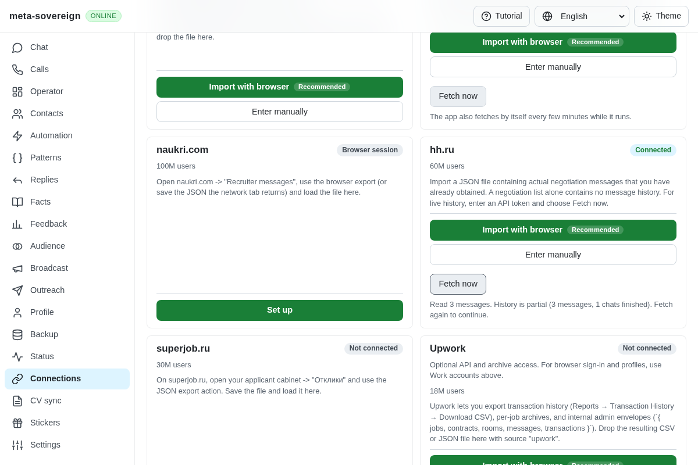


Before and after outgoing alignment:

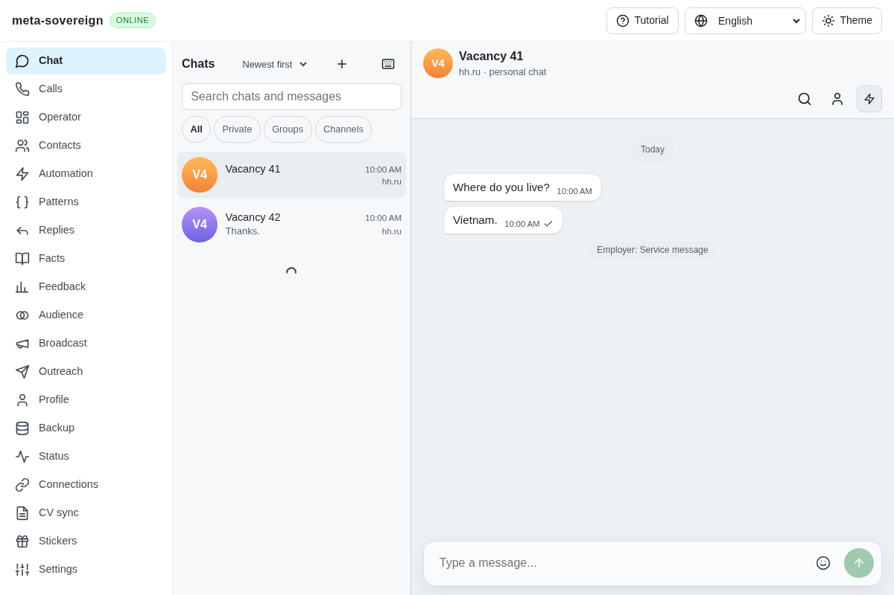


The [evidence archive](data/hh-common-history.tar.gz) and
[verified manifest](data/hh-common-history.tar.sha256.json) retain finite
regressions, checks, primary schema extracts, browser observations and source
hashes. All five workflows pass for the preceding exact head `e280197a`;
the new head still requires its own CI. That passing Pages run updated zero
APT source files because the hosted runner uses an unhandled mirror-list
file; a separate correction is required. Wider HH, QA, VK and device/platform
criteria remain unfinished. PR 57 stays draft and unmerged.

## Read receipts and provider scopes

At `9ee093a7`, marking HH read through the browser fallback could report success
after scrolling without confirming delivery to the provider. The shared
directory also counted cached rows as unread and lacked a provider filter.

The [public read operation](https://api.hh.ru/openapi/en/redoc#tag/Chats/operation/set-last-viewed-message)
acknowledges a specific HH message with HTTP 204. Chat, when read receipts are
enabled, and Operator's Done action submit a saved message from the displayed
thread. The adapter checks the current provider boundary before sending.
History pulls and post-acknowledgement reads store the provider's unread count.
Operator retains work if the count is still positive or cannot be confirmed.
Chat and Operator offer the same provider selection when several are present.

The focused `hh-common-chats`, `message-actions` and `operator` checks cover
the exact boundary, a newer arrival, unknown acknowledgements, and retained
Operator work. The registered `e2e-inbox-pull-browser.mjs` Chromium scenario
reproduces the missing provider selector on the previous bundle and verifies
both selectors, passive viewing, the exact HH receipt, and Telegram isolation.
Independent Playwright MCP verified desktop layout and a 390-pixel viewport.
The provider responses came from a fixture. Authenticated native web
messaging remains open under HH09.

The native read fallback checks only an already-open numeric web conversation.
It verifies the provider pane, chat row and latest visible message before
requesting a scroll. The read result requires a fresh unread count of zero at
that same boundary. If the history advances, the new boundary and count are
stored without claiming the operation completed. Unrecognized or unavailable
views cannot clear cached unread messages. Four native Chromium regressions
reproduce the old optimistic results and pass with the verified fallback.

## Sending from a saved native conversation

Open a saved native HH conversation in Chat, type a plain message and press
Enter. With the previous Chat bundle, the numeric web address was sent to
the negotiation API. With the current bundle, the server verifies a stored
message from the web conversation and routes it to the native HH composer.
The provider pane must still match before it can send. Drafts and answer
buttons retain their existing behavior. Only a new outgoing provider message
with a positive delivery state replaces the pending bubble. If delivery is
uncertain, Chat keeps the message for review and suspends automatic retries.

The registered question-providers browser scenario checks the production Chat
bundle, the saved provider message ID and one native send with zero API writes.
Three additional Chromium cases cover consecutive sends, existing drafts and
choice buttons, and a pending receipt. Independent Playwright MCP observed a
failed send on the old bundle and a single native dispatch and confirmed Chat
bubble on the current one. The fixture replaces live provider traffic.


## Replying in a common chat

In a common chat, open the menu for a saved incoming message, choose Reply,
and send text. Chat keeps the complete saved reference, and the server
verifies that it belongs to the same HeadHunter chat. A fresh provider read
must report that the exact message accepts replies. The [common-chat send
operation](https://api.hh.ru/openapi/en/redoc#tag/Chats/operation/chat-message-post)
receives the opaque parent ID and returns HTTP 201 and the new message ID.
The immediate bubble and later imported history share that ID. Whole-message
Reply appears only where the provider reports support.

The focused `hh-common-chats` checks reproduce the missing receipt link and
reply support on the previous source. They also cover a changed permission,
owner cancellation after the provider check, and a reply to a valid opaque
ID containing a colon. The registered `inbox-pull` Chromium scenario checks
reply selection, provider receipt, saved identity and the visible quote.
Independent Playwright MCP compares the saved reply from both bundles and
observed one fixture POST carrying the complete parent ID.


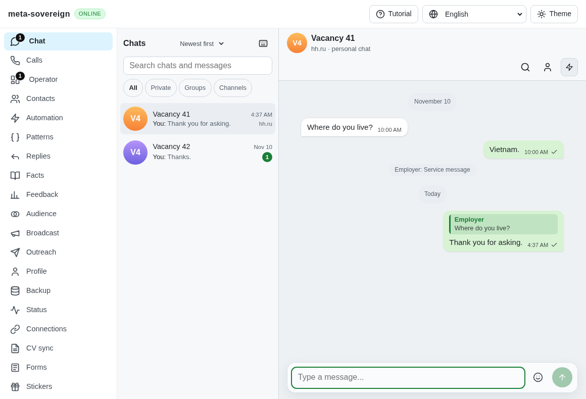

## Editing and deleting in a common chat

At `f561f52c`, Chat applied Telegram's time limit to a HeadHunter message
that the provider still allowed the owner to edit. It also offered “Delete
for me,” even though the recorded HeadHunter operations had no local-only
scope. Neither operation had a HeadHunter adapter.

Chat now uses the saved provider edit permission. The server checks for the
exact chat, message, and current participant before either mutation. Editing
also checks the saved and provider text for changes since the editor opened.
The [edit operation](https://api.hh.ru/openapi/en/redoc#tag/Chats/operation/chat-message-put)
and [delete operation](https://api.hh.ru/openapi/en/redoc#tag/Chats/operation/chat-message-delete)
update the local store only after the provider returns HTTP 204. Delete in
HeadHunter requires confirmation for one owned message. Unknown outcomes
leave the saved message intact and direct the owner to check HeadHunter.

Two adapter regressions on the previous source show absent support. The
focused tests check opaque IDs, revoked permission, stale text, the single
message scope, wrong message receipts, and uncertain results. The registered
Chromium inbox scenario checks the real Chat menu, a refused receipt, the
updated bubble, cancel, and confirmed deletion. Independent Playwright MCP
compares both UI bundles with synthetic provider data. The provider fixture
recorded one edit and one delete for the same message. The employer's message
remained visible. Node and Deno each passed 77 focused checks. The local
browser test reused the installed Chromium executable.

```sh
node --test --test-concurrency=1 js/tests/hh-common-chats.test.js js/tests/message-actions.test.js js/tests/chat-selection.test.js js/tests/chat-edit-mode.test.js
RUN_BROWSER_E2E=1 node js/tests/e2e-inbox-pull-browser.mjs
```

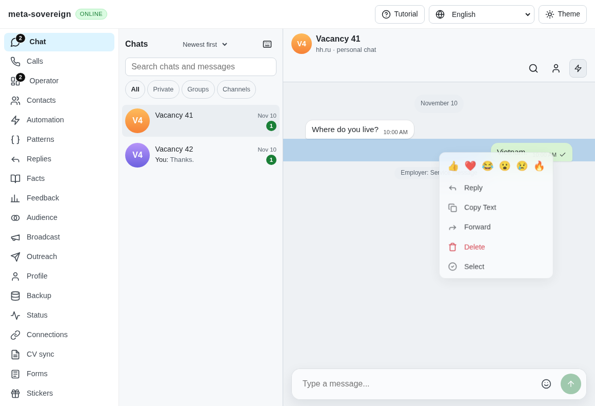

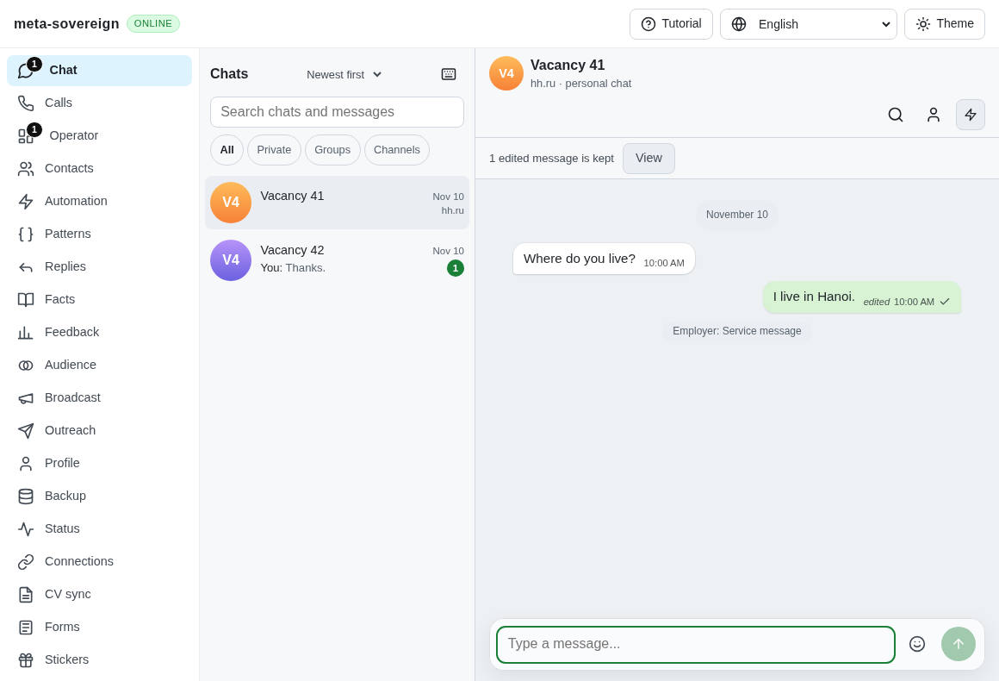

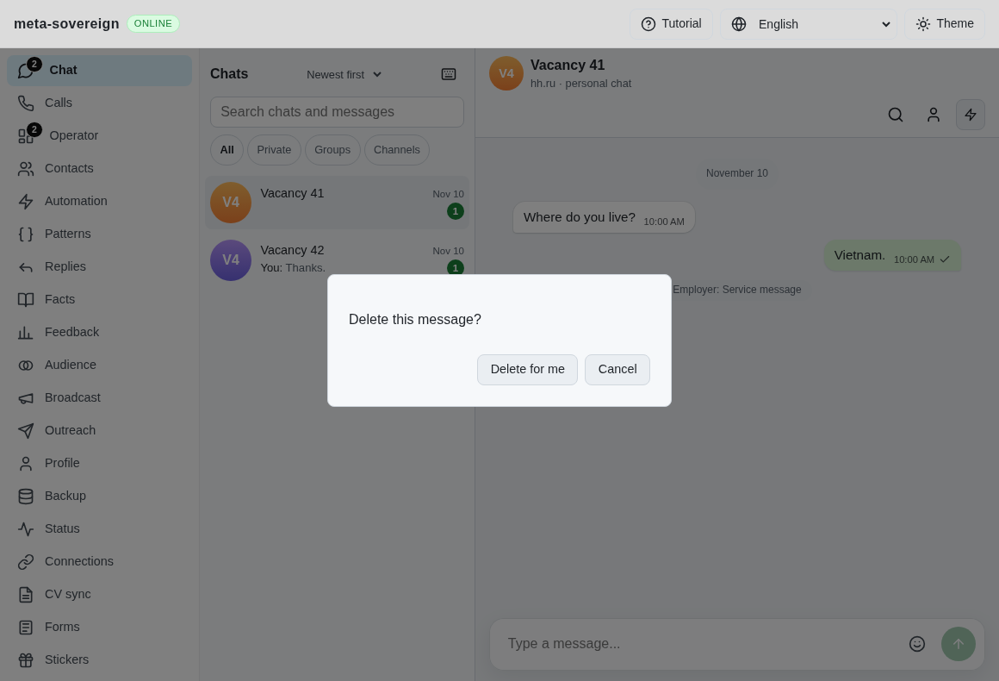

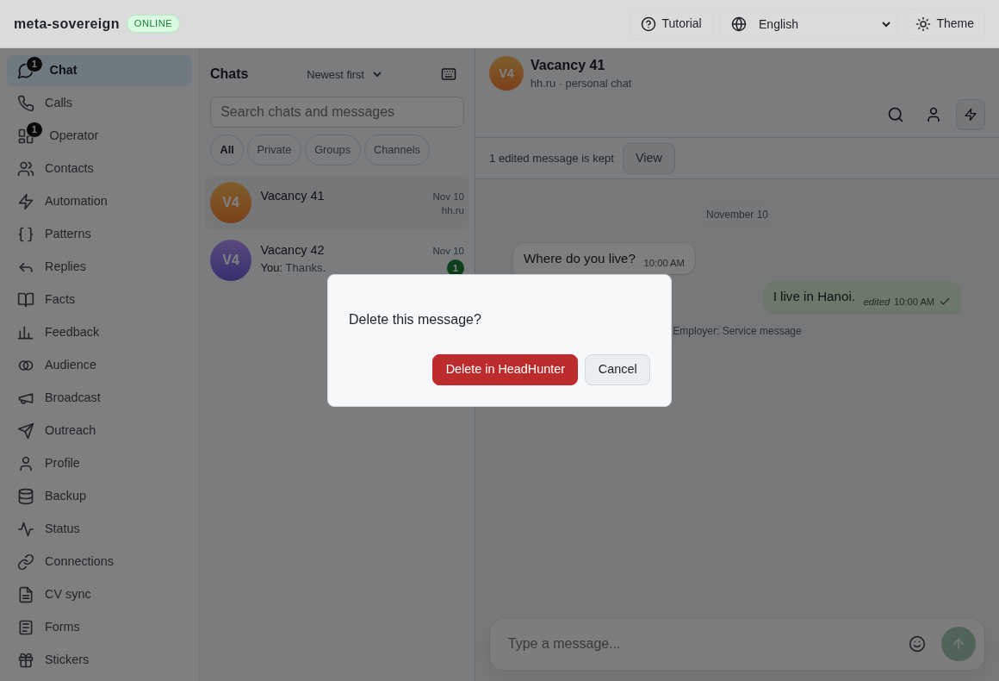

## Saving an open native conversation

At `fddd6529`, Connections offered downloaded files for HeadHunter. No
capture was available after opening the import browser. Open **Connections →
hh.ru → Import with browser**, sign in, open one conversation, and choose
**Capture this chat**. The server saves the currently loaded message window
under the native `web:<chat>` address. Repeat captures keep the same message
IDs. Chat shows the saved conversation and Operator uses the unread count
when the visible HeadHunter row agrees with the captured message boundary.
A missing or ambiguous unread observation leaves prior unread state intact.
Opening a chat yourself can affect its read state in HeadHunter. Capture
itself leaves the composer, scroll position and provider controls alone.

The authorized local server offers the same job to the terminal. Use
`--binary` to select binary Lino on the wire. Standard output is readable
text Lino in either mode.

```sh
meta-sovereign auto-import start --source=hh
job='COPY_ID_FROM_START'
meta-sovereign auto-import status --id="$job"
meta-sovereign auto-import capture --id="$job" --binary
meta-sovereign auto-import stop --id="$job"
```

The exact-parent regression finds no capture button and rejects the manager
capability assertion. The registered Chromium inbox script checks refusal
while on the list, save without an API token, draft preservation, direct and
embedded conversations, duplicate and ambiguous panes, and the resulting
Chat bubble and Operator entry. Independent Playwright MCP confirmed the
capture with no API token and the saved unread count of two. Both browser
checks used an isolated provider fixture. Node and Deno each passed 68
focused checks, including CLI status and capture over both Lino encodings.
Authenticated behavior, full history traversal and the remaining native
message actions still require evidence for HH09.

```sh
node --test --test-concurrency=1 js/tests/auto-import.test.js
RUN_BROWSER_E2E=1 node js/tests/e2e-inbox-pull-browser.mjs
```

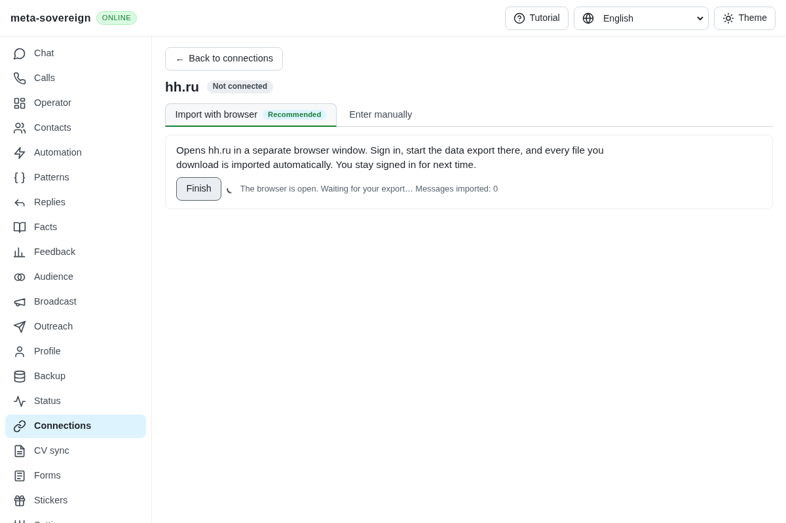

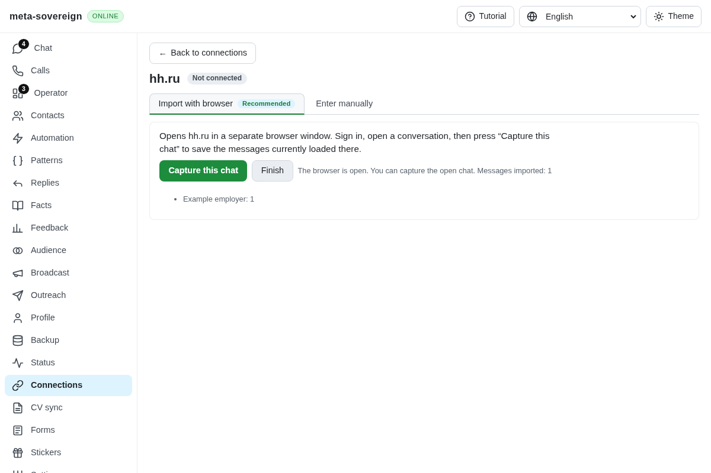

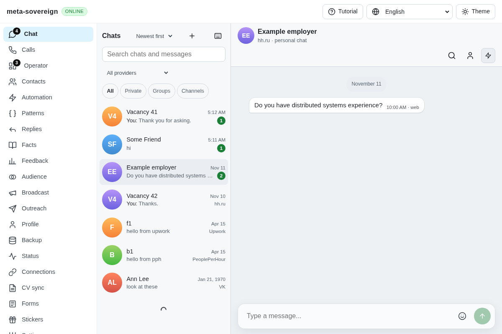

## Capturing older messages

Start a HeadHunter import and open one native conversation. Choose **Capture
older messages** and leave the provider window alone while it scrolls. The
same operation is available on the running server through either Lino
encoding.

```sh
meta-sovereign auto-import capture --id="$job" --history --binary
```

The scanner starts at the latest rendered window and archives overlapping
windows under the same native message IDs before moving on. It attempts to
restore the original scroll anchor and stops if the owner interacts with the
provider window or its identity changes. The scan is bounded and reports
complete coverage only when it observes the provider's recognized start
marker. A repeating rendered edge alone produces an incomplete receipt. The
CLI exits with status 1 for incomplete coverage and prints the saved count,
stop reason and restoration result. Completed archive windows remain saved
after an interruption. The scan retains drafts and does not write a separate
unread acknowledgement.

At `98271718`, the Connections panel has no older-message action and the
terminal silently ignores `--history`, even for providers limited to one
loaded window. The registered Chromium inbox scenario uses a 12-row
virtualized fixture to verify the earlier manual reply, the restored draft,
selection and scroll anchor, and an incomplete receipt for a second chat
without a start marker. The focused API check also cancels a scan while a
provider read is in progress and verifies that releasing scroll ownership
precedes closing its window.

Node and Deno each passed 64 focused checks. Independent Playwright MCP
verified both receipts against the same isolated provider fixture and
read back the saved manual reply without an API token.

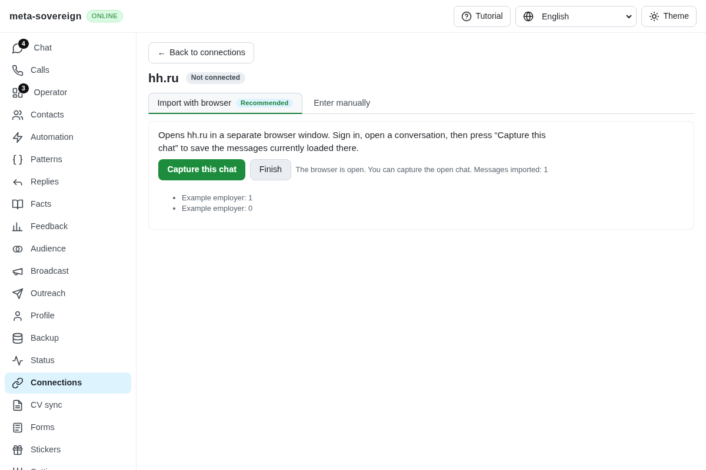

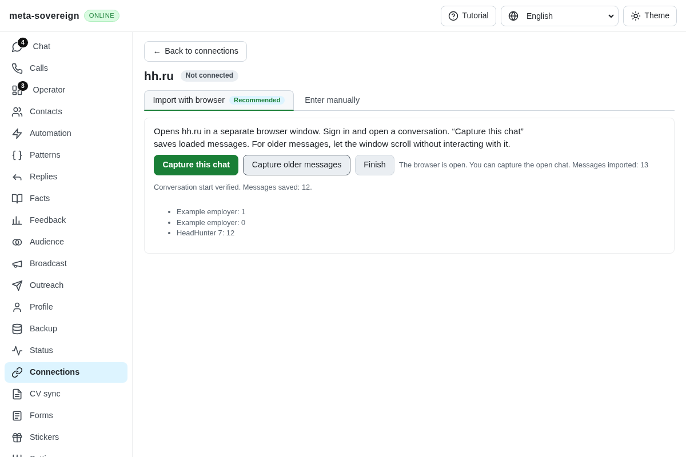

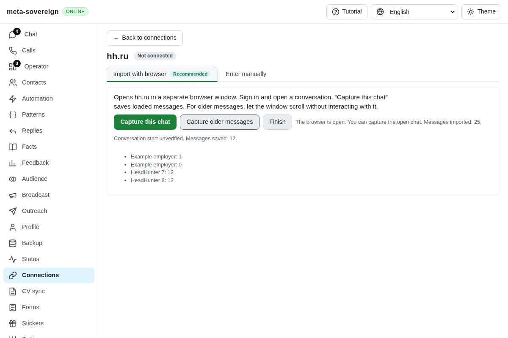

## Refusing multiple visible panes

Open `/chat/7?second-chat` in the isolated HeadHunter import fixture. The
top-level page shows conversation 7, and its visible embedded pane shows
conversation 8. At `6efbdadc` the top-level route silently limited capture to
conversation 7 and the endpoint returned HTTP 200. The import now checks
every visible native pane before choosing a conversation and returns HTTP
409 when more than one qualifies. The top-level ID must still agree with
the sole selected pane. An iframe hidden by the page does not block capture
of its visible conversation.

This is covered by `verifyMixedPanes` in the registered Chromium inbox
scenario. The underlying capture check serves both capture modes and both
Lino encodings.

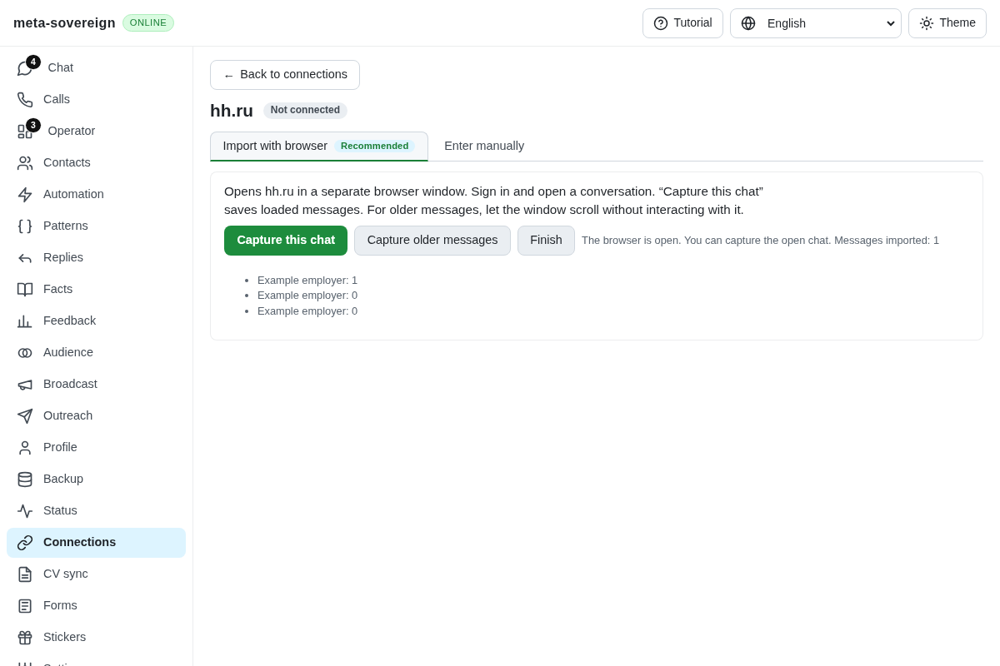

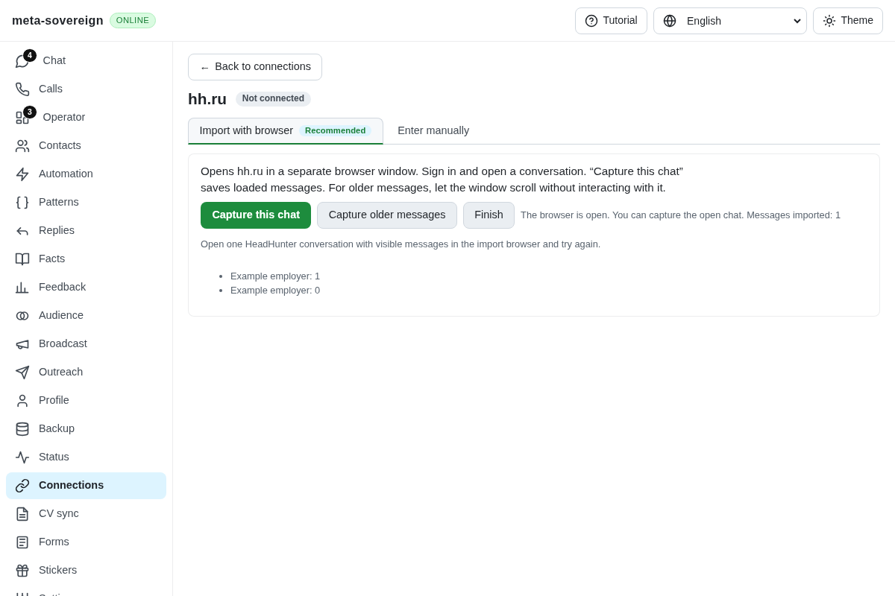

## Confirming read receipts in the import browser

Start a HeadHunter import and capture the open conversation. Leave that
conversation open in the import browser. In Operator, choose **Done** on
the captured chat. Chat also requests a receipt when you open the unread
conversation with read receipts enabled and the app in the foreground.

At `b80b61da`, the message handler looked only in the separate message
sender's browser pool. Operator showed an error and kept its unread card.
The browser read record also discarded the `web:` prefix expected by the
archive. The handler can now use the open import browser for the matching
workspace slot and save the confirmed state under the archived chat
identity. The receipt uses the saved latest message ID and a fresh badge
observation. A different or ambiguous pane is refused without navigation.
Capture cannot take over during a receipt, and **Finish** drains an admitted
receipt before closing the browser.

The registered Chromium inbox scenario reports HTTP 502 on the preceding
revision and HTTP 200 after the fix. It verifies the provider scroll
request, the canonical unread count, unchanged draft and selection,
refusal with two visible panes or a different conversation, and the
independent Chat read. Node and Deno each passed 60 focused checks,
including slot isolation and shutdown ordering. Independent Playwright MCP
confirmed HTTP 200 through both views, with no HeadHunter API token, and
verified that Finish closed the provider page. Authenticated live provider
acceptance and the remaining native messaging actions remain open.

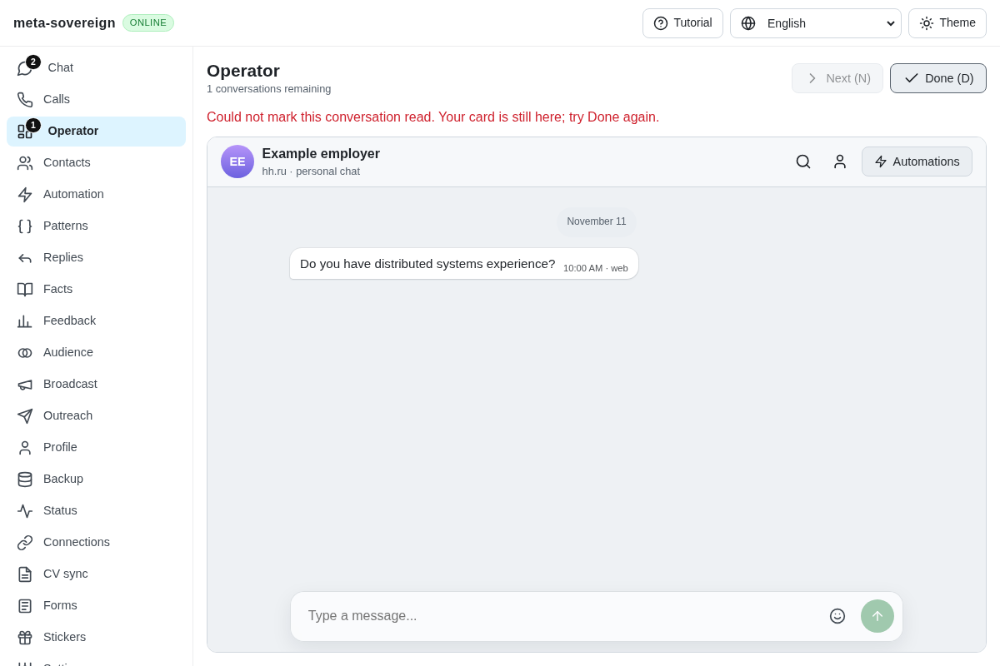

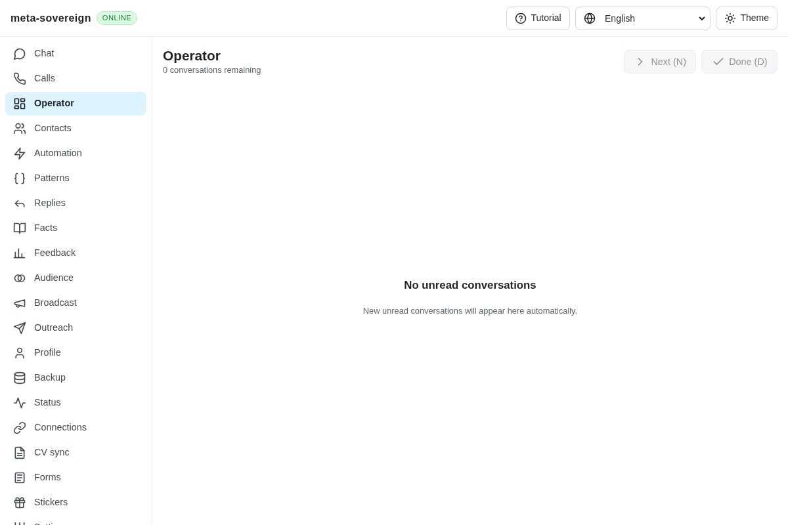

## Sending in the open import browser

Open Connections and start a HeadHunter browser import. Open a conversation
in the provider window, capture it, and leave the window open. Then select
the captured conversation in Chat, type a plain message, and press Enter.
At `45fd40f2`, Chat reported that the saved conversation could not be
verified. Capture used a `web:` address, while the send endpoint accepted
only numeric addresses from earlier archives.

The send endpoint now checks the exact saved message reference and uses the
matching open import browser. It verifies that this is the only visible
provider conversation before touching the composer. Chat accepts delivery
after the browser reports the outgoing message ID and a confirmed state.
The outgoing row retains the captured conversation's address, so it appears
alongside the incoming history. The existing separately launched browser
path remains available when no matching import job is open.

The registered Chromium scenario reproduces the failure on the previous
source and verifies the delivery in the production Chat bundle. The Lino
probes cover a missing archive reference, an unsupported quoted reply, a
protected owner draft, a different open conversation and two attempts with
one pending native send. Node and Deno each passed 68 focused checks.
Independent Playwright MCP observed one native send, a saved `delivered`
receipt and no HeadHunter API token. Authenticated provider acceptance and
the remaining browser message actions are open.

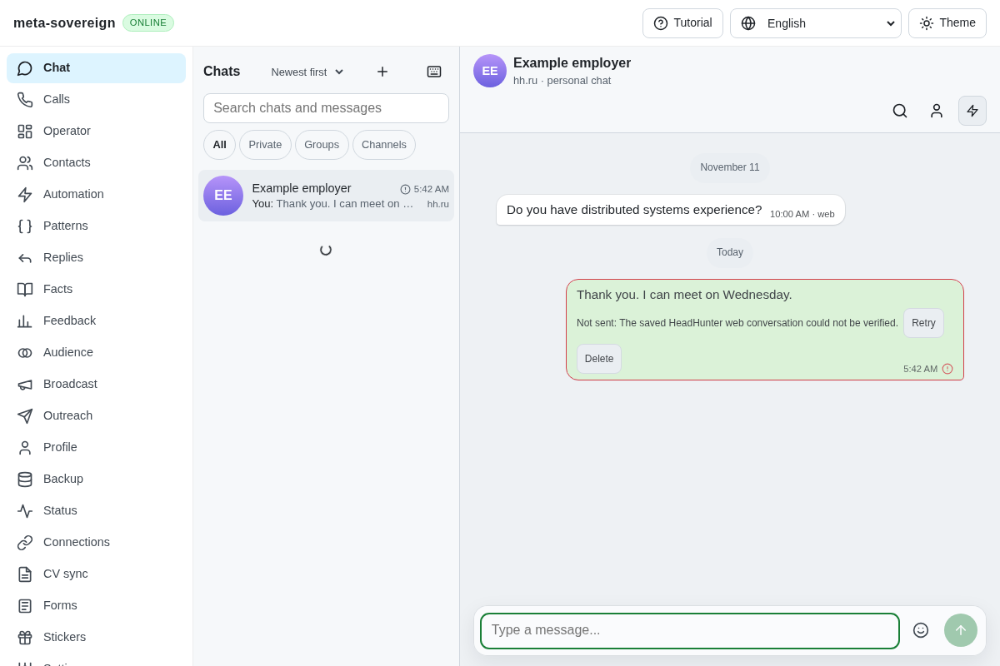

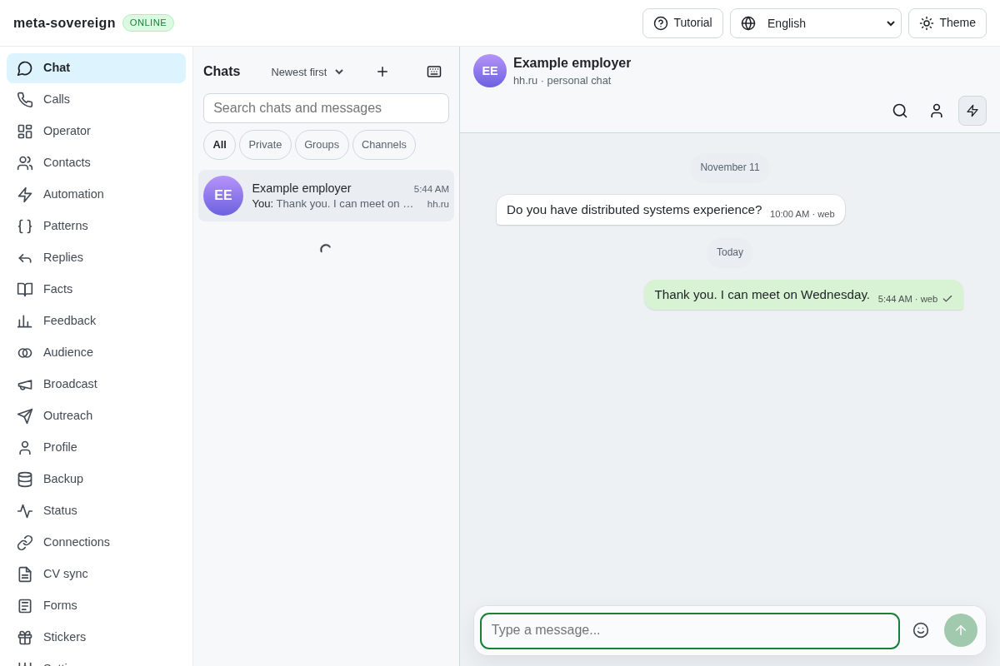

## Using the same receipts from the CLI

After capturing an open HeadHunter conversation, use the saved message ID
from Chat and the address it belongs to. The CLI connects to the same
running server that produced the capture. These commands use the IDs from
the isolated regression fixture.

```sh
node js/bin/meta-sovereign.js chat read --id=msg:hh:web:8:101 --binary
node js/bin/meta-sovereign.js chat send --source=hh --chat=web:8 \
  --reference=msg:hh:web:8:101 --text-file=./message.txt \
  --client-id=cli-review-1 --confirm
```

Before this change the CLI showed its generic help for `chat read`. Sending
through Lino with an earlier send ID and newly confirmed text returned the
old success receipt. The CLI now checks that the server preview matches all
the submitted draft fields before confirming. It prints the receipt without
the draft text or confirmation token. An exact retry within the server's
in-memory receipt window returns the earlier result. A different draft with
the same ID reports `send-id-conflict` and exits unsuccessfully. The shared
server keeps receipts for ten minutes in the current process.

The registered Chromium scenario reads and sends via the CLI in the same
isolated provider conversation. It confirms one native send for a multiline
file across text and binary Lino, verifies the saved text and native message
ID, and refuses a different message with that ID. A VK transport fixture
exercises the same controls, including zero dispatch without `--confirm`.
Node and Deno each passed 40 focused checks including the confirmation
cache. [Archived reproduction and test logs](data/hh-chat-cli.tar.gz).

The shared read action still uses the selected message boundary and the send
receipt retains the provider message identity. These behavior choices follow
the pinned client references for visible read boundaries and local pending
messages. [Telegram Web K visible read boundary](https://github.com/morethanwords/tweb/blob/579e5590d5db93e6ef39a5bbe1900257cb594cc2/src/components/chat/bubbles.ts#L3384-L3418) · [Telegram Web A pending message](https://github.com/Ajaxy/telegram-tt/blob/f67a40879a7d78c2683ec5a296cf55bc22417d56/src/api/gramjs/methods/messages.ts#L364-L405).

Authenticated HeadHunter browser checks, the remaining native message
actions and cross-restart send receipt recovery remain required.
