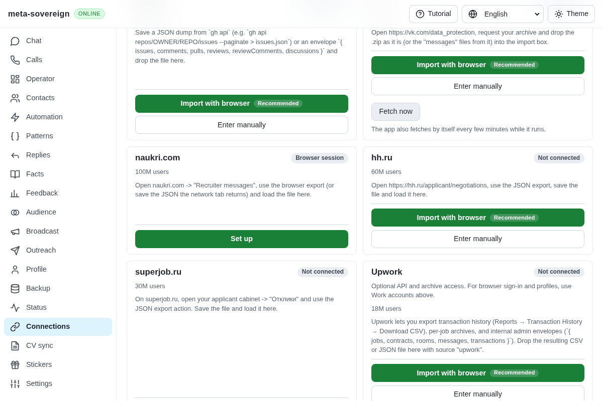
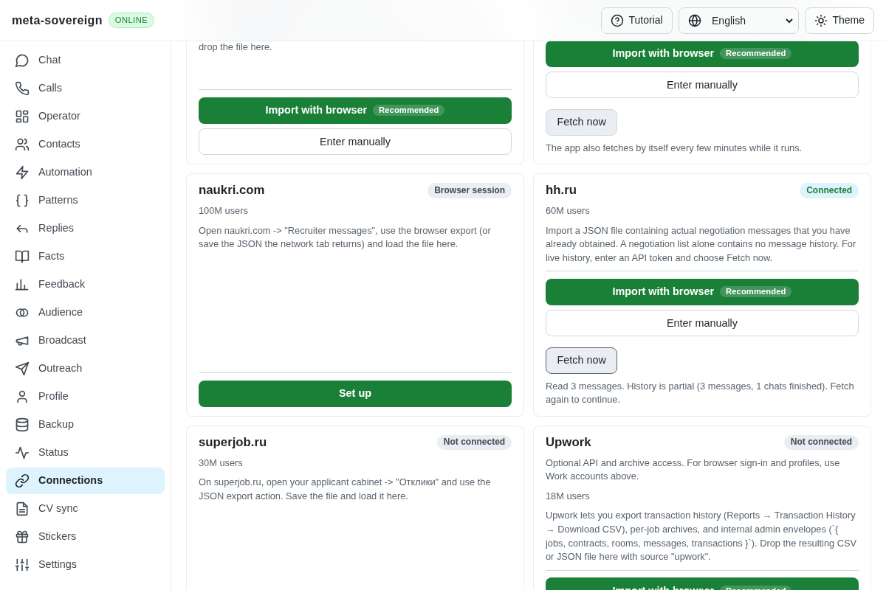
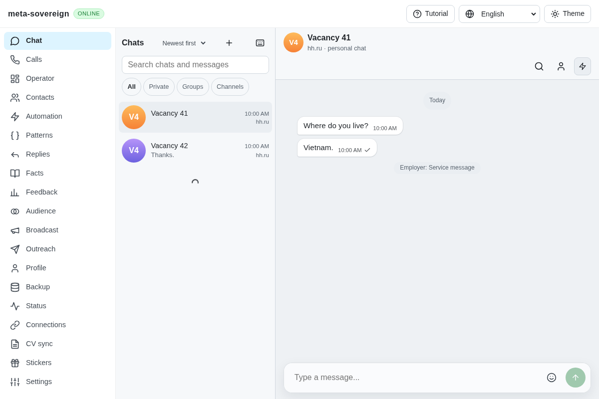
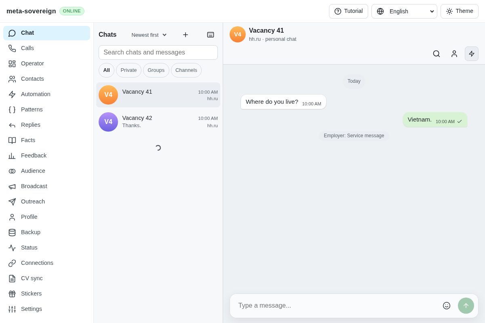
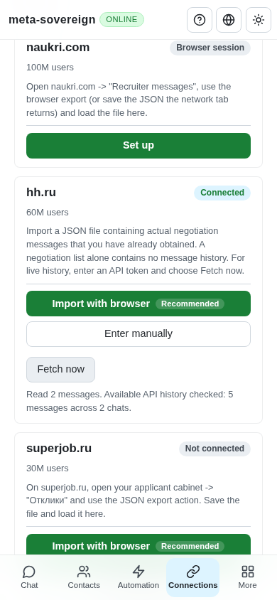

# Read actual HH common-chat history

Work for [issue 56](https://github.com/link-foundation/meta-sovereign/issues/56)
in [PR 57](https://github.com/link-foundation/meta-sovereign/pull/57). This is
the modern API history portion of QA02/QA06 and HH09–HH11. Browser messaging,
unread watching, authenticated provider verification and wider parity remain open.

## Reproduction and source

At `e280197a`, the default live reader requests `/negotiations` as though its
items were messages. The current API returns negotiation collections there.
A finite fixture of the documented common-chat API fails immediately on that
request. Connections also has no HH Fetch control. An independent rendering
regression finds that the shared bubble ignores explicit `outgoing: true`
unless the sender is literally `me`; real participant IDs render on the left.

The [official API documentation](https://api.hh.ru/openapi/en/redoc) and its
[OpenAPI specification](https://api.hh.ru/openapi/specification/public/en),
checked on 2026-11-10, define paginated `/common/chats`, oldest-first message
reads with an inclusive message boundary, `has_more`, explicit participant
direction and UUID idempotency keys for text sends. Selected schemas and
examples are preserved in the evidence archive. No reference code is copied.

## Implemented behavior

The default live reader verifies `/me`, enumerates chat pages and reads actual
messages oldest first. IDs include both chat and message IDs, separate from
legacy negotiation IDs. Bodies, attachments, timestamps, edits, raw records,
real sender IDs, explicit direction, service barriers and write restrictions
are retained. Repeated imports remain one observed learning turn; edits retain
immutable versions. Unknown participant direction stays unknown.

Each fetch has a finite request budget: ten chat/message requests by default,
configurable from one to fifty, plus one identity request. Message pages have
two to fifty entries. The saved cursor is bound to the account and API host
and advances only after successful message storage. The inclusive boundary is
reread for edits and counted once. Invalid pages, changed chat identity,
missing IDs and nonprogressing cursors fail before storage or cursor advance.
Changing chat lists and the provider's maximum list window produce explicit
limited coverage. Completion means the available API window was checked;
it does not claim all historical provider data exists in that window.

CLI `source-pull --source=hh --max-requests=2` persists continuation across
real store reopen; `--restart-history` starts again. The store always closes.
Manual Connections Fetch and text/binary Lino pull controls share the same
reader, partial/limited/complete counts and persisted status. HH has no
implicit polling schedule and fetching does not mark messages read. Four
locales explain continuation and coverage. Setup guidance accepts an already
obtained archive containing actual messages, rather than promising an
unverified provider JSON-export command. Legacy archive IDs and the explicit
`negotiations` protocol remain available.

Modern chat replies use the matching common-chat endpoint. A fresh read must
confirm the same chat accepts writing. Text sends include a UUID idempotency
key and require a positive sent-message ID; unknown outcomes forbid automatic
fallback. Attachments and quoted replies are refused before provider reads.
This does not establish full browser messaging or delivery-state parity.

The shared Chat/Operator bubble now uses the same existing ownership predicate
as message selection, preserving real sender IDs while rendering outgoing
messages on the correct side.

## Verification

Focused checks cover API pagination, bounded continuation, account changes,
failed storage, malformed/nonprogressing pages, provider windows, changed
lists, sender direction, edits, learning counts and guarded send receipts.
Controls exercise actual CLI store reopen and real HTTP text/binary Lino.
The final check log records 61 passing Node checks including the CI registry,
locale and rendering checks; twelve focused Deno cases pass. Earlier
compatibility groups pass 66 Node checks; 40
additional bubble/selection/guide checks pass. No full local suite runs.

Reproduce the final focused checks with:

```sh
NODE_OPTIONS=--max-old-space-size=384 node --test --test-concurrency=1 --test-timeout=30000 js/tests/hh-common-chats.test.js js/tests/hh-common-controls.test.js js/tests/provider-bubble-direction.test.js js/tests/connection-guide-i18n.test.js js/tests/i18n.test.js js/tests/ci-contracts.test.js
deno test --allow-all --v8-flags=--max-old-space-size=384 js/tests/hh-common-chats.test.js
NODE_OPTIONS=--max-old-space-size=384 RUN_BROWSER_E2E=1 E2E_EXECUTABLE_PATH=/usr/bin/google-chrome node experiments/issue-56/hh-common-browser.mjs
```

The focused production Chromium flow and existing inbox-pull Chromium flow
pass. The latter now belongs to the mandatory browser registry for both CI
lanes. Independent Playwright MCP confirms partial then complete history,
five messages across two chats, outgoing alignment and a 390-pixel document
without horizontal overflow. Its sole console error is a favicon 404. The
browser and isolated fixture close afterward. All provider data is synthetic;
no authenticated HH account has been exercised.

Before, the shared HH fetch is absent:



After, partial coverage remains visibly unfinished until continuation:




Before and after outgoing alignment:







The [evidence archive](data/hh-common-history.tar.gz) and
[verified manifest](data/hh-common-history.tar.sha256.json) retain finite
regressions, checks, primary schema extracts, browser observations and source
hashes. All five workflows pass for the preceding exact head `e280197a`;
the new head still requires its own CI. That passing Pages run updated zero
APT source files because the hosted runner uses an unhandled mirror-list
file; a separate correction is required. Wider HH, QA, VK and device/platform
criteria remain unfinished. PR 57 stays draft and unmerged.
