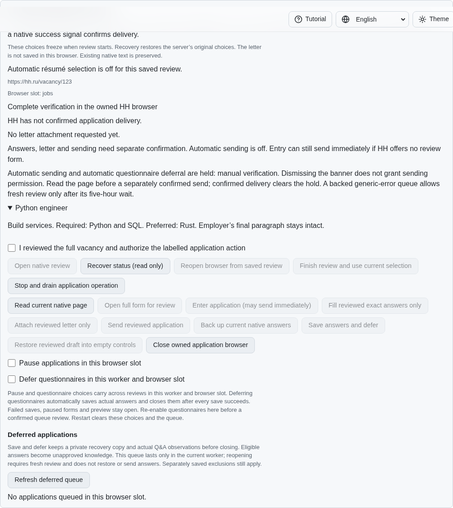
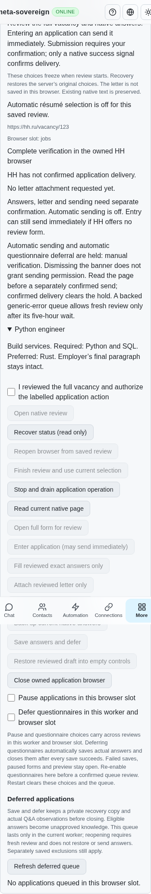

# HH discovery pauses before reading verification payloads

Résumé inventory, vacancy search and vacancy-detail inspection now recognize
HH's visible `account-captcha-input` and `captchaText` inputs and the existing
widget markers before reading state templates, cards or employer prose. Each
reader returns only its existing blocked receipt. A challenge cannot become an
observed empty inventory or search result, a cached vacancy or model context.
Hidden markers preserve ordinary discovery. No challenge is read or acted on.

This extends [form and application answer privacy](hh-captcha-boundaries.md).
Native application daily-limit priority, owner completion, synchronous action
guards, CLI/API receipt formats and provider mutations remain unchanged.

## Reproduction and verification

Published parent `c976dc985f3629afcb6f6fd6bc446d2a4d89439e` misses native text
markers in all three discovery readers. Even the already recognized legacy
marker allows payload queries before the blocked receipt is returned. The
minimal fixture throws on any such query, rather than merely checking the
returned fields. Run `experiments/issue-56/hh-captcha-before.py --discovery`:
12 visible-boundary cases fail out of 24; all 12 hidden-marker cases pass. The
`--native` variant fails with `readResumeListDocument ignored HH verification.`
Both probes restore the working sources and close their fixtures.

The corrected readers pass 63 focused Node and 63 Deno checks, including normal
résumé, search and vacancy validation. The existing mandatory finite native
Chromium CAPTCHA scenario now checks all three discovery readers for both HH
markers. An independent Playwright MCP flow repeats those checks, four locales,
phone layout and manual owner recovery. Both browser flows report zero challenge
reads/actions and zero sends; all owned fixtures close. The native scenario
retains one explicitly confirmed entry. Existing browser engines and deadlines
are unchanged.

The screenshots show the existing manual verification hold after the independent
MCP discovery checks; this unit changes readers rather than visual layout.

The HH reference markers were studied at pinned SHA
`fa0991b8c2d0896fb3b4be6c69947f0590094b15` without copying its implementation.
All browser evidence uses an isolated synthetic fixture, not an authenticated
provider account. `data/hh-discovery-boundaries.tar.gz` and its SHA-256 manifest
retain the source/parent snapshots, focused failures, native/MCP receipts,
screenshots and hosted logs.

## Hosted failures and remaining work

Parent `c976dc98` started Checks run `43600700798` on 2026-11-14 at 13:37:29 UTC.
All four companion workflows pass. Ubuntu Deno job `132465586330` fails the
30 ms signaling-delivery assertion in `server-sync.test.js:79` (complete job-log
lines 8859–8872). Chromium shard 2 job `132465586203` reaches the native daily-limit
wait, then reports `jobs-application-limit-wait` and expires its 10-second review
wait (lines 1764–1789). macOS Node shard 1 job `132465586315` was cancelled; its
complete log is retained. These causes require investigation; no failure or
cancellation is treated as a passing result. Every new head requires its own
hosted checks. Broad matrices remain in CI.

Safe daily-limit backup/dismissal, authenticated scope, paced batches, further
reader/write-boundary audits and all 81 original unchecked inventory rows remain
required. This is partial HH02/HH03/HH06/HH08 work in
[PR #57](https://github.com/link-foundation/meta-sovereign/pull/57), which stays
draft and unmerged.
