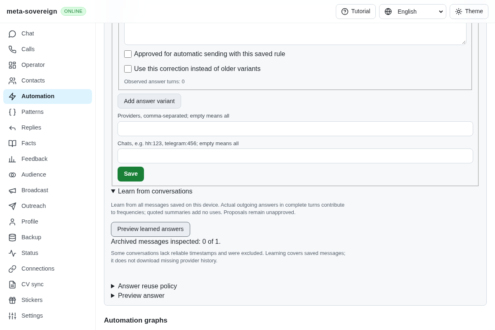
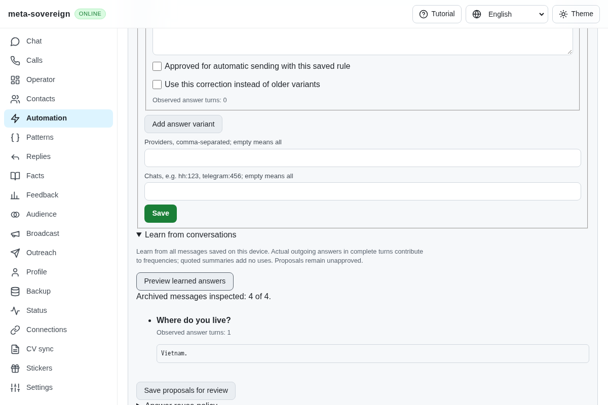
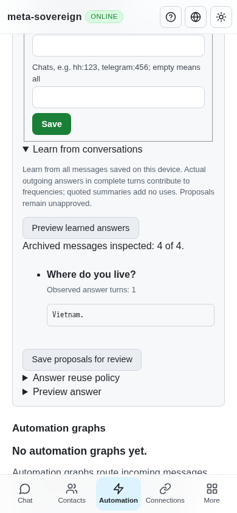

# Preserve actual HH answers when importing history

Work for [issue 56](https://github.com/link-foundation/meta-sovereign/issues/56)
in [PR 57](https://github.com/link-foundation/meta-sovereign/pull/57), covering
the HH history normalization portion of QA02/QA06. Complete provider history
retrieval and the other unchecked requirements remain unfinished.

## Reproduction and root cause

At `6c015033`, importing a negotiation containing four nested messages produced
one empty record for the negotiation. The archive parser flattened negotiation
cards rather than their messages. The live normalizer retained nested bodies
but ignored `author.participant_type`, so an applicant's answer could not be
reliably identified. Application cover letters lacked a learning barrier.
Three focused regressions fail before the change. The production browser
reproduction reports one message without chronology and has no answer proposal.

The [official HH API documentation](https://api.hh.ru/openapi/en/redoc),
checked on 2026-11-10, describes message IDs, timestamps, applicant/employer
participant roles and response-state application messages. It also warns
that the deprecated negotiation-message API does not support all newer chat
features. This implementation learns the documented data model without
copying reference code; normalization is not proof of full live history.

## Behavior and compatibility

Live and archive adapters now share one normalizer. Nested arrays and nested
`messages.items` retain actual message IDs, bodies, timestamps and raw payloads.
Documented applicant/employer roles establish direction; explicit direction
remains authoritative. Missing authors remain unknown. Explicit replies retain
canonical message IDs, edits retain their timestamps, and applicant application
messages are service barriers rather than reusable answers. Negotiation cards,
empty history and message URLs do not become invented messages.

A missing stable message ID refuses the archive before any messages are
written. Silently dropping that message could connect unrelated question and
answer turns. Missing timestamps are retained as chronology barriers instead
of inheriting a negotiation's date. Existing shared learning excludes deleted
answers, applicant counterquestions and unrelated explicit replies; consecutive
answer bubbles still form one observed turn.

Legacy flat archives keep their existing IDs and vacancy chat keys. Schema
migration `0010-hh-message-metadata` fills missing direction, sender, application,
reply and edit metadata only from saved raw payloads. It makes no network
requests and preserves explicit existing values, IDs, chat keys, bodies,
timestamps and immutable message versions. Records whose old parser discarded
raw data remain readable and require explicit re-import; discarded history
cannot be reconstructed by migration.

Repeated import counts the same source turn once. The existing shared version
store retains both bodies after an edit, while learning uses the current body
only. Preview never saves rules; explicit saving creates unapproved proposals.
Actual downloaded-file import, CLI, offline controls and both text/binary Lino
HTTP APIs use that same behavior. A malformed HTTP upload returns 400 with zero
imported messages and preserves the existing history.

## Focused verification

Thirty-six Node checks and thirteen Deno checks pass, including migration
registry/compatibility, idempotence, dry run, immutable versions, chronology,
reply ownership, deletion, application barriers, repeated upload and actual
live-adapter normalization. Local runs use one test worker and 384 MiB heaps.

```sh
NODE_OPTIONS=--max-old-space-size=384 node --test --test-concurrency=1 --test-timeout=30000 js/tests/hh-history.test.js js/tests/hh-history-controls.test.js js/tests/migrations-hh-metadata.test.js js/tests/migrations-registry.test.js js/tests/question-context-controls.test.js js/tests/live-connectors.test.js js/tests/message-versions.test.js
deno test --allow-all --v8-flags=--max-old-space-size=384 js/tests/hh-history.test.js js/tests/migrations-hh-metadata.test.js
NODE_OPTIONS=--max-old-space-size=384 RUN_BROWSER_E2E=1 E2E_EXECUTABLE_PATH=/usr/bin/google-chrome HH_HISTORY_SCREENSHOTS=1 node experiments/issue-56/hh-history-browser.mjs
```

The focused Chromium flow and existing integrated questions browser flow both
pass. The helper is registered in that existing flow for CI. An independent
Playwright MCP check verifies preview, a real rejected upload, explicit save,
unapproved state and a 390-pixel document with no horizontal overflow. Browser
and isolated server close after verification. The console contains the
deliberate upload 400 and a favicon 404; this is not a clean-console claim.

Before, nested history becomes one empty record and cannot teach the answer:



After, all four messages are accounted for and only the real answer becomes a
count-one, unapproved proposal:





The [evidence archive](data/hh-history-learning.tar.gz) and
[verified manifest](data/hh-history-learning.tar.sha256.json) preserve failures,
focused results, independent browser observations and source hashes. The
preceding head's Pages run `42812224902` was cancelled during Ubuntu package
downloads, before browser tests (log line 1295); its repeated setup timeout
requires investigation. Exact new-head CI, full live/browser history and
broader provider parity remain required. PR 57 stays draft and unmerged.
