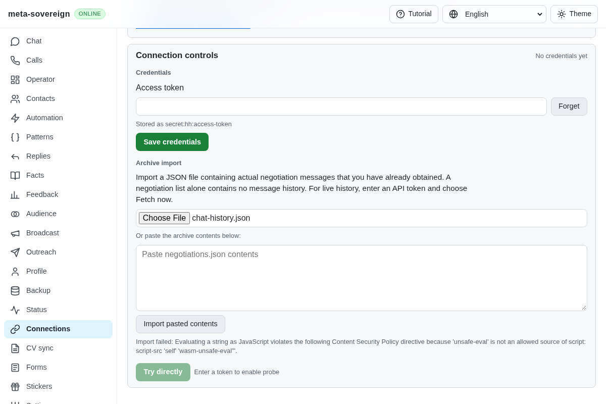
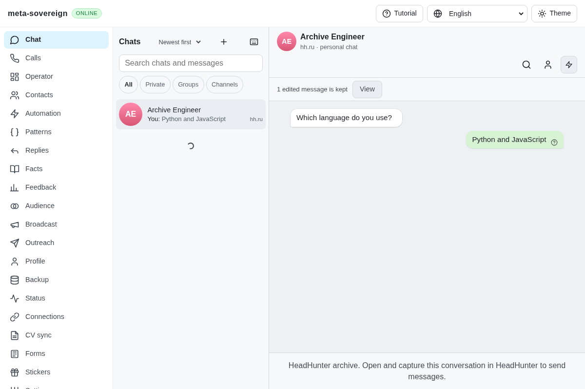
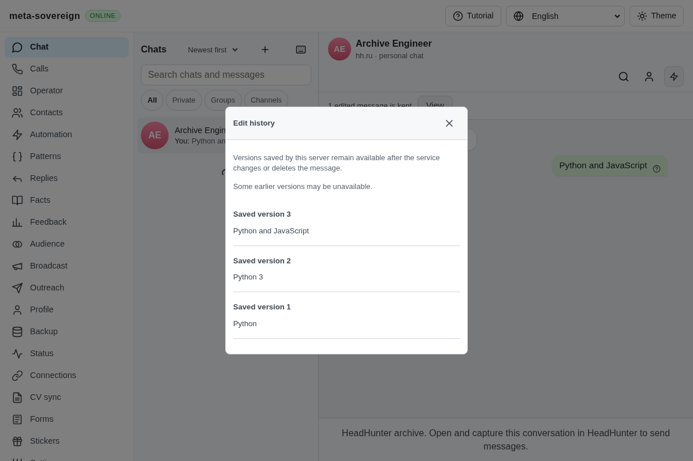

# Import HeadHunter recorder history

The pinned HeadHunter recorder stores conversations in `logs/chat-history.json`, keyed by native conversation ID. It stores the current message text and any observed earlier outgoing wording. The conversation's `at` field records when the file was updated. Individual messages lack absolute send times and delivery receipts. [Pinned recorder](https://github.com/konard/hh-job-application-automation/blob/fa0991b8c2d0896fb3b4be6c69947f0590094b15/src/chat-history.mjs#L43-L71).

On published commit `0a3283ab`, the shared importer interpreted the keyed recording as an empty archive. Connections also loaded the full source registry before parsing. That module graph used string evaluation for server-side operations, which the production content security policy rejected. Both failures reproduce with the same synthetic recording.

The shared importer recognizes the recorder format and saves distinct previous wordings as immutable revisions. It preserves any existing native message or deletion and returns the number of newly written messages. A retry adds zero messages. The connected browser uses the archive endpoint for recorder files and pasted contents. The standalone parser handles legacy HeadHunter snippets under the existing content security policy.

Chat displays the recorded wording, an unconfirmed delivery label and an incomplete version history. A recorder-only conversation directs the user to capture the live conversation before sending. Unknown timestamps leave no calendar divider. Operator leaves its work queue empty for the fixture. Questions excludes the undated conversation from learning and reports the excluded coverage.

## Reproduce and verify

Import the synthetic recorder file from **Connections → HeadHunter → Manual**, or run the shared CLI probe. On the published build the browser shows a policy error and the shared parser produces zero records. The corrected build reports two imported messages. Paste the same data again and verify that it reports zero. Open the chat and its edited-message history to see the three recorded versions.

```sh
node --max-old-space-size=384 experiments/issue-56/hh-recording-cli.mjs
node --max-old-space-size=384 --test --test-concurrency=1 js/tests/{hh-recording,hh-history,hh-history-controls,question-archive-revisions,message-versions,message-versions-api,archive-upload,chat-days,chat-failure,causal-writes,secret-store}.test.js
RUN_BROWSER_E2E=1 E2E_EXECUTABLE_PATH=/usr/bin/google-chrome QUESTION_HH_HISTORY_ONLY=1 node --max-old-space-size=384 js/tests/e2e-questions-browser.mjs
```

Seven focused assertions and the production Chromium scenario fail on the actual parent. Node and Deno each pass 78 focused checks, including recovery after an interrupted import, tombstones, encrypted storage, legacy import, and both Lino encodings. The actual CLI exports two imported messages and three immutable versions with unknown dates, then excludes the conversation from learning. Production Chromium passes the import and both existing HH history scenarios. Independent Playwright MCP confirms two imported messages, zero on replay, three versions, no composer or calendar dividers and a 390-pixel layout. It records zero page exceptions and a favicon 404. The fixture closes with zero saved proposals. Scoped ESLint reports the same pre-existing stream length warning as the parent.







[Evidence archive](data/hh-recording-import.tar.gz) · [Entry hashes](data/hh-recording-import.tar.sha256.json). QA02 and QA06 still require complete authenticated provider history and parity in [PR 57](https://github.com/link-foundation/meta-sovereign/pull/57).
