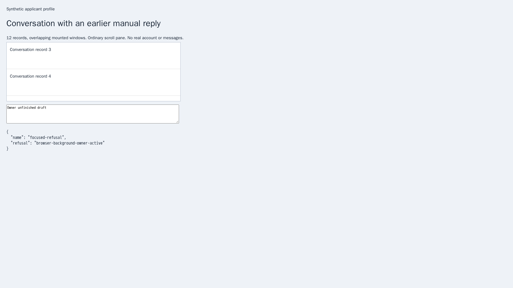
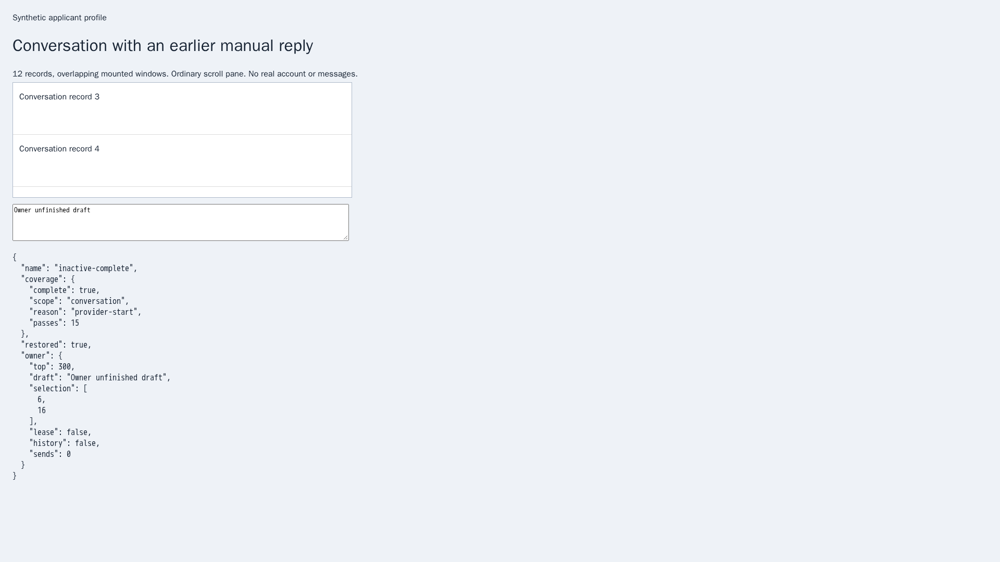
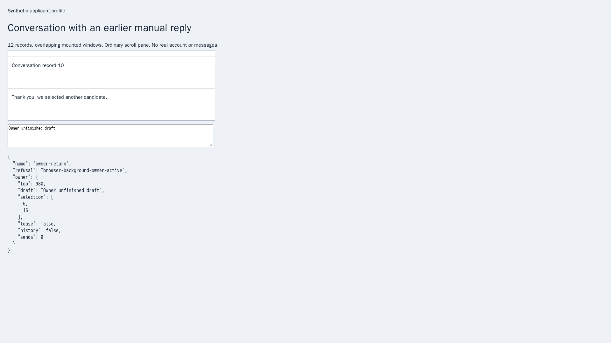

# Read an owned inactive HH conversation

Issue [56](https://github.com/link-foundation/meta-sovereign/issues/56), [PR 57](https://github.com/link-foundation/meta-sovereign/pull/57). This internal prerequisite advances reference requirements C9 and D. Background acknowledgement/rejection delivery, navigation and restoration across conversations and filters, unread orchestration, shared public controls and live-provider verification remain unfinished.

## Reproduction and correction

Parent `41fd7342d7372119f07dea12634311709dd77c41` cannot read history through an already owned inactive answer-watch handle. Opening another sender operation would navigate the provider view before establishing inactivity. The actual-parent watch regression fails on the absent method.

An existing owned handle now exposes `readInactiveHistory(options)`. It launches and navigates nothing. Both the trusted outer document and selected conversation must remain inactive. Native focus, owner input, navigation or document replacement interrupt the read; returning to another tab cannot silently resume it. Token ownership prevents one task from releasing another task's listeners. Stop closes admission, drains accepted work and restores the original inactive view before releasing ownership.

Playwright forces `document.hasFocus()` true even in background Chromium tabs. The production adapter disables that focus emulation through a short-lived CDP session before admission. This exposes real tab focus without activating or navigating the provider page. If the protocol is unavailable, admission refuses. WebKit explicitly reports `browser-background-focus-unavailable`; a modeled focus state does not establish native support.

Real background rendering exposed a second defect: a programmatic scroll could be read before its delayed scroll event updated the virtual message window. The shared list/history controller now waits for the corresponding scroll event within its existing finite budgets. An actual-parent controller fails the gated-event regression by reading stale rows. Gaps and delayed provider rendering still produce explicit incomplete coverage rather than inferred completeness.

The history scanner rechecks both ownership leases before reads, movement and restoration. It retains the original draft, selection and message anchor without writing the composer. Returning owner focus prevents restoration over the owner's current view. Cancellation and Stop can restore a still-inactive original document. Cleanup removes temporary hooks even after partial admission or failed reads. Existing bounded traversal and the native application-marker requirement for complete coverage remain in force. `MS_BROWSER_HISTORY_DEBUG=1` enables content-free ownership/history diagnostics.

## Verification

- Both actual-parent regressions fail: the watch lacks inactive history and the old controller reads before the held scroll event.
- Ninety focused Node checks cover ownership, focus preparation, history, sender/watch compatibility and mandatory CI registration.
- Eight production Chromium cases use real tab focus: focused refusal, complete twelve-message retrieval with draft/selection/anchor restoration, owner return, outer-page focus protecting a child conversation, trusted-child cleanup, cancellation, delayed scrolling and draining Stop.
- Twenty-eight retained production Chromium cases check existing conversation history and HH virtual chat lists after the shared controller change.
- Independent Playwright MCP verifies focused refusal, complete restored history and owner return preserving the new reading position. All three use the production watch and focus preparation. There are no page errors or text sends, and the browser closes afterward.

```sh
PYTHONDONTWRITEBYTECODE=1 python3 experiments/issue-56/inactive-history-before.py watch
PYTHONDONTWRITEBYTECODE=1 python3 experiments/issue-56/inactive-history-before.py scroll
NODE_OPTIONS=--max-old-space-size=384 node --test --test-concurrency=1 js/tests/browser-inactive-view.test.js js/tests/browser-conversation-history.test.js js/tests/hh-chat-scan.test.js js/tests/hh-chat-scan-sender.test.js js/tests/browser-sender.test.js js/tests/question-browser-watch.test.js js/tests/ci-contracts.test.js
NODE_OPTIONS=--max-old-space-size=384 node experiments/issue-56/inactive-history-browser.mjs
NODE_OPTIONS=--max-old-space-size=384 node experiments/issue-56/inactive-history-compatibility.mjs
node experiments/issue-56/inactive-history-mcp.mjs
```

The MCP preparation command writes its independently executable script under `ci-logs`; the actual tool response is preserved separately. These finite fixtures use synthetic routes and no external account or application server. The [verified evidence bundle](data/inactive-history.tar.gz) retains parent snapshots, implementation, checks, actual MCP response and screenshot hashes.

## Browser evidence

The first image shows refusal while the owner is focused. The second shows twelve messages recovered with the original reading offset `300`, draft and selection restored. The third preserves offset `980` when the owner returns instead of restoring over that view.







## Hosted follow-up remains required

The preceding [Checks run 43078283106](https://github.com/link-foundation/meta-sovereign/actions/runs/43078283106) was created on 2026-11-11 at 18:29:39 UTC for `c446791d`. Its preserved WebKit job log, `question-background-parent-webkit-130725304728.log`, reports `Execution context was destroyed` during `disclosure-reuse` at lines 2497–2508. The same job reaches its 35-minute deadline during `telegram-group-greetings`, with cancellation recorded at line 2940. These are separate navigation and scheduling defects; the retained history cases passed. Correct their causes and review new-head hosted results before completion. The PR remains draft and unmerged, and every unchecked issue criterion remains required.
