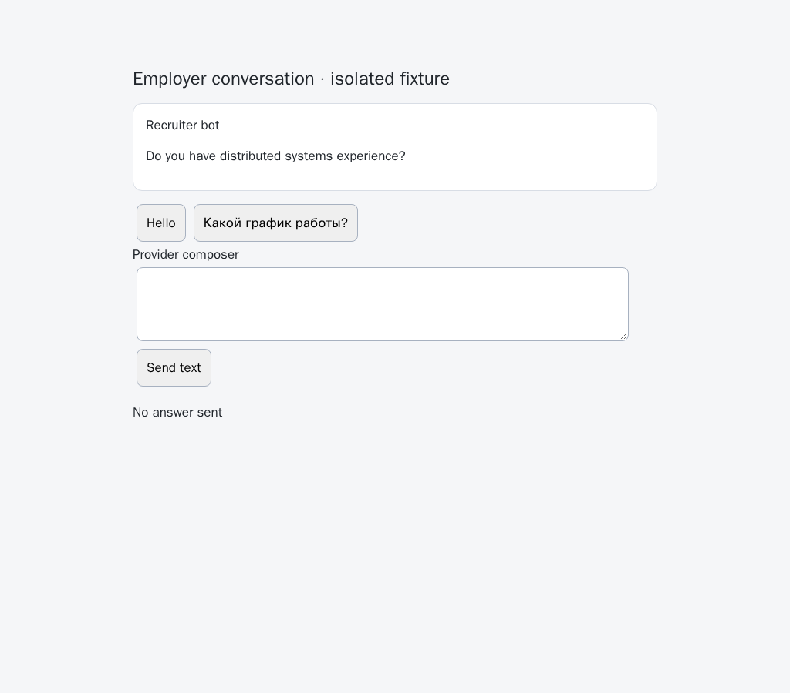
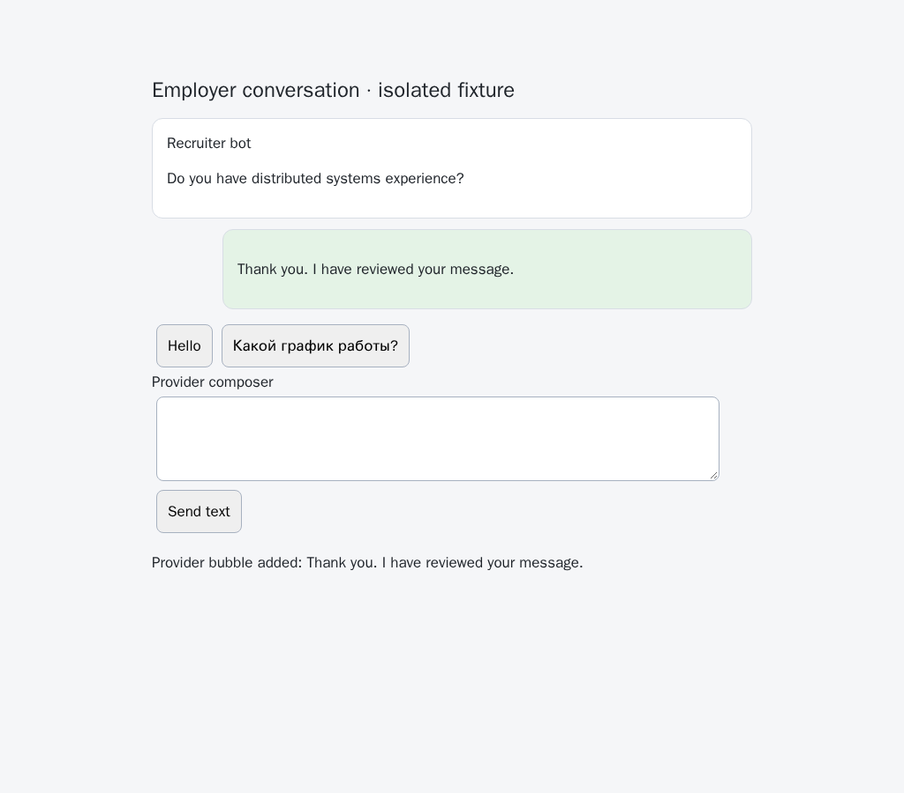

# Owned inactive text delivery prerequisite

The preceding `2b571a75` watch can read inactive history but has no inactive text operation. Its ordinary pointer click takes provider focus: the retained actual-button experiment records trusted pointer and click events with `document.hasFocus() === true`. Browser-commander's DOM activation clicks the same provider button without taking focus; a new outgoing bubble provides the receipt. Neither the click return value nor clearing the composer proves delivery.

`replyTextInactive` now runs through the existing owned watch queue, frozen whole-turn validation and one-use text guard. It requires real Chromium focus, an inactive outer document and inactive selected chat, current policy checks before arming and immediately before issue, and the exact same lease in the final page-local guard. Only the precise synthetic input event owned by the write is exempt from interruption. Other input and trusted activity still latch cancellation. DOM activation requests no pointer or scrolling. Ordinary explicit replies retain their existing pointer behavior.

The first draft exposed a separate embedded-frame race: after the adapter's last outer check, returning to the outer page leaves the child document's `hasFocus()` false. The retained finite probe records an unwanted send. An acknowledged, token-bound owner relay now carries outer activity to the child's final guard. Only the top window can invalidate a child; unrelated sources and tokens are ignored. Registration is bounded to 64 peers and a one-second handshake. Failure refuses admission. Returning focus remains latched even after the owner leaves again. Relay listeners and handshake timers drain with the lease. This closes the reproduced interleaving; it is not a claim of atomic control over a live provider's event processing.

A positive outgoing receipt survives later owner/provider activity, including the provider's ordinary composer-clearing input. Unknown outcomes remain unknown, issued work drains before close, and no automatic retry follows an uncertain send. When the owner returns after our prefill, cleanup yields rather than clear a now-active composer; the retained text is visible for owner review. Durable reservations and automatic policy orchestration remain required before this internal primitive becomes an automatic public workflow.

Reproduce the missing parent operation, then verify the current isolated fixture with one browser at a time:

```sh
python -B experiments/issue-56/inactive-text-before.py
NODE_OPTIONS=--max-old-space-size=384 node experiments/issue-56/inactive-text-browser.mjs
NODE_OPTIONS=--max-old-space-size=384 node experiments/issue-56/inactive-text-child-focus.mjs
```

The parent substitution always restores the source in `finally`; run it separately from checks importing that file. No fixture uses a live account or external provider traffic. Nine production-browser cases cover focused refusal, actual main/child receipts, exact foreground draft/selection preservation, late focus/input, late embedded outer focus, changed current knowledge and uncertain-send close draining. Thirty-nine focused Node checks and eighteen Deno checks pass. A separate ten-case compatibility run retains all eight inactive-history cases and ordinary explicit text/native-choice receipts. The new browser group remains mandatory in both CI engines; unavailable WebKit native focus is an explicit refusal, not a successful send.

Independent Playwright MCP checks repeat focused refusal, one inactive receipt with foreground preservation, and the late embedded outer return. Both watch handles close once, with no page errors. The actual parent and final screenshots below show isolated native controls; they do not establish live HH verification.

| Before: no inactive operation                                                   | After: observed outgoing bubble                                                  |
| ------------------------------------------------------------------------------- | -------------------------------------------------------------------------------- |
|  |  |


The [evidence archive](data/inactive-text.tar.gz) retains source, parent failure, the draft-race trace, platform event observations, independent MCP results and focused checks. Automatic acknowledgement/rejection policy, durable reservations, cross-chat/filter restoration, unread orchestration, public controls, live verification and every unchecked issue criterion remain unfinished. Continue them in [PR57](https://github.com/link-foundation/meta-sovereign/pull/57); it stays draft and unmerged. Exact new-head hosted checks and the preserved Windows startup/upload investigations are still required.
