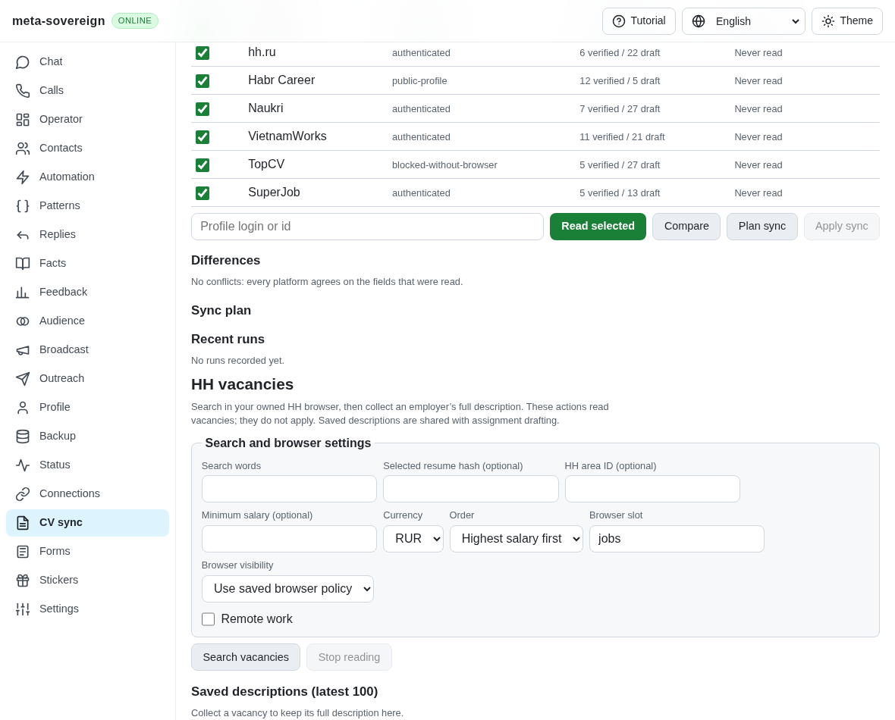
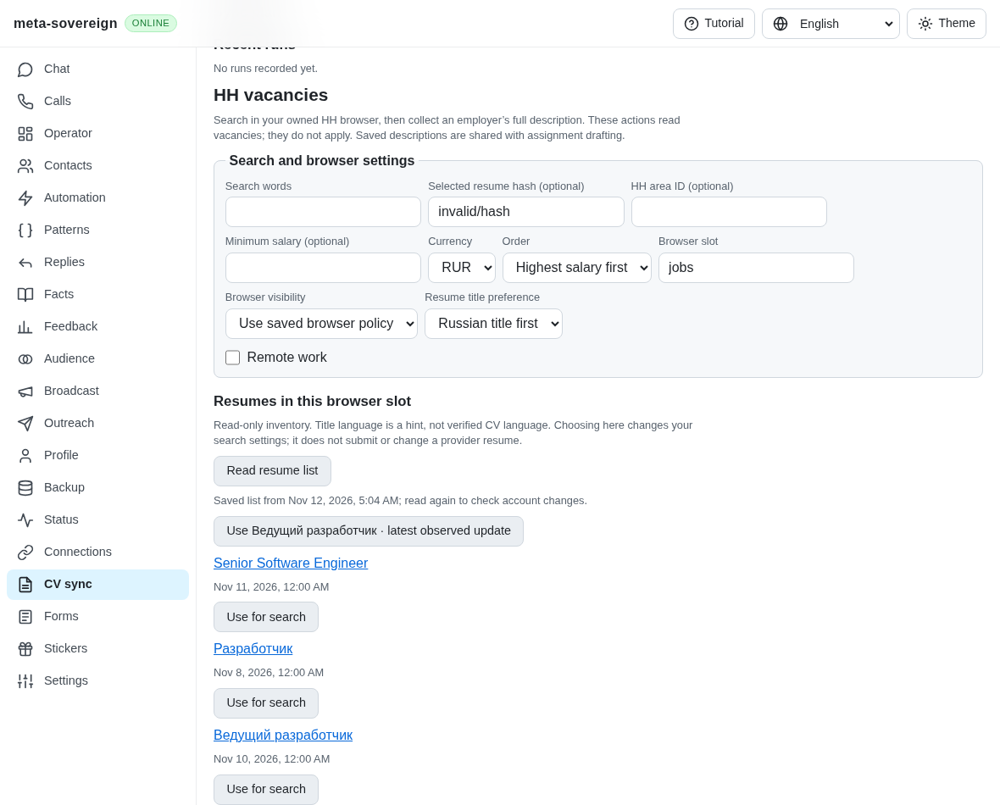
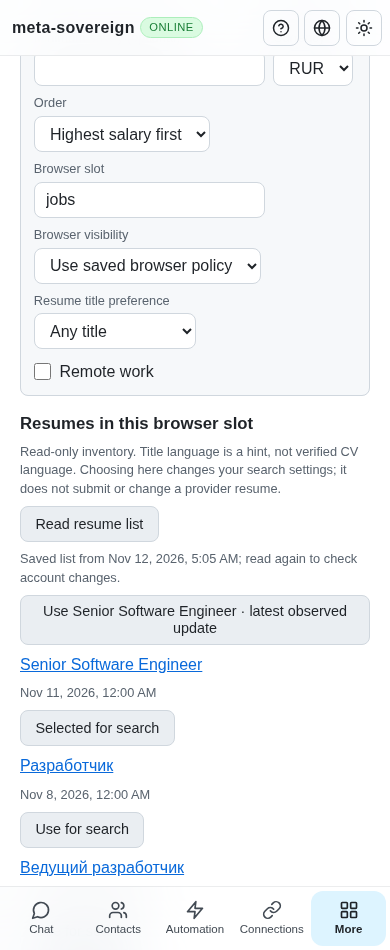

# HH résumé inventory and search selection

This unit supplies the résumé inventory and explicit search-choice prerequisites
of HH02. Export-proven language, native application selection, live authenticated
verification and every unchecked inventory criterion remain required.
[PR57](https://github.com/link-foundation/meta-sovereign/pull/57) stays draft.

The actual published parent `56419934` has resume-bound vacancy search, but no
service operation or CV control for reading the owner's native résumé list.
`resume-list-before.py` restores the actual parent service and production bundle
in separate finite replays, then restores working sources in `finally`. The
service fails with `service.resumes is not a function`; the old CV view has zero
inventory buttons instead of one. These failures and the parent screenshot are
preserved alongside the corrected code.

## Behavior and interfaces

The CV view's **Read resumes** opens the configured jobs browser slot and reads
`https://hh.ru/applicant/resumes`. Existing bounded assignment-page ownership,
headed defaults, typed overrides, cancellation and shutdown apply. No provider
control is clicked. Cards must expose one exact HH résumé identity. Embedded
state supplies timestamps and the latest marker; conflicting inventories,
login redirects, challenges and transient blank pages refuse the read. An
explicit observed empty list is valid. Raw account state is discarded before
returning or storing the allowlisted snapshot.

Recommendations prefer Russian-title hints by default, with English and any
title alternatives. Known update times rank first, then the latest marker and
stable native list order. Titles are disclosed as language hints; verified
export language remains required for full parity. Choosing a recommendation or
individual row sets the exact search hash and persists the search settings.
An invalid manually entered hash leaves inventory reading available so the
owner can replace it. Search and pagination preserve the chosen hash. Refresh
does not change that choice, and failed refresh does not erase the last list.
Cached recovery opens no provider page. Snapshots belong to named browser slots;
they do not establish an authenticated account identity.

The same operations are available through:

- `vacancies-resumes --browser-slot=jobs --resume-language=ru`; optional
  `--resume=<hash>` requires that exact hash in the observed list, and
  `--headless=true|false` overrides the saved visibility policy.
- `vacancies-resumes-stored`, which only reads validated cached lists.
- `POST /api/vacancies/resumes` and `GET /api/vacancies/resumes-stored`, using
  the existing default text/binary Lino transport, origin checks and request
  limits. The web client independently checks slot identity and recommendation
  evidence before accepting a response.

## Reference comparison

Research read the résumé list, application chooser, export, DOM export and
alias-updater modules and their focused tests at
[`konard/hh-job-application-automation@fa0991b8`](https://github.com/konard/hh-job-application-automation/tree/fa0991b8c2d0896fb3b4be6c69947f0590094b15),
dated 2026-11-05. Relevant native contracts are `data-qa="resume"`,
`resume-card-link-<hash>` and `template.ResumeProfileFront-InitialState` with
`applicantResumes`, `_attributes.hash`, update timestamps and `latestResumeHash`.
Behavior was studied without copying implementation. The reference's export
language and application chooser remain broader than this search-choice unit.

## Focused validation

Twenty-three Node and twenty-three Deno checks cover strict projection, date and
choice rules, failed-refresh retention, shared operation ownership, cancellation,
browser policy, CLI, both Lino encodings, response validation and four locales.
The existing mandatory browser entry includes the six new native scenarios.
One mandatory registry contract passes in each runtime, and all five existing
vacancy scenarios still pass. The six résumé scenarios perform 11 owned reads.
Those scenarios use actual commander navigation and DOM extraction against
isolated native HTML; every owned read closes and records zero provider clicks.
They also cover loading/challenge conflicts, visible-only dates, keyboard
selection, exact pagination, Stop and phone reload without another provider read.

Three independent MCP UI cases verify recommendations, keyboard selection,
desktop/phone layout and cached reload through a counted read boundary. That
fixture does not launch a second provider browser, keeping memory bounded;
native DOM extraction is verified separately above. Screenshot review detected
a prior MCP task's tutorial state in the first captures; a fresh browser context
and an explicit overlay assertion now keep independent captures isolated. One counted read and zero
provider clicks are retained with the screenshots. Neither fixture establishes
authenticated live-provider parity.

Reproduce the parent with `python3 experiments/issue-56/resume-list-before.py`.
Run focused checks with `python3 experiments/issue-56/verify-resume-list.py` and
native scenarios with
`RUN_BROWSER_E2E=1 E2E_EXECUTABLE_PATH=/opt/google/chrome/chrome node experiments/issue-56/resume-list-browser.mjs`.
Scoped lint, formatting, secrets and the unchanged duplication gate accompany
the [source/log/screenshot archive](data/job-resumes.tar.gz). Full runtime and
browser matrices stay in hosted CI; exact new-head results remain required.

Published parent `56419934` Checks run
[43156663984](https://github.com/link-foundation/meta-sovereign/actions/runs/43156663984),
created 2026-11-12 04:43:35 UTC, passes every runtime job and browser shard except
WebKit 2/4. Its full raw log lines 117806–117809 (job log 1412–1414) report a
30-second wait for the CAPTCHA UI's `prefilled` result. The trace confirms owner
clearance and ordinary-budget resume; it does not identify the final operation
state or establish the cause. The exact full/job logs are preserved and that
separate failure remains under investigation. No deadline has been increased.

## Visual evidence

Before, the existing vacancy panel has no résumé inventory picker:

After, native rows disclose dates and explicit choice:

Phone recovery retains the observed rows and chosen search hash:

