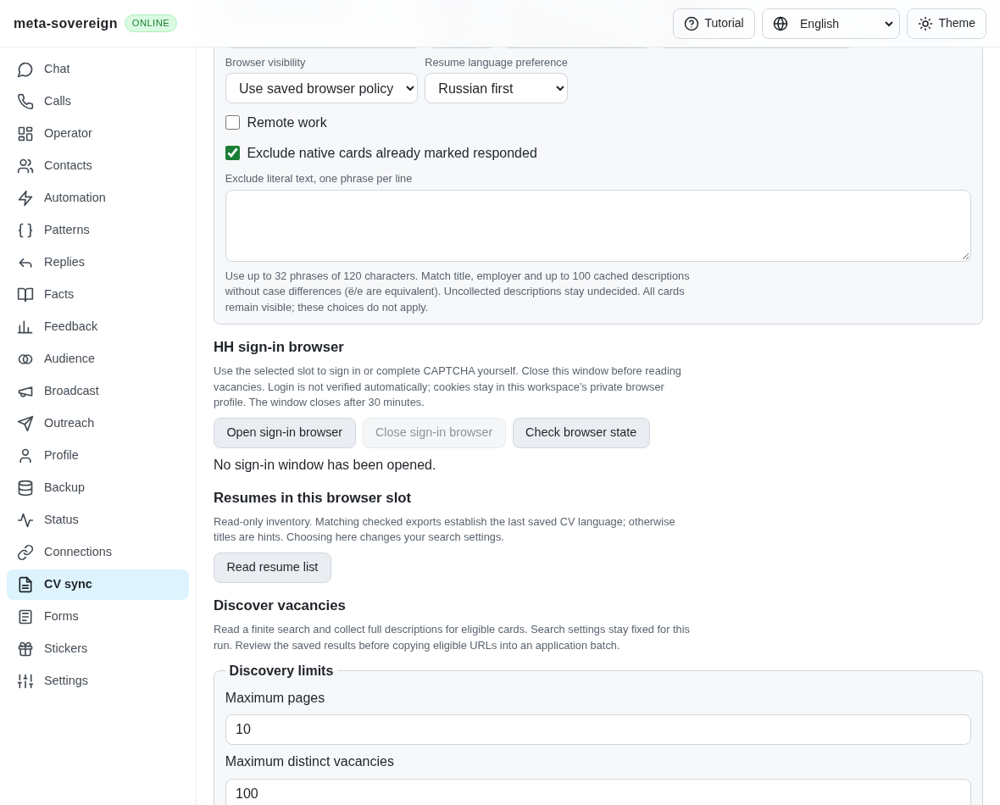
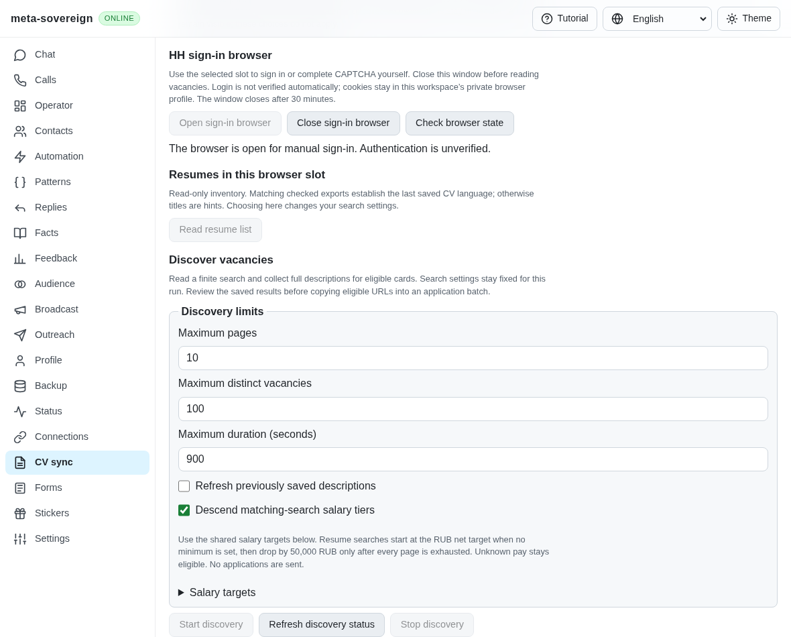
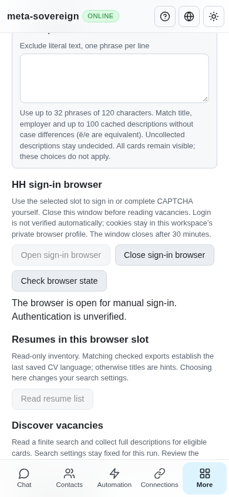

# Controlled HH manual sign-in

The selected private workspace/slot can now open a visible HH sign-in browser
through the foreground CLI, protected text/binary Lino routes and the common
four-language CV controls. The owner types credentials and completes CAPTCHA.
The service opens only `https://hh.ru/account/login`; it reads no login DOM,
credentials, challenge answers or cookies and performs no input or submission.
Authentication remains explicitly **unverified**, including after closing.

The default window lasts 30 minutes; CLI/API durations must be finite integers
from 1 to 1800 seconds. A saved headless policy refuses manual opening before
launch; an explicit visible override is available. The existing shared profile
resolver preserves private session cookies in the workspace. Other vacancy and
application operations cannot acquire that workspace while the window is held.

Open requests use durable IDs. Repeating an ID reads its receipt, including
after closing or restart, and never opens a replacement browser. A lost response
requires a status read. Close, native page closure, expiry, Stop and shutdown
drain issued browser work before acknowledging completion. Unconfirmed browser
closure or its durable receipt retains ownership for an explicit retry. A failed
admission write releases ownership when no browser was issued. Stop from another
service instance drains the actual workspace owner. Default-off
`MS_JOBS_BROWSER_DEBUG=1` logs state categories only.

```sh
meta-sovereign vacancies-login-open --browser-slot jobs --headless false
# Complete sign-in manually; Ctrl+C closes the owned browser before exiting.
meta-sovereign vacancies-login-status --browser-slot jobs
```

The server exposes POST `/api/vacancies/login-open`, POST
`/api/vacancies/login-close` and read-only GET
`/api/vacancies/login-status`. Mutations retain the existing origin and method
checks. Each route uses the shared service and negotiated Lino encodings.

## Regressions and verification

The draft browser regression loses the selected slot on reload: the UI reads the
default slot and shows no window while the original manual window remains open.
`job-login-recovery-draft.py` removes only the settings persistence call,
reproduces that exact failure and restores source and bundle in `finally`.
Persisting the chosen settings before issuing Open corrects recovery even when
the response is uncertain. The actual failure log and both source hashes are
retained. The browser scenario fails before and passes afterward.

Two additional draft regressions prove premature cross-instance Stop and a
permanent reservation after failed prelaunch writes. Both fail before their
correction and pass afterward. An initial API regression also proves that the
visible-browser refusal was being replaced by a generic error; its specific
recovery code is now preserved. Fixture sequencing failures are retained
separately from product regressions.

Focused Node checks pass **37/37**: 27 new lifecycle, storage, ownership,
policy, CLI/Lino/API and four-locale controls checks, plus ten existing vacancy
reader checks. The mandatory `jobs-manual-login` native group verifies one
launch, one closure, manually entered synthetic fields, reload recovery, lost
close-response recovery without POST replay, zero provider clicks and zero page
errors. It is registered for both hosted engines; the focused local engine was
Chromium. Its browser fixture intercepts provider traffic and verifies the
requested launch mode; it does not verify an actual headed launch.

A separate `xvfb-run -a node experiments/issue-56/job-login-headed-native.mjs`
probe uses the actual browser factory, Browser Commander and **two headed
Chromium launches**. A disposable private profile retains one synthetic HTTP-only
session cookie across close/reopen; native page closure drains the owner. DNS
and direct-proxy launch guards block hostname traffic before any restored tab
can navigate, and the owned login route supplies the synthetic page. The probe
does not authenticate an account. The existing four-launch cookie/isolation
probe also passes after extracting the common test launcher.

Independent Playwright MCP opens, reloads and closes one synthetic session,
retaining `manual-mcp`, blocking vacancy reads and fitting a 390-pixel viewport
without horizontal overflow. Its final receipt reports one drained browser,
zero provider clicks and no page errors. The only console diagnostic is the
fixture's missing favicon. Browser and fixture servers were closed afterward.

```sh
node --max-old-space-size=384 --test --test-concurrency=1 \
  js/tests/jobs-manual-login.test.js \
  js/tests/jobs-manual-login-controls.test.js js/tests/vacancy-search.test.js
RUN_BROWSER_E2E=1 npm run test:e2e:jobs-manual-login
xvfb-run -a node --max-old-space-size=384 \
  experiments/issue-56/job-login-headed-native.mjs
```

| Reload before correction                                                                   | Same slot recovered after correction                                                           |
| ------------------------------------------------------------------------------------------ | ---------------------------------------------------------------------------------------------- |
|  |  |



The [checked evidence archive](data/jobs-manual-login.tar.gz) retains focused
logs, draft failures, source snapshots, screenshot hashes and native/MCP
receipts. Scoped lint, formatting, secrets, source limits and the unchanged
6.5% duplication gate pass (6.49% duplication). New-head hosted matrices remain
required.

HH01 is **unfinished**: the complete pinned workflow, private bounded diagnostics,
attention behavior and authenticated provider acceptance still require review
and verification. No original criterion is accepted from this unit alone.
The issue inventory remains 82 verified / 36 unfinished; PR57 remains draft and
unmerged with every unfinished requirement active.
