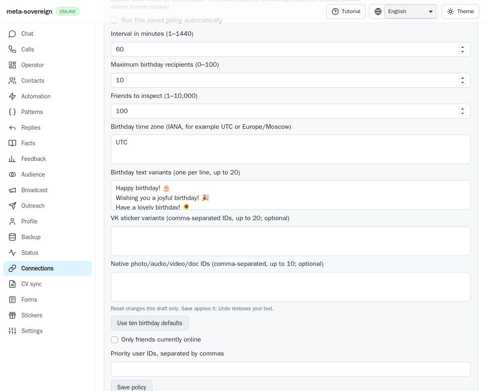
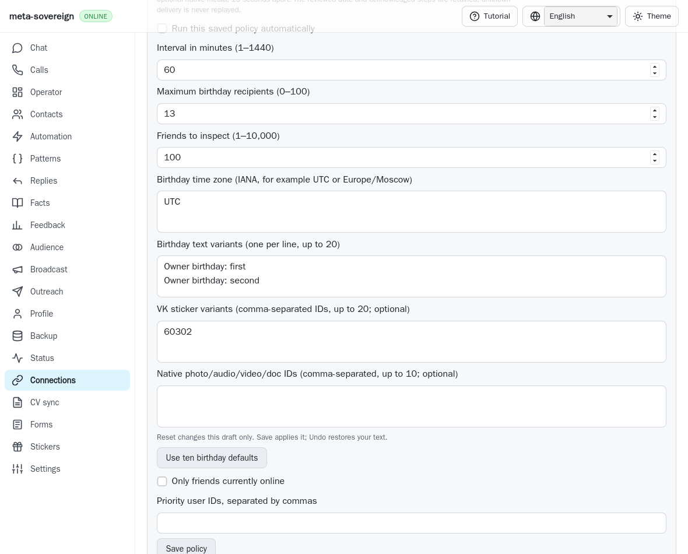

# Persisted VK catalogs and destination lists

An owner can retain message variants, destinations and attachments as Lino
lists, scalar values or empty bare keys. The strict text editors previously
rejected those saved representations. Restoring the exact `3a24c7a5` settings
reproduces two failures: reading a saved community array and previewing an actual
birthday job with a saved message array. The private browser fixture also gets
HTTP 400 for both policies; the old editor falls back to local defaults and does
not display the owner's messages or destinations.

```sh
python3 -B experiments/issue-56/legacy-catalogs-before.py
node --test --test-concurrency=1 js/tests/vk-legacy-catalogs.test.js
node experiments/issue-56/legacy-catalogs-native.mjs
```

Persisted reads now normalize only the eleven declared list fields in invitation,
birthday, three question and retention policies. Arrays join with the field's
separator; finite numeric and text singletons become text; absent, null and empty
plain objects become empty text. Missing settings inherit defaults while explicit
false and zero remain intact. Reading does not rewrite the acknowledged record.
New saves retain strict validation. Populated objects, mixed arrays, invalid
destinations, unsupported attachments and empty required content still refuse;
normalization cannot silently drop a protected destination or invent a message.

Six focused new checks pass, including actual reviewed birthday delivery with
zero provider effects before confirmation and real text/binary Lino flush and
reopen. Nine existing priority and message-default checks pass. Strict lint
passes and the shared offline web bundle is rebuilt. One private WebKit scenario
captures desktop/phone before and after views; independent Playwright MCP
inspection confirms both owner catalogs, destination `42,43` and sticker `60302`.
All owned browsers and fixtures close with zero live-provider writes. The MCP
console's only failed resource is the unrelated missing favicon.

The first browser probe incorrectly expected an alert after the HTTP refusal.
Its retained timeout led to the observed fallback-to-defaults symptom; that probe
is not counted as product verification. The final before case asserts the actual
HTTP refusal and missing owner catalog. The after case checks exact owner values
and zero alerts. The same scenario is registered in the existing hosted
engagement browser group; full runtime/browser matrices remain hosted work.

| Published parent | Corrected saved read |
| --- | --- |
|  |  |

Pinned source: `konard/vk-bot-desktop` at
`8fbf3b7c42fd8e995ef137cab9b9653a7dc9b1a1`, with configuration/list conversion
sources retained in the archive. This correction does not establish complete
desktop editing or local/SSH execution. VD07 and all 60 unchecked inventory rows
remain required in [PR #57](https://github.com/link-foundation/meta-sovereign/pull/57).

Evidence: [archive](data/legacy-catalogs.tar.gz),
[hash manifest](data/legacy-catalogs.tar.sha256.json).
