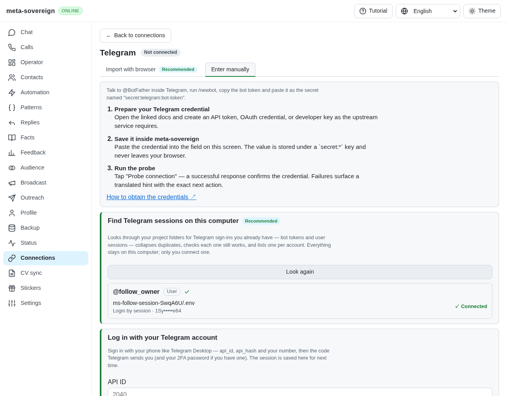
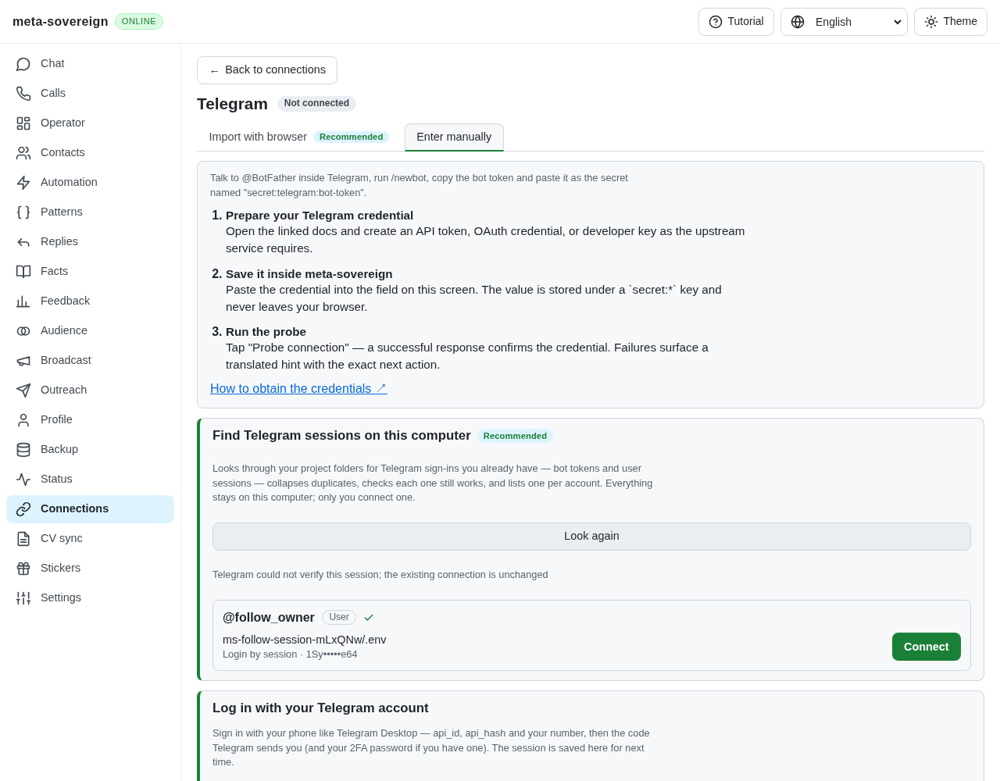
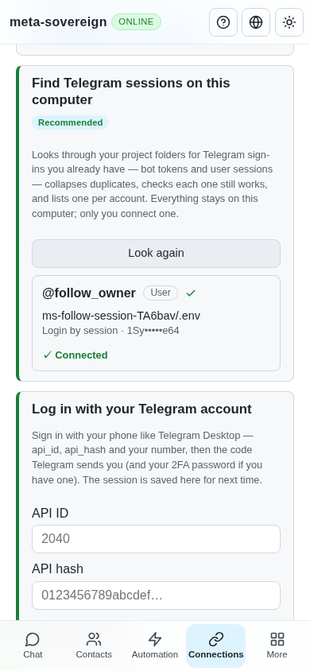

# Verified legacy Follow sessions

Issue: <https://github.com/link-foundation/meta-sovereign/issues/56>. Draft PR: <https://github.com/link-foundation/meta-sovereign/pull/57>.

FL04 now combines the existing owned phone/2FA/QR persistence in [telegram-login.md](telegram-login.md) with literal Follow configuration migration through CLI, default text/binary Lino API and shared Connections UI. FL06–FL09 and every other unchecked issue-wide criterion remain required. PR 57 remains draft and unmerged.

## Reproduction and correction

The pinned Follow reference saves API ID/hash/phone under `TELEGRAM_USER_BOT_*` and its authorization under `TELEGRAM_USER_SESSION`. The existing finder recognized these names, but Connect saved the cached session without checking its account again. It exposed the full phone inside the public entry's account object. The browser also accepted an empty response as Connected and could issue two Connect requests from a synchronous double click. Its phone-login factory was outside shutdown ownership.

Run `node experiments/issue-56/legacy-follow-ui.mjs` and open its isolated free-port server. In Connections → Telegram, scan and Connect. The fixture allows verification during scanning and refuses fresh verification afterward. Against the previous finder implementation, Connect still stores the cached session and shows Connected. The correction returns an explicit failure, keeps the previous saved authorization and leaves Connect available. Enter `r` in the fixture terminal, then click Connect again: verified import now succeeds. Enter a blank line to close the owned server and temporary directory. Only the SDK is mocked; the production server, finder, Lino routes, bundle and React controls execute normally. No live provider authorization or network write is claimed.

The terminal supports `telegram-session-import --env-file=/path/to/follow/.env --store=/path/to/store`; raw string-session import remains supported. The reader accepts literal quotes, comments and equivalent aliases, refuses conflicting aliases or executable substitutions, reads only regular valid UTF-8 files up to 64 KiB and never changes the source or process environment. Phone-only credentials retain the existing code/2FA flow. Coexisting bot tokens remain discoverable. CLI phone login accepts the original Follow environment aliases. Results default to readable Links Notation, with `--json` as explicit compatibility.

Both imports require a positive user identity before writing credentials. Finder Connect freshly checks Telegram, refuses unavailable verification or an account changed since scanning, masks phone values in both public entry/group views and retains previous credentials on failure. The existing identification deadline and phase-only diagnostics remain enabled through the shared lifecycle; diagnostics are off by default. Server shutdown awaits actual identification and pending phone factories, refuses new imports and closes late clients before releasing ownership. The UI guards a pending Connect synchronously and requires an explicit success result.

## Verification

- All 56 focused finder, import, login, MTProto, route, registry and lifecycle checks pass serially. Another 28 locale/connection-guide checks pass. Tests cover exact aliases, conflicts/substitutions, bounded invalid files, non-user/revoked identities, retained credentials, changed accounts, phone masking, coexisting bot tokens, default/explicit output, actual text/binary Lino HTTP and both verification/factory shutdown races.
- `python3 experiments/issue-56/legacy-follow-regression.py` restores each source in `finally`. Cached-verification and public-phone cases fail against the previous finder; explicit env import fails against the previous CLI; both shutdown cases fail against the previous routes. The initial browser regression fails against the preceding production bundle because duplicate clicks perform multiple fresh checks. The corrected production Chromium flow passes failed verification, missing receipts, duplicate clicks, explicit recovery and mobile width. The existing production phone/finder login browser flow also passes. The new browser check is registered in the existing CI matrix.
- Independent Playwright MCP verified the false Connected baseline, corrected failure without Connected, verified recovery and a 390-pixel mobile view. All screenshots were validated as PNGs and visually inspected. The fixture's console reports its missing favicon, browser password-form advice and the intentional 503 verification failure; these are preserved, not presented as a live Telegram success. Both fixture runs report unchanged source bytes and closed clients; all browser/server processes were closed.
- Strict focused lint, formatting, bundle generation, secret and whitespace checks are preserved with the source hashes. No full local suite, runtime or browser matrix was run. Exact-head CI remains a separate delivery gate.

Evidence: [archive](data/legacy-follow-sessions.tar.gz), [manifest](data/legacy-follow-sessions.tar.sha256.json). [Usage](../../TELEGRAM-LOGIN.md) documents both import formats and their output. Reference behavior was read at pinned Follow commit `af8fbb80cec26a7b5b205c93314372d1d92cec1f` without executing or copying upstream implementation.

## Current CI evidence

The preceding `2ccb4b45` checks run [42760324383](https://github.com/link-foundation/meta-sovereign/actions/runs/42760324383), created 2026-11-10 05:09:29 UTC, is cancelled. Its complete preserved log has 98,063 lines. At line 19,997 WebKit completes export successfully at 05:30:09.310818 UTC; line 20,000 records cancellation at 05:30:18.086628 UTC during chat-users. Lines 98,046–98,047 report `e2e-browser: cancelled` and the aggregate's exit 1. These are cancellation results, not a passing matrix or an identified application assertion failure. Job-level browser concurrency cancels older runs on the same branch; the newer `5cc23d06` workflows were created at 05:28:07 UTC, consistent with supersession.

The newer `5cc23d06` completed all five workflows successfully, including both browser engines; Checks and release finished by its 05:48:54 UTC final update. The earlier `b6e497e6` has all five successful workflows. Neither prior success nor cancellation verifies this migration commit; review its exact SHA and timestamps after pushing.

The `4b3dc3e2` exact-head Checks run [42764827897](https://github.com/link-foundation/meta-sovereign/actions/runs/42764827897), created 2026-11-10 05:52:29 UTC, exposed a resize assertion race in this new browser test on both engines (full log lines 20,150 and 22,494). All four other workflows passed. `experiments/issue-56/legacy-follow-mobile.mjs` reproduced an immediate 401-pixel document at a 390-pixel viewport, caused by the pre-resize Connections tab layout. After two animation frames the same unchanged application measured 390 pixels. The assertion now uses the existing finite condition waiter to observe settled responsive layout; it still fails if overflow remains. Its focused production Chromium rerun passes. The four ESLint warnings at log lines 2,924–2,928 concern existing large functions and are not the failed browser assertions.
