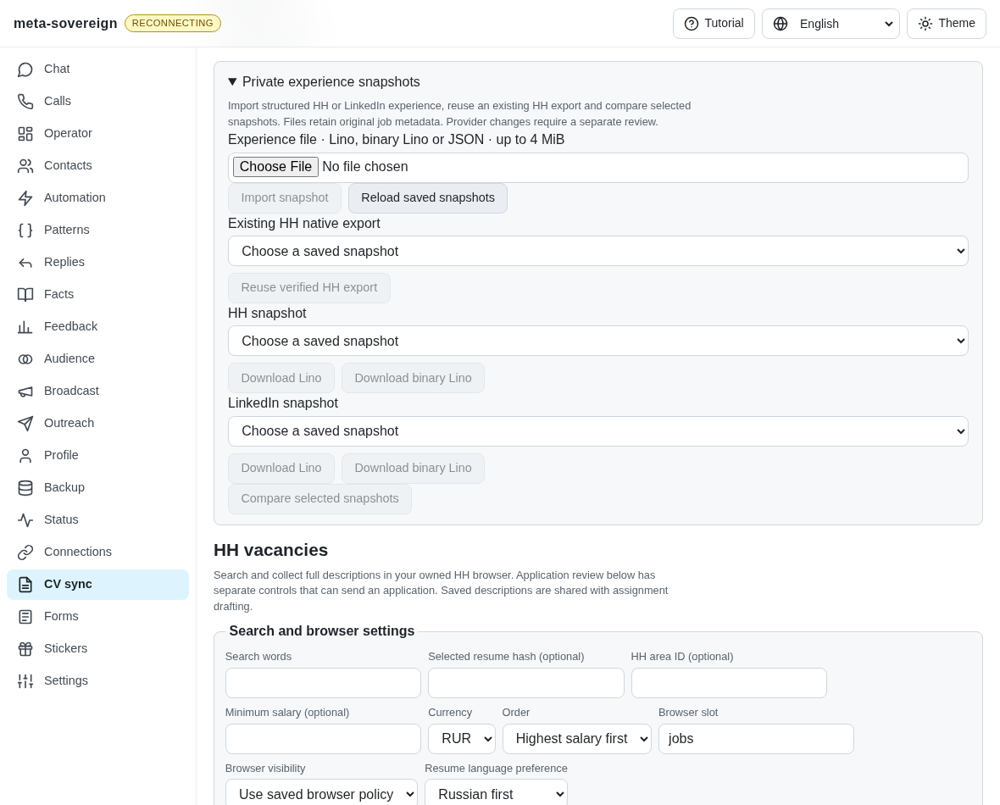
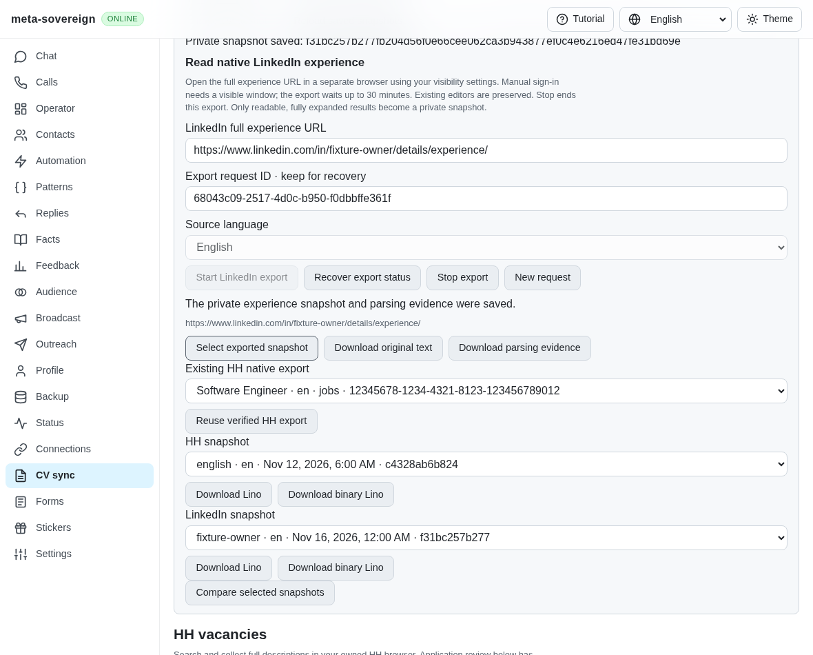
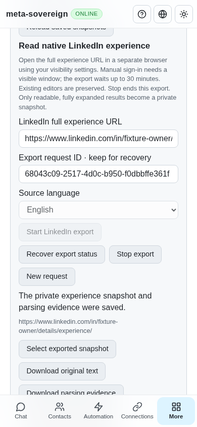

# Native LinkedIn experience acquisition

This is a partial HH21 implementation in [PR #57](https://github.com/link-foundation/meta-sovereign/pull/57).
All 60 unchecked reference rows remain unfinished. Complete HH acquisition,
About acquisition, translation-backed directed plans, independent editors and
per-change reviewed Save still remain required in this pull request.

The previous structured-document feature preserved supplied records, but could
not obtain a native LinkedIn experience page. The generic CV reader projects a
small fixed set of fields. This reader instead preserves observed entity text,
periods, descriptions and original links alongside canonical comparison fields.
Grouped companies produce one job per dated role. Dateless nested skills/media
remain attached to their role. Skills are observed job-local labels; combined
labels are preserved rather than inventing individual skills from prose.
External media URLs and titles enter canonical media; original internal links
remain in native evidence. This does not certify complete live provider metadata.

The selected full experience URL loads once in the fixed, separate, persistent
`linkedin-experience` slot. An exclusive profile lease prevents simultaneous
readers. Existing visible dialogs or editor controls refuse navigation.
Browser visibility uses the shared slot/case/default policy and defaults to
visible. Manual sign-in requires visible mode; configured headless mode without
an authenticated session refuses with `cv-linkedin-login-required`.

Authentication checks only the presence of the `li_at` cookie name, absence of
visible login walls and the expected URL/main content. Credential control values
and cookie values are never read, typed, logged or saved. Visible manual login
waits at most 30 minutes with cancellation checks. Traversal has a two-minute
deadline, 40 passes, at most 20 result expansions, 200 company cards, 200 final
jobs and a 1 MiB raw scan ceiling. Original entity identities must retain their
prefix across passes; replaced or removed cards refuse completion. Two repeated
stable scans at the rendered bottom, without loader, collapsed prose or further
results, are required. Unrecognized cards, ambiguous buttons and exceeded limits
refuse rather than silently truncate. This boundary is a rendered-page claim;
an authenticated live verification remains required.

Exports write four private, acknowledged/hash-described artifacts: original
`linkedin-experience.txt`, structured `linkedin-experience.json` parsing evidence,
`experience.lino` and `experience.bin`. Folders use the existing private storage
permissions. Raw evidence is bounded to 2 MiB per file and interchange to 4 MiB.
Immutable snapshots use `linkedin-native` provenance and the existing private
snapshot catalogue. Raw files are private plaintext; store encryption follows
the existing passphrase configuration. Ordinary peer reconciliation excludes
the secret export records and snapshots.

Request IDs are durable and idempotent. Start first acknowledges its opening
record, then owns the reader. Repeated IDs return their acknowledged state;
conflicting options refuse. Status and evidence never launch a browser. A lost
process is reported as interrupted. Stop writes a tombstone even before Start,
aborts an active reader, waits for browser detach and cannot revive that ID.
Shutdown drains the same owner before final storage flush. Initial flush refusal
opens no browser; snapshot flush refusal rolls back the snapshot and removes new
evidence. Evidence downloads verify the acknowledged size and SHA-256 with bounded
allocation. Errors retain generic safe codes rather than provider page content.
Optional phase-only tracing is disabled unless `MS_CV_LINKEDIN_DEBUG=1`.

The CLI exposes `cv-experience-linkedin-start --url=... [--language=en|ru]`,
`cv-experience-linkedin-status --request-id=...`,
`cv-experience-linkedin-stop --request-id=...` and
`cv-experience-linkedin-evidence --request-id=... --name=...`.
Foreground Start drains SIGINT/SIGTERM and reports manual sign-in.
The CLI owns and closes its store after draining the reader. Status and evidence
use read-only store access, including while another process holds the writer
lock. A running disk receipt reports `unknown` ownership and its last acknowledged
phase, rather than claiming another process stopped. Use the owning foreground
command's Ctrl+C or the owning server's Stop action to cancel active work.
The local API offers the same four operations under `/api/cv/experience/linkedin-`, with trusted
mutations, private/no-store responses and both Lino encodings. The shared CV panel
provides Start, read-only status recovery, Stop, raw evidence downloads and a
separate explicit selection action. Completion cannot replace an active comparison.
URL, request identity, source language and saved selections survive refusals.
English, Russian, Hindi and Chinese share the same controls and recovery states.

Verification uses synthetic data without provider requests or edits:

- The exact published `d00abfaf` facade fails the new public native parser
  regression; `linkedin-experience-before.py` restores the draft in `finally`.
- Seventeen new focused core/API/CLI/controller checks cover grouped metadata,
  unsafe URLs, one-load ownership, visibility policy, credential-value nonreads,
  bounded login/traversal refusal, late launch cancellation, detach cleanup,
  durable recovery, evidence tamper refusal, stop tombstones, flush rollback,
  real HTTP text/binary Lino, trusted origins, unlocked disk recovery and drained shutdown.
- The relevant existing document controller, CV CLI and help checks pass with
  these tests (29 passing focused checks in the final run). The earlier 46-case
  focused run also retains dictionary parity/interpolation coverage.
- A real browser and real browser-commander verify one intercepted page load,
  three dated jobs, expansion, grouped roles, dateless skills/media association
  and preservation of description line breaks. The same assertion and UI
  inspection join the existing mandatory CV translation browser group.
- Independent Playwright MCP checks the shipped SPA against an isolated fixture:
  a lost Start acknowledgement recovers with GET without replay, completion
  requires explicit selection, Stop drains manual login, two evidence downloads,
  all four languages and a 390 px phone without horizontal overflow. No page
  exceptions were reported. The intentional HTTP 503 exercises recovery.

The [hashed evidence archive](data/linkedin-experience.tar.gz) retains source,
focused logs and eight screenshots. All browsers and fixture servers were closed.
Full hosted runtime/browser matrices must pass on the exact published commit.
The published parent `d00abfaf` has 70 successful and six skipped checks; all
five workflows completed successfully. Those results precede this reader unit.
No fixture result establishes real authenticated LinkedIn acceptance or completes
HH21; the pull request remains draft and unmerged.
