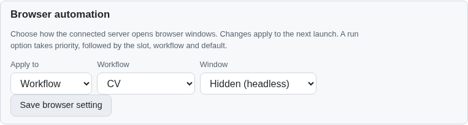

# Structured HTTP migration (R-AA16, partial)

The JavaScript server's shared `json` helper and `readBody` parser forced JSON on every route. Installing lino-rest-api alone could not change that behavior. The browser also parsed responses through three separate paths: fetch, streamed request recovery and XHR upload progress. The model download and browser diagnostic routes bypassed the shared helpers.

The server now binds a representation policy before routing, uses the published Lino REST encoder/decoder for its text formats and explicit JSON compatibility, and adds a bounded binary adapter using the current Links Notation and object-codec APIs. Requests negotiate `text/lino`, `application/lino-binary`, `text/lino-line` or `text/lino-compact`. JSON is rejected unless `jsonCompatibility: true`, `--json-compatibility=true` or `MS_JSON_COMPATIBILITY=1` explicitly enables it. Unsupported request types and unacceptable response representations are rejected before writes.

The binary adapter encodes the typed compact object AST directly. The library's text canonicalizer unwraps unary containers, so using it would lose object shape. Decoding formats the decoded links directly before object decoding, preserving Unicode references and container types. The upstream binary gap and negotiation defect have reproductions in [lino-rest-api #10](https://github.com/link-foundation/lino-rest-api/issues/10) and [#11](https://github.com/link-foundation/lino-rest-api/issues/11). Negotiation locally respects specific q=0 exclusions before delegating explicit candidates to the library. No JSON byte wrapper is used as a substitute for binary Lino.

The browser applies the portable codec at its server fetch boundary, retaining Response clone/stream behavior and recovery ownership. XHR sends raw files and decodes its Lino reply. Provider requests keep their own protocols. Model gzip responses and client-log bodies now share the transport. Origin, Host, secret masking, body ceilings, read recovery and single-attempt mutations remain in effect. The 64 MiB archive ceiling is preserved; normal mutation bodies retain the 1 MiB limit. Parsers additionally bound nesting and binary graph expansion.

Existing route-unit fixtures without a real server policy retain their former JSON contract. Existing legacy HTTP integration tests explicitly enable compatibility through `helpers/legacy-server.js`. Production-default HTTP regressions and browser tests use the actual Lino server. Browser route fixtures now encode Lino replies and decode Lino request bodies using a shared helper; the reusable syntax-aware migration is in `experiments/issue-56/migrate-wire-fixtures.mjs`.

## Reproduction and checks

`python3 experiments/issue-56/reproduce-legacy-http.py 553bc475` extracts a temporary source snapshot, reuses installed dependencies and runs only the small HTTP regression with a 192 MiB JS heap, a finite stack and per-test timeout. All seven current HTTP cases fail against the legacy server. The same cases pass with the migration. Logs are retained as [before](evidence/local/lino-http-before.txt) and [after](evidence/local/lino-http-after.txt).

- Twenty focused codec, HTTP and client cases pass with one test worker: typed values/Unicode/empty collections, bigint/date normalization, text/binary writes, explicit compatibility, origin denial, negotiation exclusions, malformed input, object and size validation, compressed models, redacted diagnostic entries, raw bytes, clones, streamed recovery and single-attempt mutations.
- Five existing focused legacy cases pass: malformed/oversized bodies, uniform errors, readBody validation, compressed models and WhatsApp archive import. The [compatibility log](evidence/local/lino-json-compatibility.txt) records the result. Full suites and runtime/browser matrices remain in CI.
- Playwright MCP attached to installed Chrome launched visibly through browser-commander under Xvfb against a temporary isolated server/store, with external requests blocked and no accounts. A workflow preference saved and survived reload. A raw WhatsApp fixture upload imported two messages and reported progress. Recorded headers were `text/lino` for the settings POST and response, and `application/octet-stream` / `text/lino` for upload request/response. The browser and fixture were closed. The same XHR check is included in `e2e-browser-preferences.mjs`.

This step completed the structured JavaScript HTTP boundary only. Subsequent [event](lino-events.md), [socket/TCP](lino-sync.md) and [native](lino-native.md) work covers the other existing transport paths. Exact-head verification, full native feature parity and associative-stack capability integration remain tracked separately; these checks do not complete issue 56.
