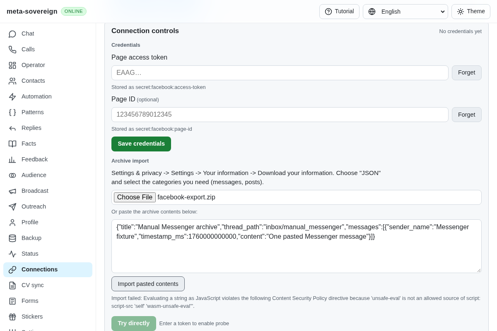
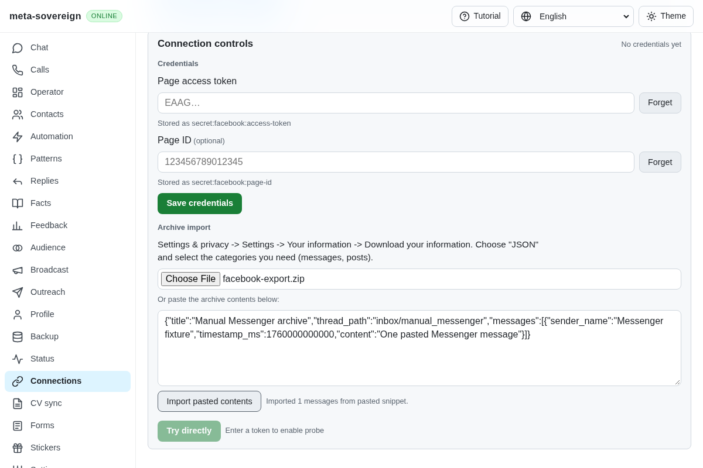
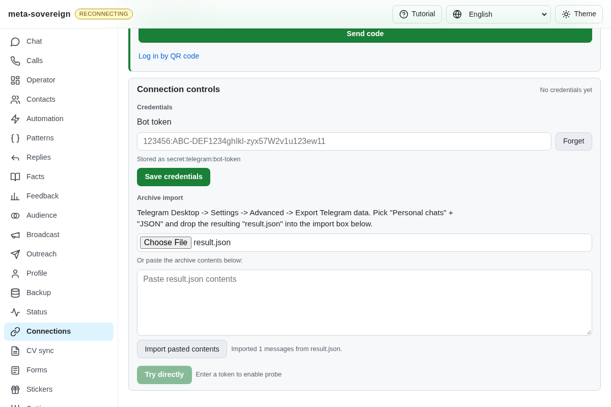

# Manual archive imports under the browser policy

On published commit `e3b6edb9`, pasting a valid Messenger JSON archive into Connections failed before the archive parser could run. The full source registry loaded GitHub's gzip helper, whose module initializer constructed a function from a string. The app's content security policy rejected that initializer. [Published source](https://github.com/link-foundation/meta-sovereign/blob/e3b6edb9234c223ef0e7b96e180abf4610655089/js/src/sources/github.js#L441-L449).

GitHub now resolves the runtime gzip module when cloning a repository. Connections can load the shared parsers and save supported snippets and plain archive files to the browser store under the existing policy.

## Reproduce and verify

Open **Connections → Facebook → Manual**, paste the Messenger thread JSON used by the [browser regression](../../../js/tests/e2e-archive-media-browser.mjs), and choose **Import pasted contents**. The published bundle shows the policy error. The corrected bundle imports one message. With the server API unavailable, upload the Telegram Desktop `result.json` fixture from **Connections → Telegram → Manual**. Reload and open both Chat threads. Each has its original imported message.

```sh
node --max-old-space-size=384 --test --test-concurrency=1 js/tests/{github-source,archive-imports,archive-media-import,archive-upload,connections-screens}.test.js
RUN_BROWSER_E2E=1 E2E_EXECUTABLE_PATH=/usr/bin/google-chrome node --max-old-space-size=384 js/tests/e2e-archive-media-browser.mjs
```

The registered Chromium scenario preserves the streamed Messenger ZIP, images, files, reactions, and missing-attachment behavior. It now runs both manual imports and verifies their messages after reload. Focused checks passed in Node (44) and Deno (41 tests and five steps), including GitHub's gzip clone. Independent Playwright MCP repeated both imports at 390 × 844, interrupted 14 API requests and recovered each message from browser storage. The four inspected views fit the viewport. It recorded zero page exceptions, and the fixture closed with zero saved proposals.







[Evidence archive](data/manual-archive-import.tar.gz) · [Entry hashes](data/manual-archive-import.tar.sha256.json). QA02 and QA06 still require complete authenticated provider history and parity in [PR 57](https://github.com/link-foundation/meta-sovereign/pull/57).
