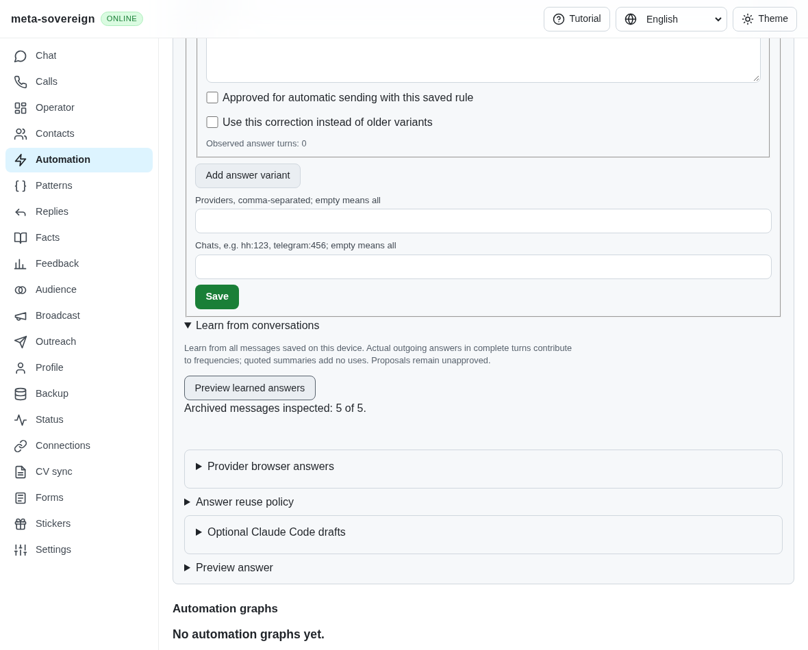
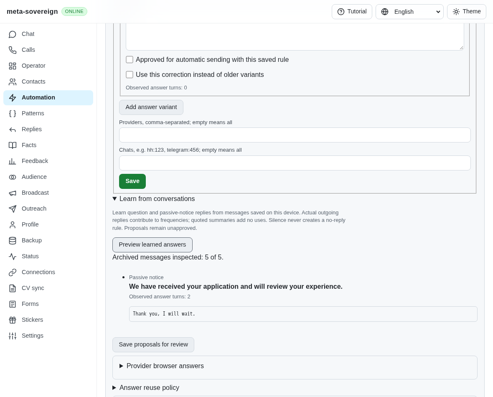
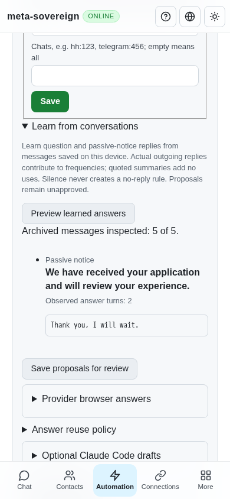

# Learning actual passive-notice replies

The pinned HH reference requires ordinary notice/reply observations as well as question answers: [C6 and C12–C13](https://github.com/konard/hh-job-application-automation/blob/fa0991b8c2d0896fb3b4be6c69947f0590094b15/docs/requirements/forms-and-chats.md). Saved notice rules existed, but the chronological learner accepted only questions. This step extends that existing bounded learner; it does not infer a reply from silence.

## Reproduction and cause

On actual parent `66a1949fb3e497060b68924f8be7559e6d3b0238`, archive an incoming “We have received your application and will review your experience.” followed by the owner's delivered “Thank you, I will wait.” Open Automation → Questions → Learn from conversations and preview. No proposal appears. The new actual-message regression expects four normalized notice rules across five provider namespaces and four languages; the parent returns zero. The production parent browser likewise inspects five messages and produces no notice proposal.

`experiments/issue-56/notices-before.py --learning` runs that actual-parent assertion and captures its missing proposal, restoring source files and rebuilding the current web bundle in `finally`. It is intended to run while the draft source changes are present. The original transcripts are never rewritten.

## Shared behavior and guards

Actual chronological incoming notices can now pair with a delivered owner reply in the same provider/chat. Existing service/application barriers, reply-parent checks, owner identity, maximum age, privacy, rejection, clarification and contact-substitution guards remain in effect. Greetings and explicit final signatures normalize through the notice matcher. A reminder question cannot redirect its substantive reply to an earlier notice.

Notice records use a distinct stable ID namespace. Canonical corrections retain provider/chat scope and remain separate from non-question form labels. Actual outgoing turns contribute counts; saving and replaying the archive preserves approval decisions without inflating counts. Silence and a literal `[без ответа]` outgoing string never create no-reply observations. Proposals remain unapproved and text replies require review.

CLI, offline API and negotiated text/binary Lino use the same learner. The four-language learning hint explains actual counts, summary evidence and silence. Proposal rows identify their kind on a separate line. The existing shared Questions browser fixture runs this regression in hosted CI; its registration contract prevents passing an incompatible standalone Browser.

## Verification

The focused Node and Deno checks cover learning, shared controls, canonical corrections, automatic-turn compatibility and CI registration. The production Chromium helper verifies read-only preview, two actual observations, replay-safe saving, no proposal from silence and an unapproved notice editor at desktop and 390-pixel widths. Its provider counter remains zero. Independent Playwright MCP also confirms the count, saving and both layouts. An initial MCP navigation used the wrong fixture port; retrying with the server's printed port succeeded. The only console error was the fixture's missing favicon.

Screenshot review found the new kind label adjacent to the notice text; a block label and a geometry assertion correct and cover that layout. Raw logs, actual-parent source snapshots and screenshot hashes are retained in [the evidence archive](data/notice-learning.tar.gz) and [manifest](data/notice-learning.tar.sha256.json).

## Remaining required work

Regenerated generalized notice patterns, complete pending-turn and owner-activity guards, automatic inactive acknowledgements/rejections, unread traversal, paused-chat orchestration and authenticated provider parity remain unfinished. Every other unchecked issue requirement remains required; PR 57 stays draft and unmerged.
