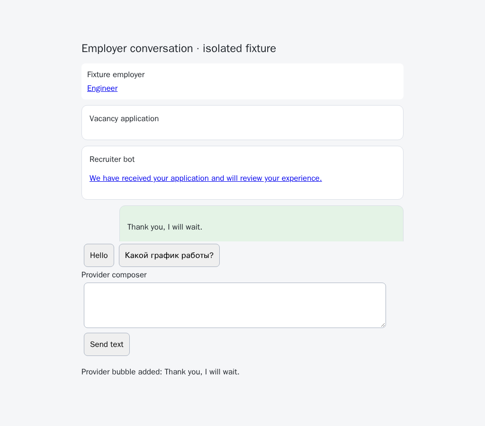
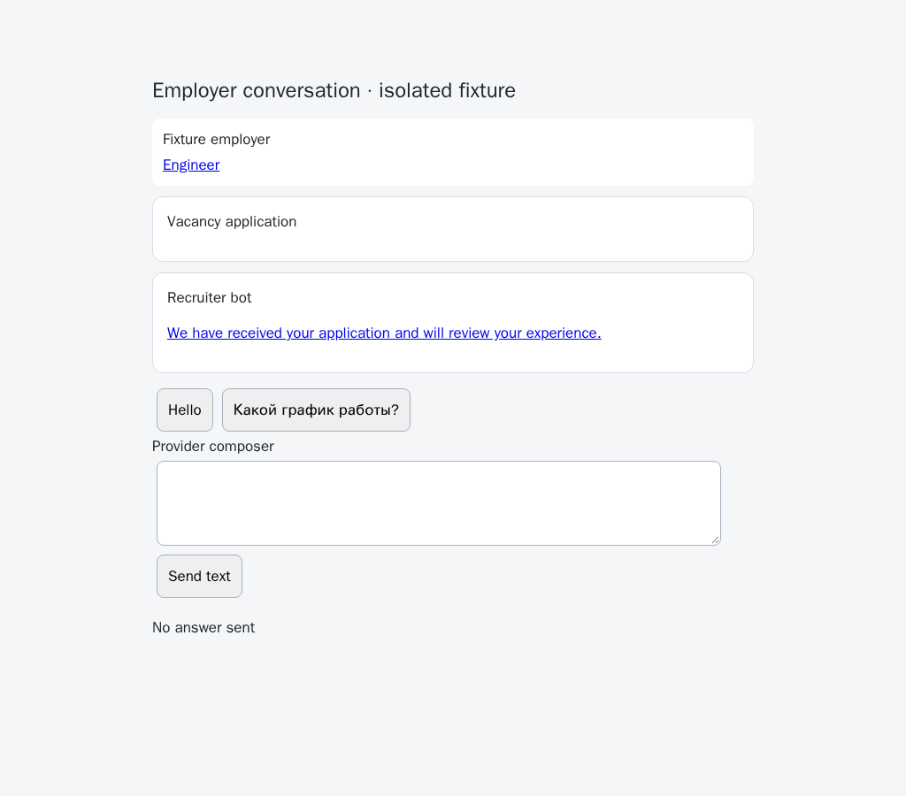

# Keep linked HeadHunter notices for review

A recruiter notice can have the same visible words as an approved acknowledgement while containing a different action underneath. On published parent `5a182de2`, the notice watch read the anchor destination and still authorized a reply from the visible words. It also authorized linked rejections and dropped a linked handover from the pending turn. [Pinned notice requirements](https://github.com/konard/hh-job-application-automation/blob/fa0991b8c2d0896fb3b4be6c69947f0590094b15/docs/requirements/forms-and-chats.md#L233) · [PR #57](https://github.com/link-foundation/meta-sovereign/pull/57).

The shared notice planner now checks native anchors and text destinations before applying either acknowledgement or rejection policy. A linked handover stays in the pending turn. The linked message remains available for owner review, without a send reservation. The sequential unread pass still reaches later eligible plain notices.

## Reproduction

```sh
NOTICE_LINK_SCREENSHOTS=docs/screenshots/issue-56-notice-link \
  node experiments/issue-56/notice-link-browser.mjs
```

Run with `NOTICE_LINK_BEFORE=1` using the parent planner and the same fixture helpers. The synthetic recruiter wraps the approved acknowledgement in an anchor while keeping its wording identical. An inactive Chromium window runs the actual current-chat watch against the routed provider fixture. The parent adds a confirmed outgoing bubble. The updated watcher reads the original text and destination, holds review, then stops with zero sends, selections and reservations.

| Parent sends the saved thanks                                                      | Updated watch leaves the linked message for review                            |
| ---------------------------------------------------------------------------------- | ----------------------------------------------------------------------------- |
|  |  |

Five parent regressions report `ready` where `review` is required. The fixtures cover linked acknowledgements and rejections, bare and contact destinations, and an earlier linked handover. Node and Deno each pass 39 focused tests, including the sequential two-chat fixture that delivers only the second, unlinked notice.

The independent Playwright MCP run used the production Questions controls and a synthetic sender. At 390 pixels the manual review receipt exposes the destination. Stop drains the only watch, with zero sends and reservations. The page reported no exceptions and one favicon 404. [Phone screenshot](../../screenshots/issue-56-notice-link/mcp-phone.png) · [Logs](data/notice-link.tar.gz) · [SHA-256 manifest](data/notice-link.tar.sha256.json).

QA04 and QA17 remain open for the remaining provider and notice behavior. [Acceptance inventory](reference-feature-inventory.md).
