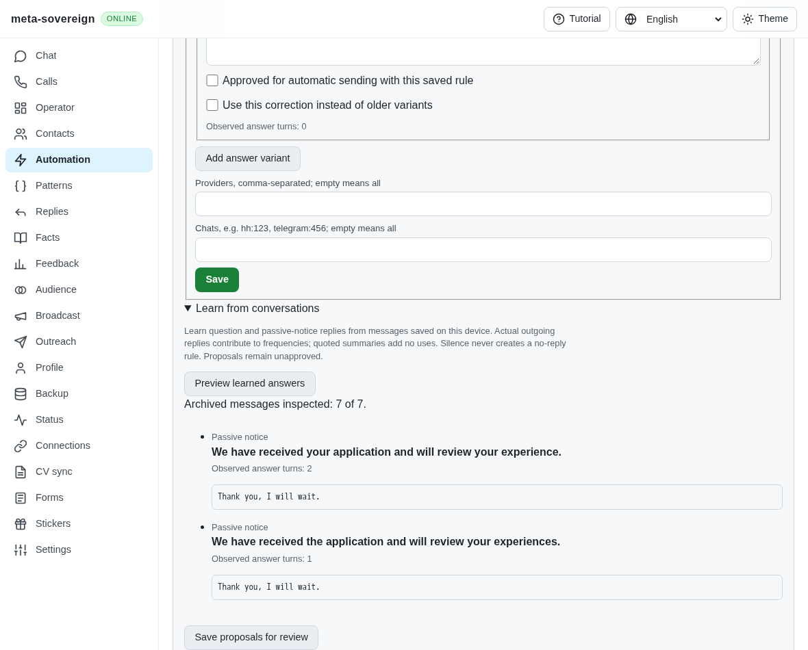
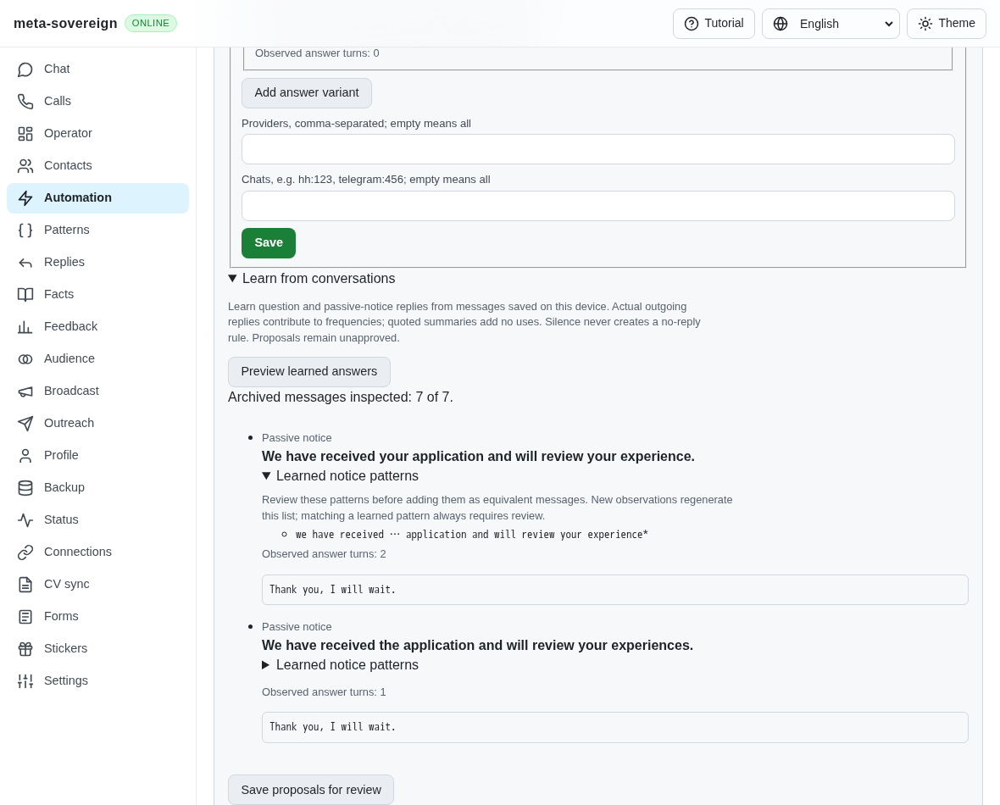
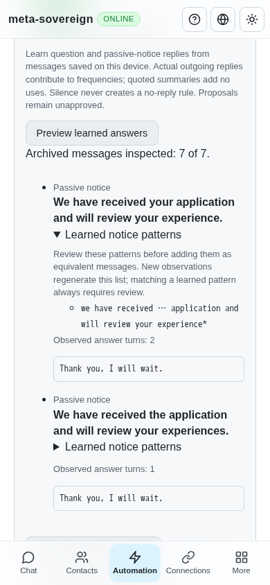

# Learned notice patterns

Issue [56](https://github.com/link-foundation/meta-sovereign/issues/56), [PR 57](https://github.com/link-foundation/meta-sovereign/pull/57), reference requirement C12 in the pinned [forms and chats requirements](https://github.com/konard/hh-job-application-automation/blob/fa0991b8c2d0896fb3b4be6c69947f0590094b15/docs/requirements/forms-and-chats.md).

## Reproduction and cause

At actual parent `bd871352`, learning two related passive notices with the same delivered owner reply creates two independent records, but cannot recognize a new variant through their shared word order. Exact records and approximate suggestions already work. There is no synthesis step after collecting observations.

The finite fixture archives “We have received your application and will review your experience” and a variant using “the application” and “experiences,” each followed by an actual owner reply. The regression requires both originals to retain their own counts and a separate generated pattern. Against the actual parent, its assertion fails because neither rule has a learned pattern. The production browser shows the two proposals without patterns.

Run `python3 experiments/issue-56/notices-before.py --patterns` to preserve the actual-parent failure and screenshot. It restores modified production sources and rebuilds the current bundle in `finally`; do not edit those sources during the probe.

## Change and boundaries

The shared learner now reuses the existing LCS primitive to derive ordered-word patterns from structurally related notices with equal or sufficiently similar actual replies. Differences become `…`; shared word prefixes can produce `*` endings. Russian, Hindi and Chinese variants have focused coverage. Negated replies and different numeric replies do not join a group. Unrelated templates with the same acknowledgement remain separate.

Derived patterns are stored as `learnedPatterns` on each original notice record. They do not duplicate observations or become owner aliases. Saving new observations regenerates the proposal's list while preserving the original count, owner aliases and approval decisions. Replaying an archive does not recount its outgoing turns. A saved change from notice to question remains a question.

Matching a generated pattern always requires review, including when the owner has subsequently changed its answer to an approved `[без ответа]` marker. Generated metadata also cannot expand a canonical correction's authority. The owner can explicitly adopt a pattern through the existing equivalent-message editor. Existing question/request/link, provider/chat, delivered-owner and service/application barriers remain in force; the broader automatic-send pending-turn guards are still unfinished.

Synthesis admits at most 256 words per notice, shares a 4,194,304-cell budget and a 100,000-reply-comparison budget, and permits at most 100 generated patterns per original rule. Exhaustion refuses learning before storage writes. These finite bounds prevent uncontrolled pairwise work; large collections can receive an explicit capacity error rather than silently applying partial proposals.

The CLI, offline API and default text/binary Lino routes share the same implementation. Four-language review controls display patterns separately from original messages, actual counts and owner aliases, with an explicit review explanation. No provider sends occur in the browser fixture.

## Verification

- Actual-parent regression: one failing test and the missing-pattern browser state.
- 67 focused Node checks and the same 67 Deno checks pass: synthesis, languages, similar/negated replies, capacity refusal, original counts, regeneration, owner changes, explicit adoption, no-reply, canonical corrections, archive concurrency, controls and browser registration.
- Three production Chromium review scenarios pass with zero provider sends: preview, save/replay/editor and mobile layout. Both retained notice-learning modes run in the mandatory Questions browser group, using its real shared page/store.
- Independent Playwright MCP verifies two generated patterns, original count two, two saved rules, the review warning and `scrollWidth === 390` at a 390-pixel viewport. The browser and isolated fixture are closed afterward.
- Strict changed-file lint, formatting, secret scanning and the existing duplication gate pass. Full runtime/platform/browser matrices remain hosted CI work; exact new-head CI is required before PR completion.

Focused command:

```sh
node --test --test-concurrency=1 js/tests/notice-pattern-learning.test.js js/tests/question-notice-learning.test.js js/tests/question-notice-learning-controls.test.js js/tests/question-notices.test.js js/tests/question-notice-controls.test.js js/tests/question-corrections.test.js js/tests/question-concurrency.test.js js/tests/ci-contracts.test.js
```

Use the same files with `deno test --allow-all --no-check`. The reusable browser probe is `experiments/issue-56/notices-ui.mjs --learning --patterns`, with `RUN_BROWSER_E2E=1`, an installed Chromium executable and `NOTICE_SCREENSHOTS=docs/screenshots`.

The [evidence archive](data/notice-patterns.tar.gz) preserves logs, source snapshots, actual-parent files, screenshots and the independent MCP observations. Rebuild it with `python3 experiments/issue-56/collect-notice-learning.py --patterns` after the focused checks pass and before committing the unit.

Before:



After:





## Remaining required work

Complete pending incoming-turn, draft/activity and durable delivery guards; inactive acknowledgements/rejection handling; all-unread orchestration; remaining forms/provider parity; device/platform work; and every other unchecked criterion in the [plan](PLAN.md) remain required. This unit does not establish live-provider acceptance or finish issue 56. PR 57 stays draft and unmerged.
