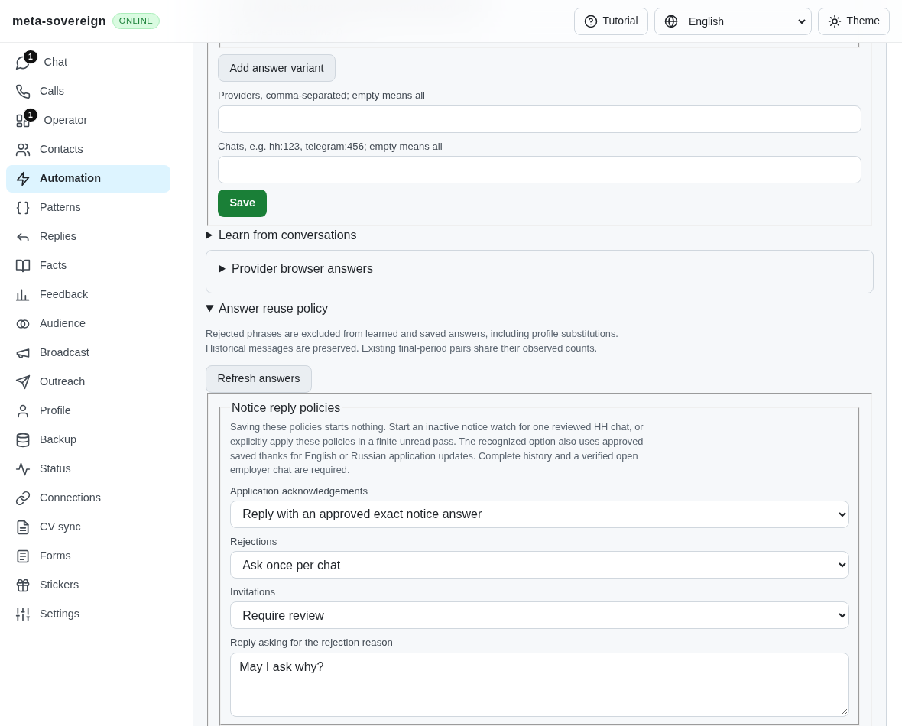
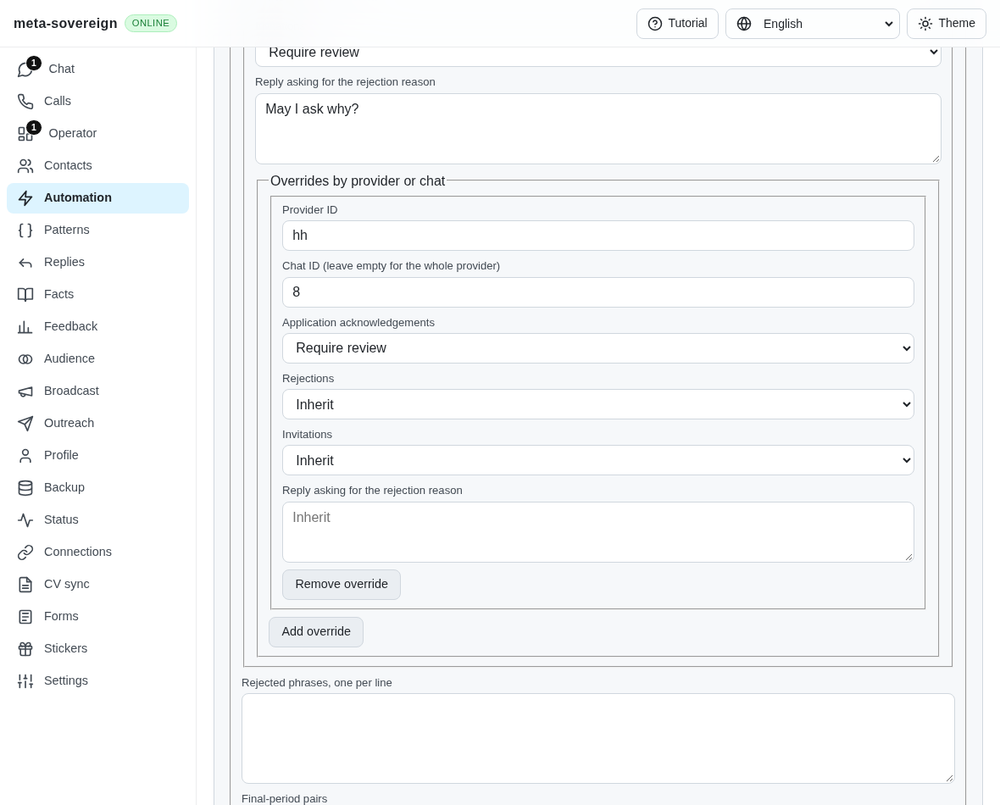
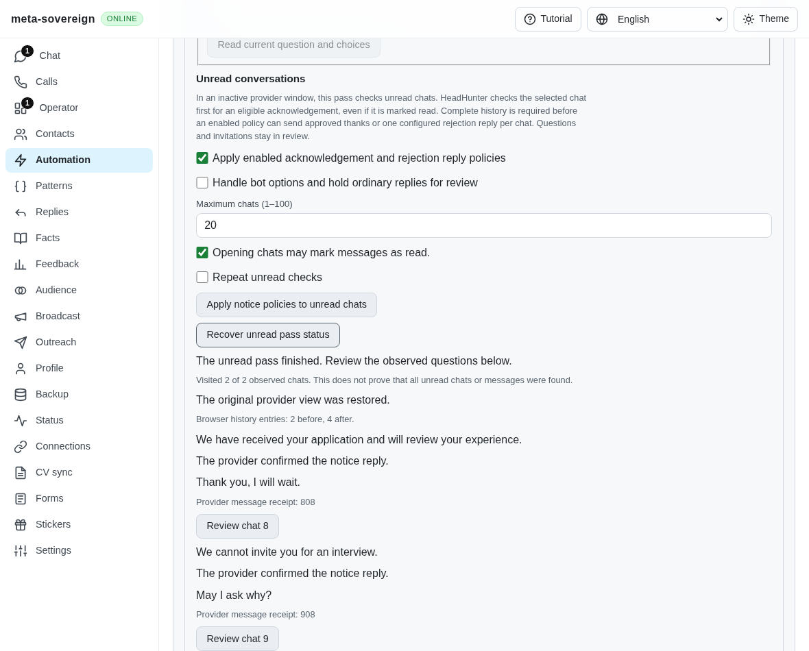
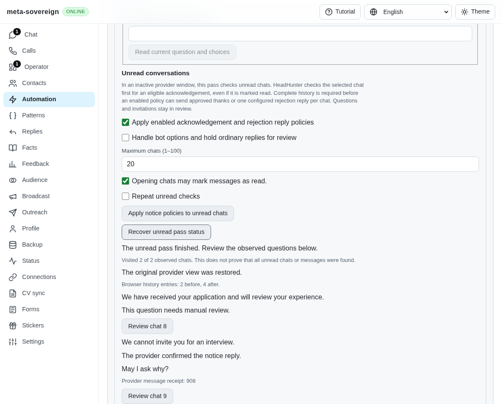

# Provider and chat overrides for notice decisions

With a global automatic acknowledgement enabled on `c9cc7143`, saving an exception for chat 8 discarded the exception. The settings had no way to add it. The next unread pass sent an acknowledgement in chat 8 and a configured rejection follow-up in chat 9.

Open **Automation → Questions and saved answers → Answer reuse policy**. Under **Overrides by provider or chat**, add an entry for provider `hh`, chat `8`, and leave acknowledgements on **Require review**. Save and reload. Chat 8 stays in review during the next explicitly confirmed pass. Chat 9 still gets the configured rejection follow-up. Saving the policy leaves the provider untouched until a pass starts.

Omit the chat ID for an override that applies across a provider. Each field inherits independently. An exact chat decision takes precedence over the provider's decision, which inherits the global defaults. Invitation decisions remain review or ignore. The same record round-trips through the CLI, offline API, and both connected Lino encodings.

The Chromium reproducer uses an owned synthetic provider and a saved owner draft. Run the first command to replay the parent server modules and bundle, and the second to check the current build.

```sh
export RUN_BROWSER_E2E=1 E2E_EXECUTABLE_PATH=/opt/google/chrome/chrome
node --max-old-space-size=384 --import ./experiments/issue-56/notice-policy-scopes-parent.mjs \
  experiments/issue-56/verify-notice-policy-scopes.mjs --before
node --max-old-space-size=384 experiments/issue-56/verify-notice-policy-scopes.mjs
```

The focused parent run failed five regressions. The updated Node and Deno runs each passed 48 checks. These include exact ID matching, invalid and duplicate override refusal, and an opt-out saved while an acknowledgement was queued. [Policy tests](../../../js/tests/question-notice-policy.test.js) · [Queued send regression](../../../js/tests/question-notice-watch.test.js) · [Native browser regression](../../../js/tests/e2e-question-notice-policy-browser.mjs)

At 390 pixels, an independent Playwright run confirmed that saving starts no visits, chat 8 stays in review, and the only synthetic send goes to chat 9. The original draft remained intact. The page had no exceptions or horizontal overflow. Its favicon returned 404.

| Before                                                                                                         | After                                                                                                                          |
| -------------------------------------------------------------------------------------------------------------- | ------------------------------------------------------------------------------------------------------------------------------ |
|  |                   |
|    |  |

[Phone viewport](../../screenshots/issue-56-notice-policy-scopes-settings-phone.png) · [Logs and source hashes](data/notice-policy-scopes.tar.gz) · [SHA-256 manifest](data/notice-policy-scopes.tar.sha256.json)

Authenticated notice delivery and the full cross-provider automation audit remain open under QA19.
