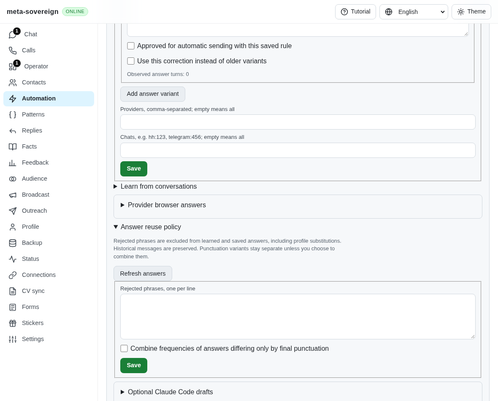
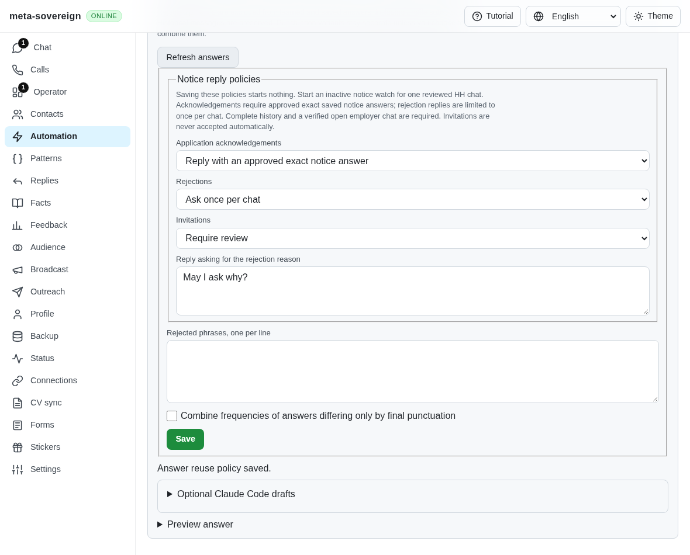
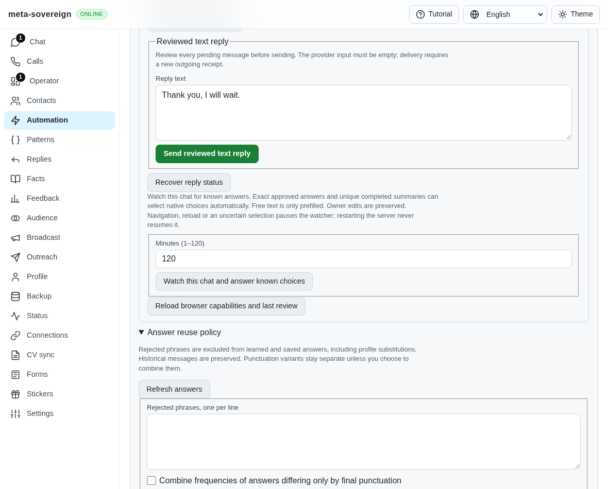
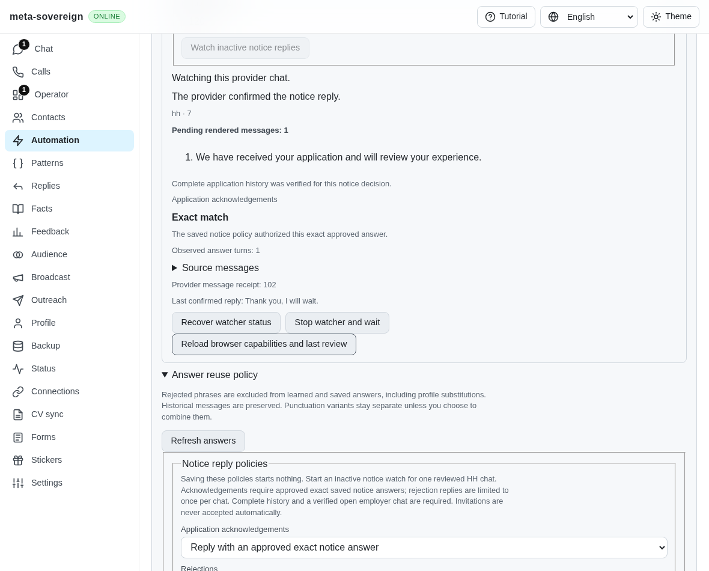
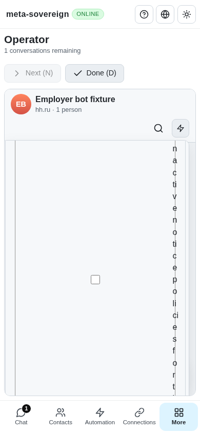
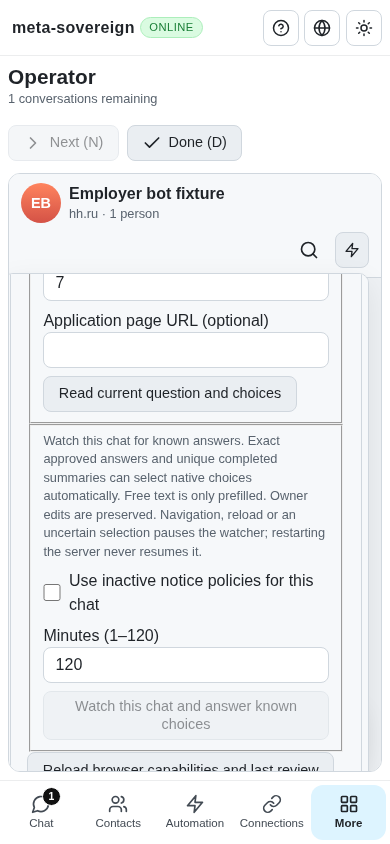

# Saved notice policies and inactive current-chat delivery

The actual parent `cdbfeaf1` has an inactive text primitive but cannot retain independent acknowledgement, rejection and invitation policies or start a corresponding watch. The regression fails against that parent with missing `policy.notices`; the parent UI screenshots show both missing control groups. The same check passes after the shared policy normalizer is extended.

Each policy defaults to review. Acknowledgements may use an approved exact saved notice answer; generated patterns, unapproved learned replies, model proposals, no-reply rules and conflicting answers cannot authorize a send. Rejections use a configured full reply and reserve the chat once, independently of later provider IDs or wording. Any earlier owner response following a rejection also ends automatic rejection replies for that chat. Invitations support review or leaving the notice unanswered; automatic acceptance is unavailable. Saving policy starts nothing.

A separately selected finite notice watch owns one reviewed HH document. It never navigates to another conversation. Admission requires a uniquely identified visible employer and vacancy, an HH vacancy URL, a writable open composer without an owner draft, complete history from the application-start marker, restored owner state and exactly one eligible pending notice. Explicit completed bot wrap-ups may accompany it. Earlier tasks, extra requests, positive invitations, support/closed/transitional views, strict native choices and incomplete history remain for review. Native focus/activity leases and frozen whole-turn/context guards apply through the final page-local send event. A late employer change is a tested zero-send refusal.

Both acknowledgement and rejection delivery reserve the existing shared question key; rejections additionally reserve a chat key. Each reservation is flushed before issue. Current policy and saved knowledge are recomputed inside queued admission. The actual outgoing provider message must bind source, chat and the complete reply text before delivery is confirmed. Missing receipts hold the reservations as unknown; Stop drains issued work and aborts history traversal. Reopening an actual Lino store preserves full positive receipts and uncertain holds, and never resumes the old watcher or repeats a rejection.

CLI policy files, offline controls and both text/binary Lino HTTP routes use the same normalizer. An older backend that drops the new policy fields cannot produce a saved confirmation. Questions, Chat and Operator share explicit watch controls in English, Russian, Hindi and Chinese. All three modes remain independent and the notice checkbox starts unchecked. WebKit without verifiable native focus must refuse delivery; its required hosted group checks that refusal rather than reporting success.

Save a policy with `meta-sovereign automations answers policy policy.lino`. Inspect the current chat with `meta-sovereign automations answers browser inspect --source=hh --chat=7`, then use its returned review ID with `meta-sovereign automations answers browser watch --id=<review> --confirm=true --notice-replies=true`. Ctrl+C drains the owned action. Browser status/Stop commands retain their existing request IDs and never replay a send.

Run the parent reproduction separately from checks importing its temporary source substitution:

```sh
python3 experiments/issue-56/notice-policy-before.py
NODE_OPTIONS=--max-old-space-size=384 node --test --test-concurrency=1 --test-timeout=15000 js/tests/question-notice-policy.test.js js/tests/question-notice-watch.test.js js/tests/question-notice-policy-controls.test.js js/tests/question-notice-policy-i18n.test.js js/tests/question-notice-restart.test.js
NODE_OPTIONS=--max-old-space-size=384 node experiments/issue-56/notice-policy-browser.mjs
NODE_OPTIONS=--max-old-space-size=384 node experiments/issue-56/notice-policy-ui.mjs
```

Twenty-three focused Node checks, seventeen Deno checks and forty-four existing compatibility checks pass. Seven production Chromium scenarios verify actual receipts, owner preservation, rejection deduplication, closed/support/task refusals, a late employer change and unknown holds. Four production UI scenarios verify settings, actual watch delivery, Chat and phone-sized Operator. Three independent Playwright MCP checks verify saved controls, persistence and mobile layout with zero watch opens/sends. Its deliberately lightweight UI server uses a synthetic provider; native delivery evidence comes from the separate browser scenarios. No scenario uses a live account. Scoped lint, formatting and secret checks pass; duplication remains 6.49%, below the unchanged 6.5% gate.

The watch now labels its verified complete history and policy-authorized exact answer independently of ordinary previews, which still require review. Sending, uncertain, refused and manually resolved notice states describe text replies rather than native choices. Screenshot review caught an intermediate layout regression: a shared text-input selector also matched the new checkbox, forcing it to full width. The retained draft images show squeezed vertical labels. Excluding checkboxes preserves the existing native control width; both UI and independent MCP now assert the checkbox width and label height as well as document overflow. Headless contexts also retain separate native focus, so the browser fixture uses an actual owner tab in the provider context, with no focus emulation. Opening Chat marks the fixture read; the Operator case explicitly restores unread fixture data before navigation.

| Parent controls                                                                  | Saved independent policies                                                     |
| -------------------------------------------------------------------------------- | ------------------------------------------------------------------------------ |
|  |  |

| Parent watch                                                               | Verified reply receipt                                                        |
| -------------------------------------------------------------------------- | ----------------------------------------------------------------------------- |
|  |  |

| Draft checkbox layout                                                                          | Corrected phone controls                                                                                |
| ---------------------------------------------------------------------------------------------- | ------------------------------------------------------------------------------------------------------- |
|  |  |

The [source/log archive](data/notice-policy.tar.gz) and its hash manifest retain reproduction, focused checks, screenshots and independent MCP results. The preceding exact-head [Checks run](https://github.com/link-foundation/meta-sovereign/actions/runs/43100397266), created 2026-11-11 21:07:44 UTC for `cdbfeaf1`, passes the browser jobs and the earlier Windows startup check. Its Windows Node/Bun/Deno jobs fail on a reconnect-fixture absolute preload path; Windows Deno additionally times out draining delayed CLI output. Those separate failures are preserved for correction, and new-head hosted verification is required.

This current-chat unit does not complete QA17 across providers. Cross-chat/filter restoration, shared unread orchestration, live provider verification, exhaustive language/reference parity and every other unchecked criterion remain required in [PR57](https://github.com/link-foundation/meta-sovereign/pull/57). Keep that PR draft and unmerged while completing them.
