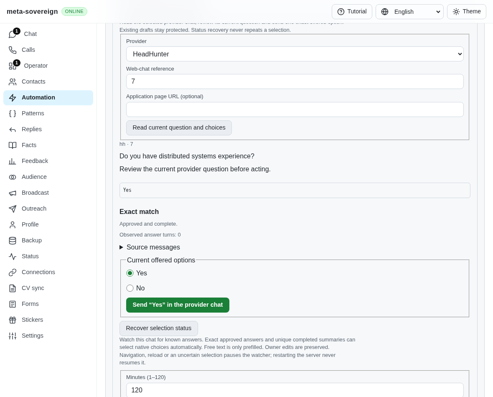
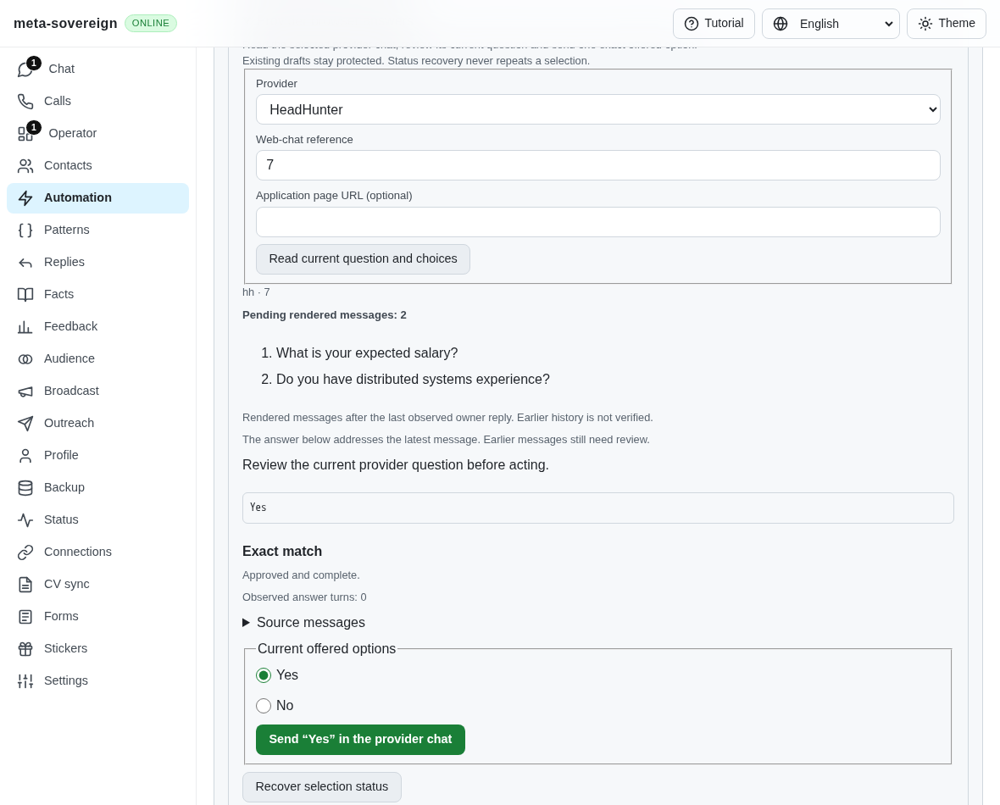
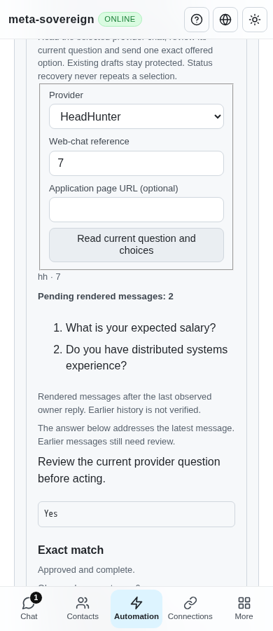

# Rendered pending incoming turns

Issue [56](https://github.com/link-foundation/meta-sovereign/issues/56), [PR 57](https://github.com/link-foundation/meta-sovereign/pull/57), and the pending-message/manual-reply requirements in the pinned [forms and chats requirements](https://github.com/konard/hh-job-application-automation/blob/fa0991b8c2d0896fb3b4be6c69947f0590094b15/docs/requirements/forms-and-chats.md).

## Reproduction and cause

At actual parent `d4d04df2`, render an owner reply, an incoming salary question, and a later incoming technical question with native Yes/No choices. Inspection displays only the latest question. Changing the earlier pending message, or inserting a manual reply before the unchanged latest question, does not invalidate the held latest-only intent. The reader already collects rendered history, but the review and dispatch identity discard that context.

`python3 experiments/issue-56/pending-turn-before.py` preserves four failing assertions against that actual parent and captures the missing earlier-message review. Its `finally` restores the modified production sources and rebuilds the current bundle. Do not edit those sources while running the probe.

## Change and limits

Browser inspection now retains every rendered incoming message after the last observed owner or service record. The snapshot records that boundary, or explicitly records the start of the rendered window. It does not claim complete provider history. Action evidence refuses empty messages, duplicate identities, more than 20 pending messages, more than 24,000 total UTF-16 code units, individual bodies over 6,000 units, and malformed or mismatched supplied context. Read-only history still returns its existing bounded rows independently of these action limits and never acquires or clears the composer.

Shared Questions, Chat and Operator controls show all pending messages, the observed coverage boundary, and that the proposed answer addresses the latest message. CLI and default text/binary Lino inspection, saved review recovery and native action drafts retain the same detached context. All four languages are covered. Legacy reviews disclose unknown coverage; a legacy latest-only action cannot consume multiple pending messages.

Prefilling, native selection and the actual pointer/mouse/click event guard compare the complete held pending context. An earlier edit or manual reply therefore refuses before a provider write. Owned-prefill clearing uses the same context so changed conversation state cannot erase a held draft. Native uncertain-attempt identity remains tied to the latest question: editing earlier context cannot authorize an ambiguous repeat of that question. Automatic watches hold multiple pending messages for review without prefilling or clicking. Whole-turn automatic planning remains required work.

## Verification

- Four actual-parent assertions fail because context is absent or the stale intent remains accepted. The production parent screenshot verifies the earlier salary question exists in the provider but is absent from review.
- 69 focused Node checks and the same 69 Deno checks pass across pending context, serialized provider reading, existing native choices/history, review controls, CLI/Lino, watch controls and CI registration. A subsequent nine-check focused Node/Deno run includes the additional four-language rendered-control assertion: 70 distinct checks in total.
- Four production Chromium scenarios pass: earlier edit refusal, inserted manual-reply refusal, an edit during native pointer dispatch, and stale-prefill refusal followed by a fresh explicit mobile selection. Refusals produce zero clicks, text sends and draft writes; the explicitly confirmed fresh selection produces one native click and zero text sends.
- Independent Playwright MCP verifies both messages, stale-context refusal, desktop and 390-pixel layout, one explicit click and recovery without replay. No page errors occur. Both browser fixtures are closed afterward. No live provider account is used.
- Strict changed-file lint, formatting, secret scanning and the existing duplication gate pass. Repeated evidence collection now shares the existing archive helper; historical evidence archives remain intact. Full browser/runtime/platform matrices remain hosted CI work.

Focused compatibility command:

```sh
node --test --test-concurrency=1 js/tests/browser-pending-turn.test.js js/tests/browser-choices.test.js js/tests/hh-browser-history.test.js js/tests/question-browser.test.js js/tests/question-browser-controls.test.js js/tests/question-browser-watch.test.js js/tests/question-browser-watch-controls.test.js js/tests/ci-contracts.test.js
```

Use the same files with `deno test --allow-all --no-check`. The bounded production browser probe is `experiments/issue-56/pending-turn-ui.mjs`; CI registers its four scenarios in the existing mandatory question-controls browser group. The [evidence archive](data/pending-turn.tar.gz) preserves source snapshots, actual-parent files, verification logs and screenshot hashes. Rebuild it with `python3 experiments/issue-56/collect-pending-turn.py` after checks pass and before committing.

Before:



After:





## Hosted observations and remaining work

On preceding head `d4d04df2`, Chromium job 130572979540 in Checks run 43035096745 fails during browser dependency installation: the preserved log's lines 585–628 report DNS failures resolving Ubuntu package hosts; lines 629–632 report installation exit 100. No browser assertions execute. Pages run 43035096398 is cancelled during dependency installation after the same DNS errors (lines 505–520 of its preserved log). This evidence does not establish an application failure or a passing exact new-head matrix.

Complete provider-history retrieval, whole-turn planning, owner activity and durable delivery guards, automatic acknowledgements/rejection handling, all-unread orchestration and every other unchecked [plan](PLAN.md) criterion remain required. PR 57 stays draft and unmerged.
