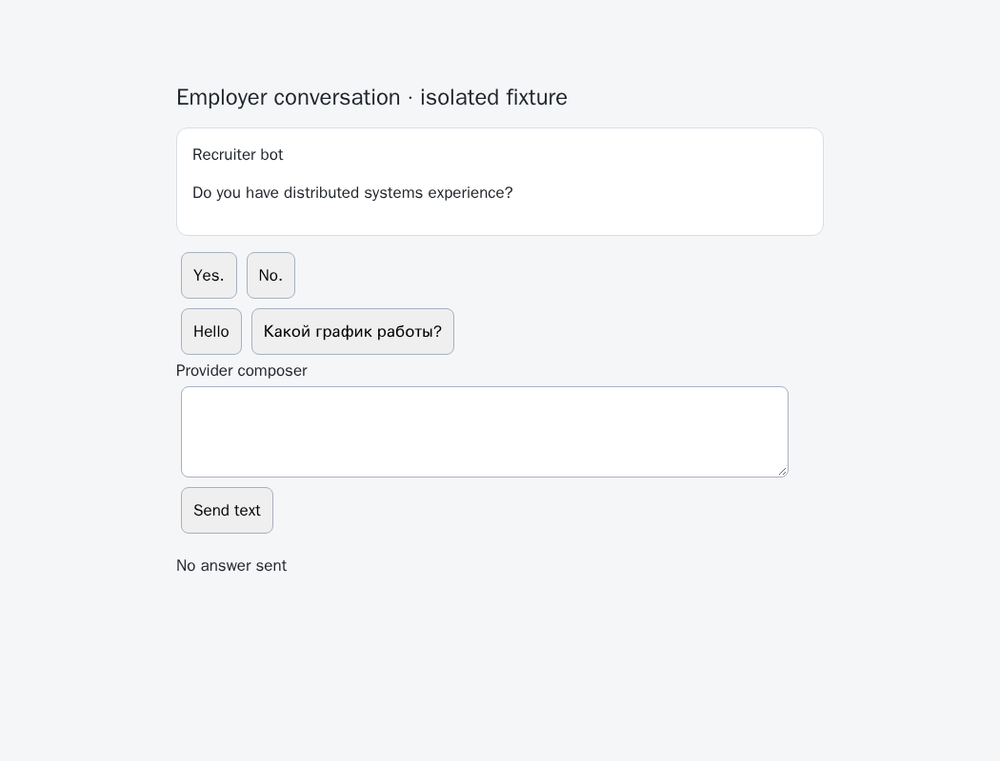
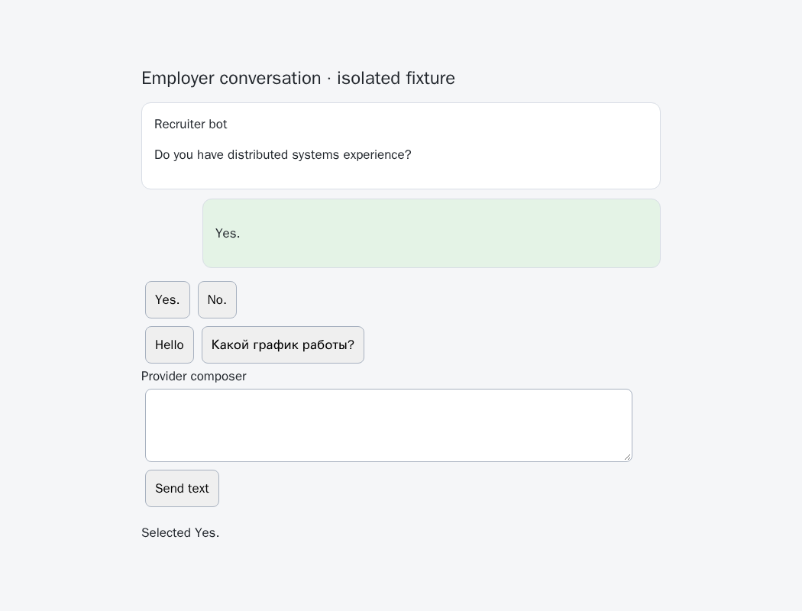
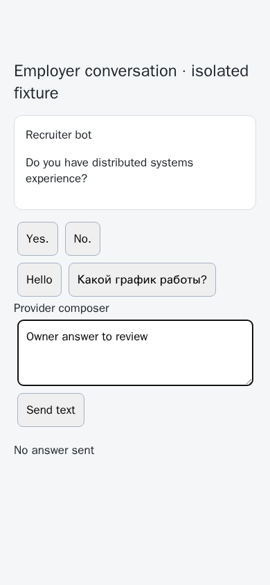
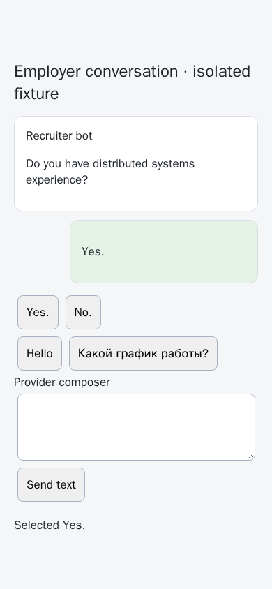

# Provider choice execution and private draft ownership

[PR 57](https://github.com/link-foundation/meta-sovereign/pull/57) adds the browser primitives following the [strict choice contract](question-strict-options.md). QA14 remains unfinished: built-in HH chat/application frame routing, the shared CLI/Lino/React execution workflow and live provider verification are still required. These checks use isolated synthetic provider markup, not a signed-in HH account.

The pinned [reference requirements](https://github.com/konard/hh-job-application-automation/blob/fa0991b8c2d0896fb3b4be6c69947f0590094b15/docs/requirements/forms-and-chats.md), current choice-control reader and browser fixture distinguish actual choices, conversation starters, disabled controls and unchanged automatic drafts. Their behavior informed this implementation; no reference code was copied.

## Reproduction and correction

The preceding commit `33eac5b5` refuses strict default sends because it has no verified click executor. Direct calls to its browser sender also ignore answer intent and can begin ordinary text delivery. Its history reader does not attach strict choice metadata. The finite [parent probe](../../../experiments/issue-56/provider-choices-before.py) replaces only that production sender and always restores it: two of six unit checks fail, and the browser flow fails on missing strict metadata before any selection.

Configured browser adapters now declare the allowed origins, chat path/ID, stable message IDs, outgoing markers, composer and choice selectors. The shared reader validates the current URL and bounded visible history, associates controls with the latest message, excludes old rows and unrelated binary dialogs, and distinguishes a unique Yes/No pair from generic starters. Hidden and disabled controls cannot supply a selectable option. Duplicate labels remain ambiguous. An inconsistent history/choice snapshot fails closed instead of shedding metadata and becoming free text.

The sender requires one frozen latest question, its exact option list and the selected actual label. Both default and direct browser sends route strict answers through this operation. Unsupported selectors are rejected before opening a browser. One native browser-commander click is guarded again at pointer-down, mouse-down and click against changed questions, controls, chat identity and composer content. There is no ordinary API or browser text fallback.

A new, uniquely identified outgoing message after the question must contain the selected label before delivery succeeds. Missing, incoming, duplicated or newly revealed older messages cannot prove delivery. A post-dispatch exception still permits positive readback. Uncertain attempts retain a page-local reservation; the existing automation outbox supplies durable protection across restart. Reservations are bounded to 32, retaining unresolved attempts and replacing only completed entries; exhaustion refuses additional choices. No uncertain click is retried automatically.

Explicit automatic prefilling writes only an empty native input and verifies readback. Ownership stays in the provider document, outside DOM data attributes and application logs. Later controls clear only the same question's unchanged automatic value. Input edits revoke ownership, including an edit subsequently reverted to the original text. An older question's draft and any manual draft remain intact. Only a temporary data attribute identifies an armed control; listeners and that attribute are removed after completion.

## Focused verification

- **46 Node and 46 Deno checks pass**, including existing sender and strict-planning compatibility cases. Six are focused choice adapter contracts; two fail against the parent.
- **20 production Chromium cases pass** through the actual browser sender and browser-commander: exact/native delivery, direct sender, history metadata, generic starters, delayed/disabled/duplicate controls, owned cleanup, edited/reverted and older drafts, an unrelated toolbar, fresh-question and navigation races, unknown retry protection, invalid receipts, delayed receipt and post-click failure, and owner input between pointer-down and click. They record zero API text writes and zero ordinary browser text sends.
- **Independent MCP desktop/mobile checks pass** against the production page controller: edit preservation, explicit owner clearing, native selection, one outgoing message ID and zero text sends. No page errors are reported. The VM does not support dynamic Node imports, so the owned local fixture serves the static production controller; the MCP script itself uses only page interactions.
- The native fixture is registered within the existing Questions browser check, so hosted Chromium/WebKit coverage includes it. Only this focused flow was run locally. Strict scoped lint/format/secret checks and the existing duplication gate are recorded in the evidence archive.

All fixture servers, contexts and browsers are closed. No owner server, account or live provider was used. No shared React visual design changed in this unit.

The parent CI Checks run `42975700692`, created at `2026-11-11T06:54:35Z` for `33eac5b55e437a471b3fd37198fca5288f016ca5`, completed with a WebKit failure. Its raw job log line **2314** reports an automation-chat layout warning with `bottomGap: -29`; the pipeline log lines **282–283** correctly fail the gate. All four auxiliary workflows and the other selected checks pass. This layout investigation and the new exact-head matrix remain required; this unit does not claim CI completion.

## Visual evidence

The parent screenshot shows available choices with no outgoing answer. The corrected native flow selects the real control and shows the outgoing answer. These are synthetic fixtures; they do not demonstrate signed-in provider compatibility.

The [collector](../../../experiments/issue-56/collect-provider-choices.py) freezes production/test sources, parent sources, logs, pinned reference evidence, CI observations and ten PNGs into a checksummed archive beside this report. Full HH routing, application panels, watcher retries, completed-summary option recovery and shared execution controls remain required, along with every other unchecked issue criterion. PR 57 remains draft and unmerged.
