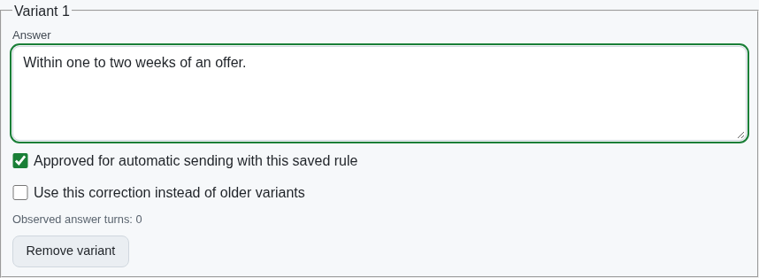
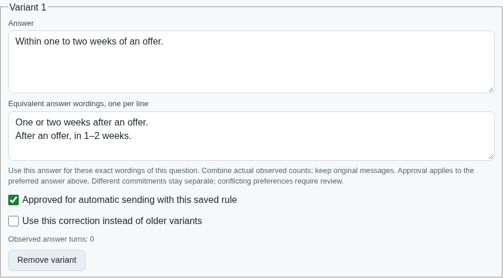
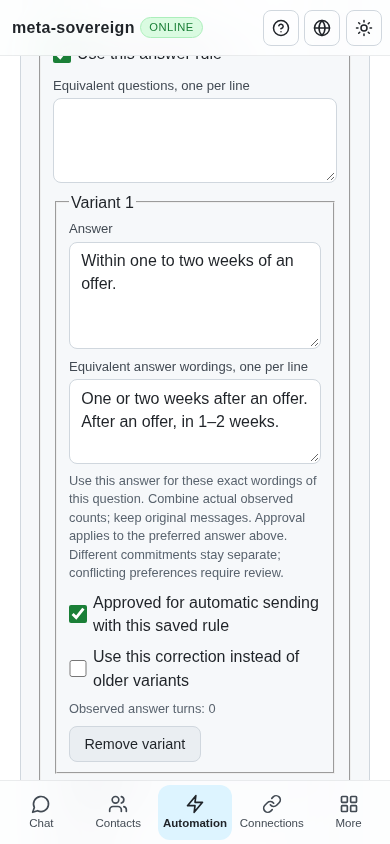

# Explicit question-scoped answer wording

The pinned [approved-wording tests](https://github.com/konard/hh-job-application-automation/blob/fa0991b8c2d0896fb3b4be6c69947f0590094b15/tests/answer-preferences.test.mjs) require declared equivalent spellings to reuse the preferred answer with actual observation counts, preserve different commitments and unrelated questions, reload owner edits and leave raw history unchanged. Behavior was studied without copying or running reference code.

## Reproduction and implementation

On published parent `244e6da5`, save a zero-use preferred answer with two declared equivalent spellings, with two and three actual observed uses. The shared planner returns the preferred text with zero uses, because normalization drops the declarations. Four finite cases in `question-answer-equivalents.test.js` fail on missing counts, missing conflict review and missing validation. Both the original baseline and a repeat using the exact prior planner/normalizer module preserve those four failures. The finite module hook retains current dependencies; it is not a whole-parent checkout.

Each preferred answer now accepts bounded literal `equivalents`. Exact matches combine eligible observed counts across learned rules for the same question; template and approximate matches keep their rule boundary. Different commitments and unrelated or ineligible provider/chat scopes remain distinct. No alias is inferred. Approval belongs to the preferred answer; an unapproved declaration remains review-only. Canonical corrections admit only their declared spellings, and rejection policy still excludes rejected text.

Declarations cannot form ambiguous chains or exceed the finite per-rule limits. Conflicting preferences across rules and overlapping observation evidence require review instead of silently summing counts. Safe integer checks and bounded evidence remain in place. Default-off content-free question tracing records only rule identifiers and counts. Raw rules and messages are not rewritten by planning; repeated real archived learning retains actual counts.

The localized shared editor exposes the list with the preferred answer, preserves drafts on refusal and reloads the acknowledged saved value. CLI supports one literal flag or multiple spellings through an edited Lino/JSON rule file. Both Lino encodings and offline acknowledgements use the same normalization. Migration 0024 validates explicit declarations while leaving old records, approval, counts and messages untouched. The native schema stays aligned. See the [user guide](../../QUESTIONNAIRES.md#preferred-answer-wording).

## Verification boundary

Sixty-eight distinct focused portable checks pass: the ten new planner, CLI,
offline, HTTP, learning and migration cases plus existing correction, policy,
strict-choice, period, registry and locale coverage. After extracting the conflict
check for the unchanged complexity limit, seventeen affected checks pass again.
The native browser scenario is mandatory in the shared questions CI group. The
local run selects only that scenario on installed Chrome; it verifies five actual
uses, acknowledged preference saving, unchanged raw variants, failed-save draft
preservation, reload and compact layout. The screenshots below were validated
as PNGs and visually inspected.

Independent Playwright MCP verifies edited preferred wording across save/reload,
five-use previews, refusal recovery and compact layout in a separate production
fixture. The initial error mock used a mismatched JSON wire response and timed
out on its expected wording; a subsequent invocation wrapper had a syntax error.
Both attempts are retained as fixture failures, not production regressions. The
correctly encoded Lino mock passes every semantic check. The browser and every
owned fixture have been closed. Its console preserves a favicon 404, a browser
cache-write failure and the expected mocked 500; no clean-console claim is made.

The [evidence archive](data/question-answer-equivalents.tar.gz) and
[hash manifest](data/question-answer-equivalents.tar.sha256.json) retain the original
failures, exact prior module, current source hashes, reference Git bytes and
portable/native/MCP results. Full runtime/browser matrices and exact-head CI
remain required. This correction alone does not accept QA11 or any other inventory
row. Standalone worker configuration, irrelevant-answer filtering and all other
original contracts remain subject to their complete acceptance mapping. PR57
stays draft and every unchecked criterion remains required.

Before, the existing answer editor had no equivalent-wording field:

The shared editor now saves explicit equivalent spellings with the preferred answer:

