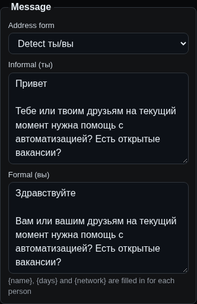
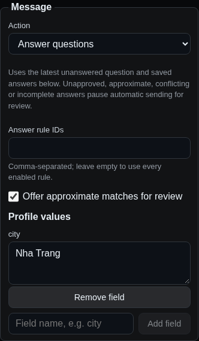
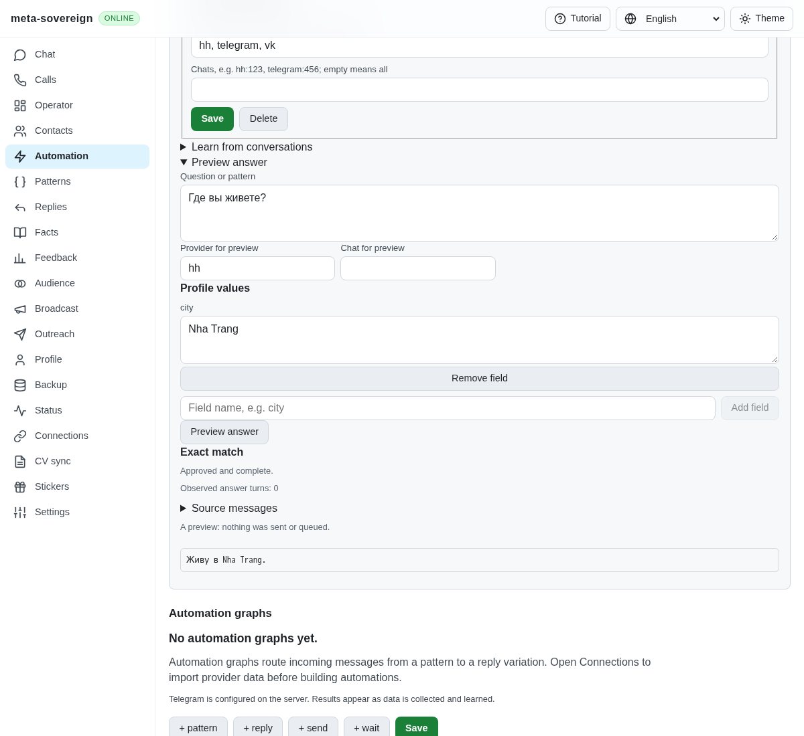
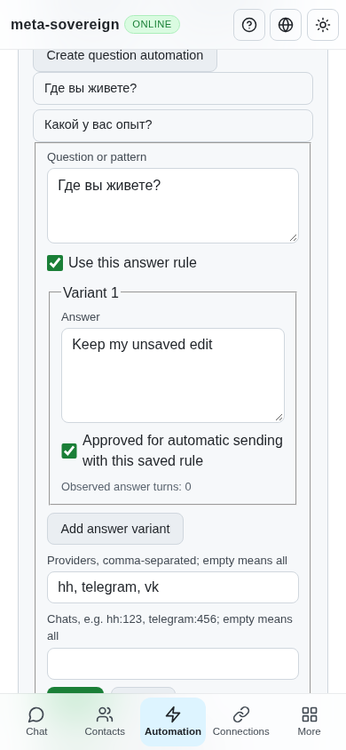

# Shared question and answer automation

Issue [56](https://github.com/link-foundation/meta-sovereign/issues/56) requires the HH reference's configurable answering behavior in every chat. This step adds the shared knowledge, planning and delivery foundation. The [reference inventory](reference-feature-inventory.md) tracks the remaining contextual answers, forms and provider workflows; this step does not complete their parity.

## Reproduction and root cause

Previously, saving an automation with `action.kind: answer-questions` failed with `unknown action "answer-questions"; known: send-template`. The existing learned-reply suggestions and generic templates had no shared persisted answer approval, frequency, profile substitution or question-specific delivery identity. `data/question-answers.tar.gz` preserves the failing regression and passing checks.

The production Automation screen now has **Questions and answers** controls. Save a question such as `Где вы живете?` with answer `Живу в {{city}}.` and approve the rule explicitly. Previewing with no city keeps the unresolved placeholder and requires review. Adding profile field `city` with value `Nha Trang` produces an approved, complete exact answer. Previewing never queues or sends. Creating a question automation opens the common editor with manual chat-menu triggering and draft mode; automatic sending requires the owner's existing automation controls.

## Implementation and boundaries

`qa-rule:` records contain question patterns, independently approved answer variants, observed turn counts, source-message provenance, provider/chat scopes and an enabled flag. Manual entries start with count zero. Exact matches precede explicitly saved bounded templates, then approximate suggestions. Case/Unicode normalization preserves meaningful language and currency distinctions such as C++, C#, .NET and currency symbols. Templates support ordered words, word suffix `*` and bounded `…`/`...` gaps; new questions, links and unrelated invitations/assignments are rejected. They are data, never executable regular expressions. Approximate, conflicting, assembled and incomplete answers always require review.

Learning uses actual owner identity or explicit outgoing flags. It joins consecutive delivered owner bubbles, counts turns rather than bubbles, deduplicates actual message IDs and retains provenance. Unknown timestamps, missing/deleted/service messages, another incoming turn, owner questions and failed/pending delivery form barriers. Private invite/access URLs and unresolved placeholders are excluded. Whole numbered question/answer pairs remain available; components are learned only from sequentially aligned lists. Learning previews are read-only; applying proposals never grants approval or inflates counts merely because the same window is processed again. Coverage reports disclose the bounded recent-history window; full-archive cumulative frequency remains unfinished.

The common runner uses the existing pacing, typing, caps, delivery uncertainty and outbox. The actual incoming message ID belongs to confirmation and deduplication. Immediately after typing and before claiming the outbox, delivery rechecks the latest turn and current saved rules. A newer/edited question, owner reply, service barrier, revoked approval or changed answer stops automatic delivery. Failure diagnostics use the existing opt-in logger and record IDs/codes without message bodies. Reviewed drafts still require the original current turn. Chat and Operator share the same match, review and provenance display; owner edits are retained, and provider failures remain failures.

## CLI, API and UI

The normal `automations` CLI exposes `answers list`, `answers save [file.lino]`, `answers delete <id>`, `answers plan --question=<text>` and `answers learn [--apply]`. For example:

```sh
meta-sovereign automations answers save --id=location --question='Где вы живете?' --answer='Живу в {{city}}.' --approved --sources=hh,telegram,vk
meta-sovereign automations answers plan --question='Где вы живете?' --source=hh --profile='(city "Nha Trang")'
meta-sovereign automations answers learn --self=me
```

CLI output uses Links Notation by default; `--json` is explicit compatibility. Structured rule files use the production Lino decoder, with `.json` input explicit. Planning accepts `--rule-ids` to restrict the saved rule set.

The production default Lino API provides `GET /api/automations/answers`, `PUT /api/automations/answers` (or `POST .../save`), `POST .../plan`, `POST .../learn`, and `DELETE .../:id` (or `POST .../delete`). Both text and binary transports use the same functions as the CLI and offline UI. Invalid profiles/rules are rejected before mutation. The UI includes variants, counts, approval, scopes, profile fields, learning preview/apply and deletion. Failed remote saves retain the edit and show the actual error instead of silently writing a local replacement.

## Verification and visual evidence

Seventeen focused cases in `question-automation.test.js` and `question-controls.test.js` cover planning across HH/Telegram/VK/email/WhatsApp, bounded matching, learning barriers and alignment, approvals, actual-turn deduplication, typing races, CLI/offline UI parity and real text/binary default-Lino routes. Sixty existing focused automation, planning, query-cost, editor and localization cases pass after the shared delivery refactor. The isolated production-page `e2e-questions-browser.mjs` passes in Chromium: persist/reload, missing profile review, actual learning, saved action/profile, refused save/edit preservation and mobile width. It is registered for both existing CI browser jobs; no full local browser matrix was run. Playwright MCP separately exercised the rendered controls. Fixtures use isolated memory stores and no provider sends.

Before: the action editor exposed only generic templates. After: a shared question action uses selected rules and editable profile fields.

| Before                                                                   | After                                                                                 |
| ------------------------------------------------------------------------ | ------------------------------------------------------------------------------------- |
|  |  |





[Answer policy and summary handling](question-policy.md) now add explicit corrections/aliases, rejected wording, optional punctuation equivalence and bounded zero-count summary facts. Advanced salary/context rules, optional local-model drafts, generic external forms and provider-specific bot/button/closed-chat execution remain explicit required work in the inventory. Existing provider capabilities are not expanded by a successful pure planner fixture.
