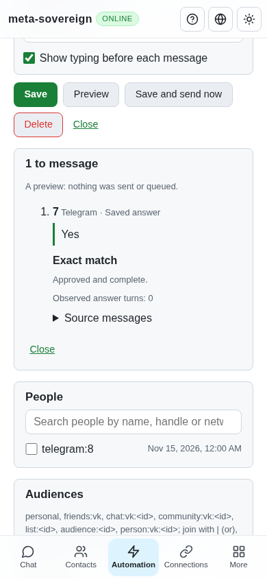
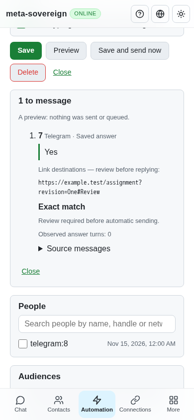

# Structured Telegram question destinations

Issue [#56](https://github.com/link-foundation/meta-sovereign/issues/56),
PR [#57](https://github.com/link-foundation/meta-sovereign/pull/57), 2026-11-15.

The exact published parent `d34db92c` loses destinations in four finite inputs:
Bot API text, caption entities, stored MTProto messages and actual Desktop-export
imports. An approved `Do you have experience?` → `Yes` rule is marked complete
although `experience` points to a separate assignment URL. Replacing only that
URL leaves the frozen draft valid. The actual native UI labels this draft
“Approved and complete.” Both before captures use the parent's production code.

Three boundaries cause the loss. Desktop imports flatten rich text and omit its
destination. Ordinary stored-message planning deliberately removes raw provider
records before reading question metadata. The final history projection also
omits raw entities, so the frozen identity cannot detect a destination-only edit.
The native anchor correction covers normalized `links`, which none of these
paths previously supplied.

Telegram's primary specifications distinguish the visible label from its URL:
[Bot API MessageEntity](https://core.telegram.org/bots/api#messageentity) and
[MTProto messageEntityTextUrl](https://core.telegram.org/constructor/messageEntityTextUrl).
Both define offsets and lengths in UTF-16 code units. JavaScript string indices
use the same units; offsets inside a surrogate pair are rejected. The repository's
existing Desktop export adapter supplies the rich-text segment reference.

## Correction and limits

Extract only bounded destination metadata before discarding raw records. Keep
full destination bytes, order and repetitions without rewriting the question,
normalizing URLs, following them or copying raw media into planning/history.
Desktop imports retain this metadata. All shared stored-message plans and the
final send check bind it into the existing frozen turn. Missing identity on a
legacy reviewed draft requires a fresh plan when destinations are present.

Invalid ranges, overlapping links, malformed URLs, stale source text, conflicting
normalized metadata and disagreeing export segments refuse the question turn.
The limit is 128 source entries and the existing 20 destinations, 2,000 characters
per target and 6,000 total. An invalid imported destination remains `links: null`
so import preserves the visible message while subsequent planning refuses it.
Existing default-off `META_SOVEREIGN_QUESTION_DEBUG=1` reports the refusal code
and message identifier without message text or destination payloads.

Hidden destinations require review through the existing shared answer planner.
Literal destinations appear in foreground CLI output and the common answer
evidence used by previews, Chat and Operator. Native pending-turn review reuses
the same component and four existing translations. Ordinary approved questions
still deliver exactly once through the injected sender. Explicitly confirmed
linked drafts also deliver once through the existing reviewed-draft action;
the automatic-delivery action keeps requiring review.

## Reproduction and verification

All commands use disposable stores, local servers on ephemeral ports and injected
senders; no authenticated provider or running user server is involved.

```sh
node experiments/issue-56/question-api-links.mjs
node --test --test-concurrency=1 js/tests/question-api-links.test.js
deno test --allow-all --no-check js/tests/question-api-links.test.js
```

- The parent source comparison in `question-api-links-parent.py` restores every
  edited source in `finally`. Five of seven integrated regressions fail on the
  exact parent. Two new extraction-only checks pass independently.
- Seven focused Node and Deno checks pass after correction. They cover all four
  input shapes, target-only edits after review, UTF-16/order/repetition, malformed
  metadata refusal, legacy identity, automatic-send refusal, the ordinary positive
  receipt, a confirmed linked-draft receipt with replay refusal, foreground CLI
  and both Lino encodings. The initial focused compatibility
  run passes 39 checks including native hidden-link, template and Bot API cases.
- One isolated native Chromium scenario captures actual parent/current production
  previews at desktop and phone widths, with zero sends and page exceptions.
  It is the fourth mandatory scenario in the existing question-template CI group;
  the focused registration contract passes without changing engine budgets.
- Independent Playwright MCP checks literal destinations and translated labels in
  English, Russian, Hindi and Chinese, phone wrapping, no destination requests and
  no preview replay after reload. Its owned server reports zero sends and drained
  resources; the MCP page is closed. Console evidence retains a favicon 404 and
  four `ERR_CACHE_WRITE_FAILURE` diagnostics in the first session; the final
  repeated session retains four cache diagnostics. No clean-console claim is made.

The extra reviewed-delivery check initially called the automatic-delivery method,
which correctly refuses linked questions. Using the existing confirmed-draft
action verifies the positive receipt without changing production delivery policy.
Its failed draft log is retained. The initial duplication check hit the unchanged
6.5% gate; reusing fixture seeding and viewport assertions brings it to 6.49%.




The [checked evidence](data/question-api-links.tar.gz) and
[SHA-256 manifest](data/question-api-links.tar.sha256.json) retain parent/current
sources, bounded probes, complete focused logs, native/MCP evidence and screenshots.
Full runtime/browser matrices remain in hosted CI. Exact-head checks remain
required. This unit addresses structured Telegram metadata only: QA04's advanced
context and remaining provider cases, every other original incomplete criterion,
and issue 56 remain unfinished. PR57 stays draft and unmerged.
