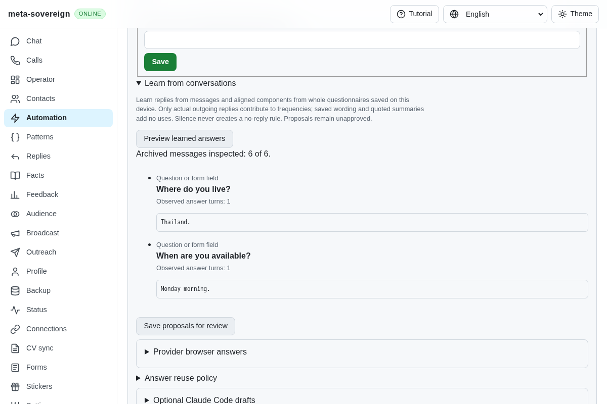
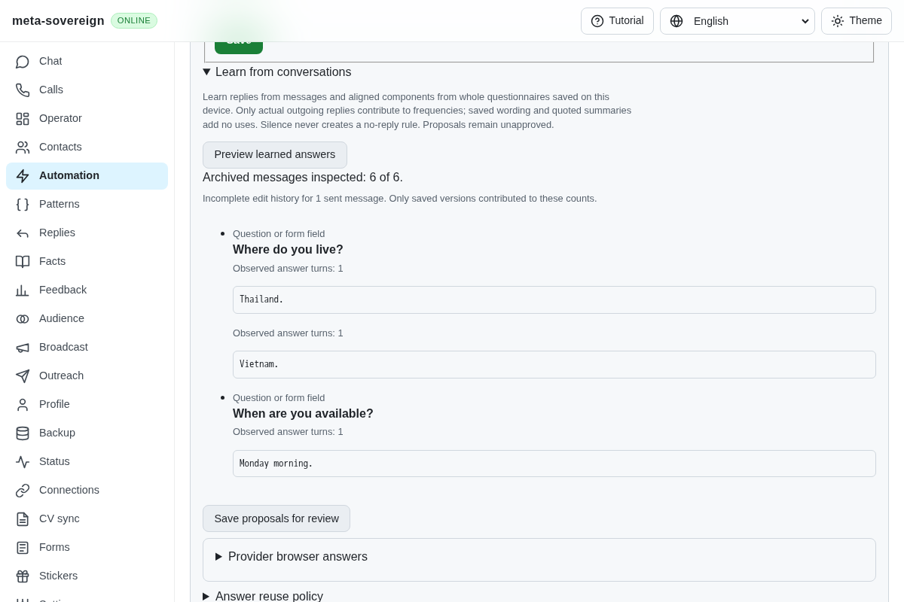

# Count earlier versions of sent answers

The reference learner counts each distinct earlier wording of an actual sent reply once while leaving unrelated reply frequencies unchanged. Owner corrections apply to edited wording as well as current messages. At `05366339`, our immutable message store retained the previous body, but the archive learner read only the newest body. Both the shared CLI and production Questions view omitted the earlier observed answer. [Pinned frequency contract](https://github.com/konard/hh-job-application-automation/blob/fa0991b8c2d0896fb3b4be6c69947f0590094b15/src/chat-answers.mjs#L941-L972) · [Pinned correction policy](https://github.com/konard/hh-job-application-automation/blob/fa0991b8c2d0896fb3b4be6c69947f0590094b15/src/chat-learning.mjs#L21-L53).

The shared archive learner reads the bounded immutable chain for each eligible outgoing message. It replays one previous version at a time through the same turn reader, preserving the real adjacent bubbles, reply target and privacy barriers. A repeated wording or replay of the same archive does not add another count. The proposal retains the current message IDs and, when it fits the existing evidence limit, the corresponding revision ID. Explicit corrections, approval, private links, failed or uncertain delivery, service notices and deleted messages follow the existing policies.

The archive keeps each message's original chronological position. It reads at most 128 versions of one message, 4,096 versions per operation and 8 MiB of projected historical content. Over-capacity input refuses before applying proposals. First-seen edits and known missing chain entries contribute the available evidence and show an incomplete edit-history count. The shared UI reports partial edit coverage in all four languages. No unavailable version is reconstructed from a summary or downloaded from the provider.

## Reproduce and verify

Import the synthetic HH archive with the confirmed answer `Vietnam.`, then re-import the same message ID edited to `Thailand.`. Open **Automations**, expand **Learn from conversations** and choose **Preview learned answers**. The published production build lists only `Thailand.`. The revised build lists both wordings with one observed answer turn each, and a separate first-seen edit displays the incomplete history notice. No preview writes a rule.

```sh
node --max-old-space-size=384 --test --test-concurrency=1 js/tests/question-archive-revisions.test.js js/tests/question-archive-controls.test.js js/tests/hh-history.test.js
RUN_BROWSER_E2E=1 E2E_EXECUTABLE_PATH=/usr/bin/google-chrome HH_HISTORY_REVISIONS_ONLY=1 node --max-old-space-size=384 experiments/issue-56/hh-history-browser.mjs
```

Six focused regressions and the browser assertion fail on the actual parent sources and bundle. Node and Deno each pass 66 checks on the corrected source, including consecutive replies, an edit to a counterquestion, incomplete and concurrently removed chains, capacity, provenance, owner corrections and private links. The CLI, offline client and text and binary Lino endpoints return the same counts. Production Chromium passes the original and revised HH scenarios from the hosted Questions sequence. Independent Playwright MCP confirms the two counts and incomplete notice at 390 pixels with zero page exceptions and zero saved proposals. Its isolated fixture reports a favicon 404 and closes after the test.





[Evidence archive](data/question-archive-revisions.tar.gz) · [Entry hashes](data/question-archive-revisions.tar.sha256.json). QA02 and QA06 require full authenticated provider history and parity in [PR 57](https://github.com/link-foundation/meta-sovereign/pull/57).
