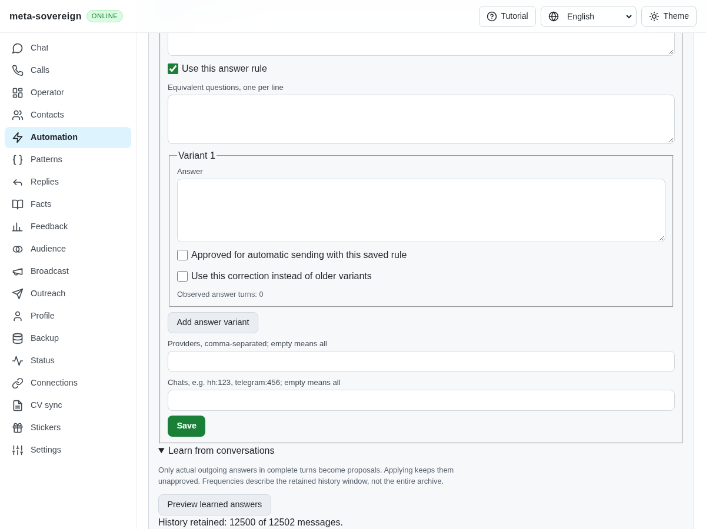
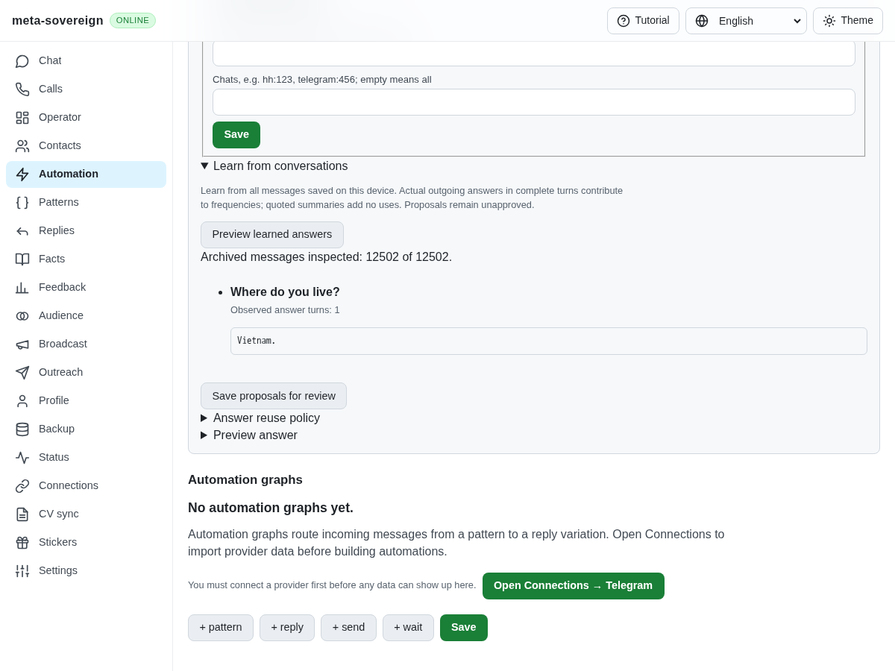
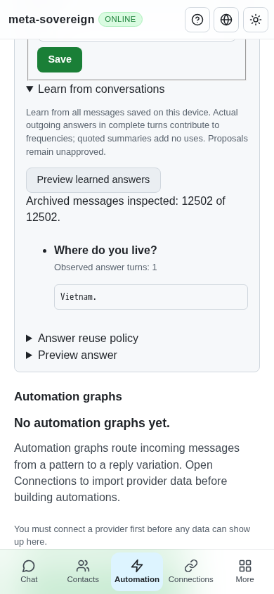

# Learning across the stored archive

The former learner reused delivery's recent-history window: at most 12,500 messages and 8 MiB of selected text. This was suitable for recent reply context but discarded older answered questions when learning reusable rules. A finite fixture stores one answered question followed by 12,500 unrelated notices. Before the fix the learner inspects 12,500 of 12,502 records and proposes no answer; afterward it inspects all 12,502 and proposes `Vietnam.` for `Where do you live?`, with one observed use.

Production stores now scan message identifiers, chat identifiers and timestamps into a bounded metadata index. They sort each chat chronologically and project one message body at a time into a streaming turn learner. They do not copy provider payloads or an entire conversation into the learner. The compatibility path for third-party stores that expose only `query()` still materializes that query. The metadata estimate has a 64 MiB limit; learned proposals have an 8 MiB estimate, 1,000-rule and 100-variant limits. Exceeding a limit raises an explicit error before applying proposals, rather than reporting a partial sample as the archive.

Actual completed outgoing turns contribute to frequencies. Joined answer bubbles count as one turn; questionnaire summaries still add zero uses. The evidence display retains at most 100 unique message identifiers without limiting the observed count. Repeating learning does not increment counts by itself or remove prior approvals/canonical corrections. A chat with unreliable chronology is excluded in full and shown as incomplete coverage. Message writes detected while reading or preparing proposals abort before applying; this guard is not a transaction across later asynchronous rule writes. Preview is read-only, applying proposals leaves new answers unapproved, and neither operation sends messages. This covers messages already saved on the device; it does not download missing provider history or implement historical message-version learning.

The shared CLI, offline application, and text/binary Lino API all use the same implementation. The four UI languages describe actual archive coverage, and learned proposals display observed answer frequency before saving. `node examples/question-archive-learning.mjs` demonstrates offline learning across two providers and a repeat application without count inflation. `node experiments/issue-56/question-archive-ui.mjs` starts an isolated screenshot fixture. Setting `QUESTION_ARCHIVE_BEFORE=862af4ba` replays the former learner and bundle from that revision, without modifying production files.

Verification includes the failing-before archive-window and concurrent-edit cases, 40 passing focused learning/policy/substitution/UI checks, and nine final archive/control checks including saved-rule capacity. The control regression exercises CLI, offline UI and both Lino encodings against an actual isolated server. Existing browser-store projection checks, changed-code lint, formatting, the production bundle build and the production Chromium question flow pass. Independent Playwright MCP confirms the 12,502-record comparison, one observed use, saving unapproved proposals and a 390-pixel mobile viewport without horizontal overflow. Browser and fixture processes are closed. Raw logs, actual screenshot observations and verified hashes are preserved in `data/question-archive.tar.gz` and its adjacent manifest. Full runtime and browser matrices remain in CI.

Before: the older answer is outside the retained window.

After: the older answer is offered for review with its observed frequency.

This verifies the shared stored-archive mechanism. Provider history import, historical versions, wider language/form workflows and the remaining requirements in [PR 57](https://github.com/link-foundation/meta-sovereign/pull/57) remain unfinished.
