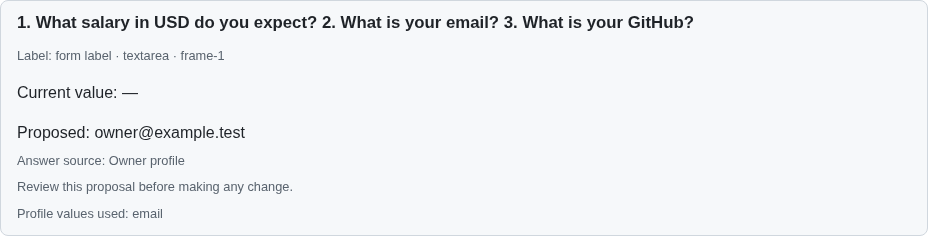
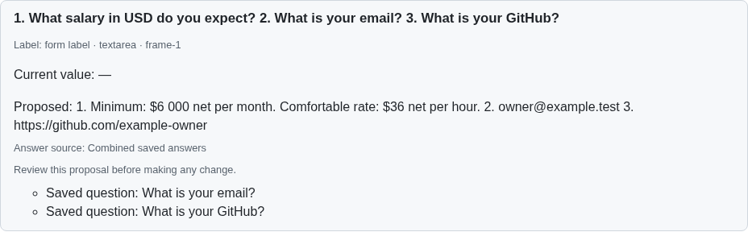
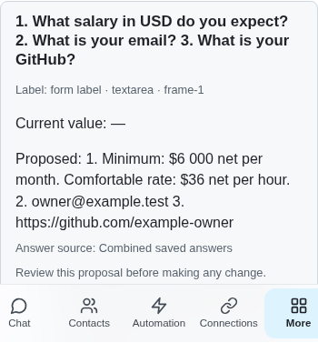

# Salary and contact questionnaire proposals

Work for [issue 56](https://github.com/link-foundation/meta-sovereign/issues/56)
and [PR 57](https://github.com/link-foundation/meta-sovereign/pull/57).
This correction addresses QA10's component context in the shared form planner.
The whole issue remains unfinished and the PR remains draft.

## Reproduction and cause

Save a reviewed owner profile containing a salary and email/GitHub contacts,
and saved component answers using the contact placeholders. Read a form whose
textarea label contains this numbered questionnaire:

```text
1. What salary in USD do you expect?
2. What is your email?
3. What is your GitHub?
```

Select that profile in Forms and plan answers. Published `cb95c654` proposes
only the email, omitting salary and GitHub. The actual browser screenshot
and parent-source unit regression preserve the failure. The first draft test
used an overlong synthetic field ID and was refused during report validation;
that fixture error is retained separately from the valid reproducing test.

There are two causes. Inspection collapses label line breaks, losing the
questionnaire boundaries before planning. The form planner also replaces all
rules with an exact contact template whenever any part mentions a contact.
That artificial whole-label match hides other components and outranks an
owner's saved complete answer. Existing answer reports already expose the
selected match, profile keys, rules and component provenance; these fields
make the deterministic failure observable without logging private answers.

## Correction

Inspection retains authored line breaks and explicit label block/`br`
boundaries within the existing text and traversal bounds. Control subtrees
remain excluded from label extraction. Single-field option and description
normalization is unchanged. The planner applies its contact-field template
only to a single question; questionnaires retain the shared exact-whole or
component assembly path. Each component resolves its own salary currency and
tax basis and current reviewed contact profile. New assemblies remain subject
to review, and missing contacts or ambiguous salary context remain open.

## Verification

Eighteen focused Node checks pass, including fourteen existing form-planning
checks. Four new portable checks also pass in Deno. They cover separate
USD-net/RUB-gross components, five provider contexts, field mode, missing
contacts, ambiguous currencies, profile revision readback, frequency ordering,
exact whole-questionnaire priority and the actual form planner. Previews do
not learn or write messages. The valid parent-source form regression fails
with an exact contact answer where a four-part assembly is required.

The new mandatory browser helper is registered in the existing Forms reader
scenario for both hosted engines. One focused local Chromium run passes:

```sh
RUN_BROWSER_E2E=1 E2E_EXECUTABLE_PATH=/usr/bin/google-chrome FORMS_QUESTIONNAIRE_ONLY=1 NODE_OPTIONS=--max-old-space-size=384 node js/tests/e2e-forms-reader-browser.mjs
```

It inspects actual newline and `br` labels through Browser Commander, then
checks both complete three-part proposals through the production HTTP route
and UI. Both owned controls stay empty; no form interaction or submission is
issued, and the owned browser closes. Independent Playwright MCP repeats the
production read/plan flow against an isolated server, verifies both controls
and phone width, and captures these screenshots. All data is synthetic; no
authenticated provider, model call or live delivery is claimed. The unchanged
favicon 404 is the sole browser console network error; there are no page
exceptions. The browser, fixture servers and contexts close cleanly.

Before:



After:



Phone:



Scoped strict lint, formatting and whitespace checks pass. The
[evidence archive](data/question-assembly-context.tar.gz) and
[verified manifest](data/question-assembly-context.tar.sha256.json) retain the
actual parent source, failing and passing checks, browser receipts and source
hashes. Exact new-head hosted verification remains required before accepting
QA10; the ongoing `cb95c654` matrix precedes this correction.
