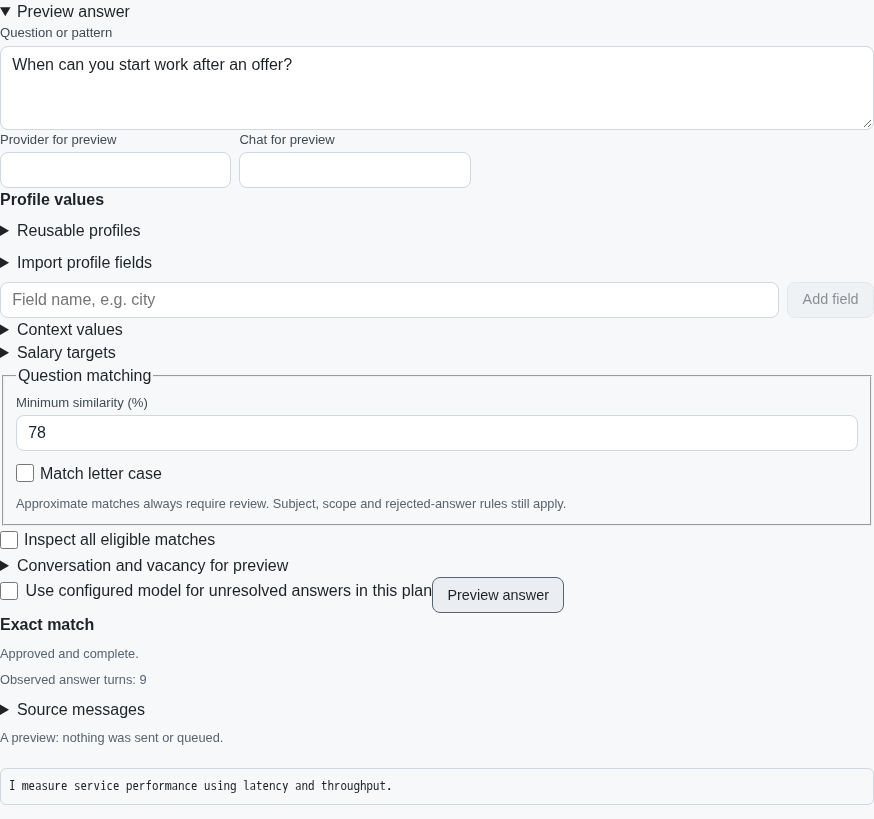
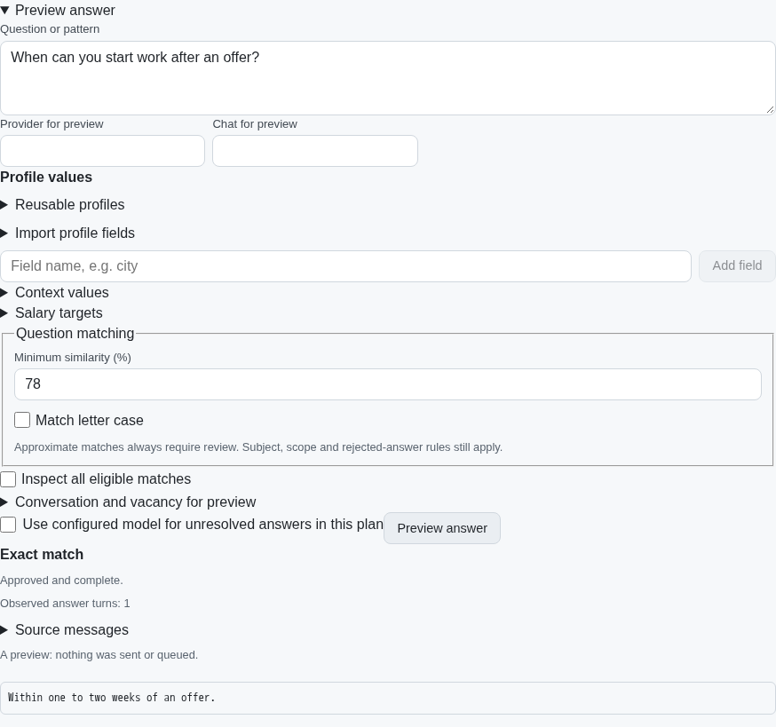
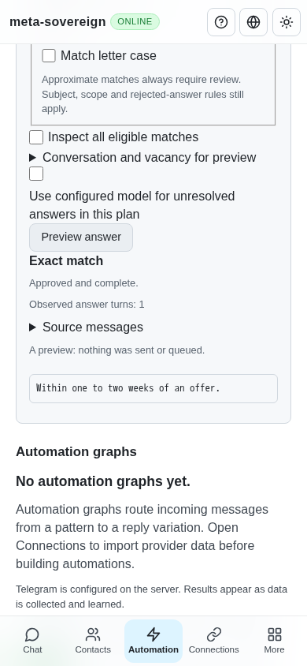

# Work-start timing relevance

The pinned [approved-answer preference tests](https://github.com/konard/hh-job-application-automation/blob/fa0991b8c2d0896fb3b4be6c69947f0590094b15/tests/answer-preferences.test.mjs)
exclude an unrelated performance reply from a work-start timing question while
preserving other commitments, unrelated questions and literal history. The
[reference implementation](https://github.com/konard/hh-job-application-automation/blob/fa0991b8c2d0896fb3b4be6c69947f0590094b15/src/answer-preferences.mjs)
uses a narrow wording check; it does not establish general semantic correctness.
Behavior was studied without copying or running reference code.

## Reproduction and cause

On published parent `7001c9a4`, a saved approved performance reply with nine uses
outranks the actual timing answer with one use. The native preview incorrectly
calls it approved and complete. Four finite regressions fail on the actual
parent and on the exact prior turn-eligibility module with current dependencies:

```sh
node --max-old-space-size=384 --import ./experiments/issue-56/answer-availability-before.mjs --test --test-concurrency=1 js/tests/question-availability.test.js
```

The shared sufficiency check excluded generic affirmative replies to detail
requests, but had no work-start timing guard. Consequently, both planning and
archived learning admitted an unrelated reply. The same four-language bounded
guard now covers those call sites and accepted-summary reuse. It recognizes
explicit work-start timing and numeric/time/conditional wording, preserves
different commitments and allows yes/no for closed timing questions. Office
consent, project duration and performance questions keep their original behavior.
Absent a usable answer, planning remains unanswered for review. Stored answers
and transcripts remain literal; repeated learning retains actual counts.

The first affected-caller run caught a real interaction: filtering an unusable
preferred wording hid its conflicting declaration and removed review. Declaration
conflicts are now checked before sufficiency filtering, using the same scoped
claim validator, while counts project only eligible observations. The existing
conflict regression passes unchanged. Approval is never inferred by this guard.

## Verification and limits

Fifty-four focused checks pass, including the four new multilingual/provider,
commitment, archived-learning and CLI/offline/text-binary Lino cases. Existing
turn, correction, strict-option, accepted-summary and equivalent-wording checks
cover the affected callers. The mandatory questions browser scenario verifies
the actual one-use preview, unrelated-question reuse, reload, unchanged variants
and phone layout on installed Chrome. Full runtime/browser matrices remain on CI.

Independent Playwright MCP verifies the same timing preview and compact layout.
The existing wording probe is also reused with an additional nine-use unrelated
reply: the preferred five-use answer still wins, edited wording survives reload,
and refused saves preserve drafts without false confirmation. Every owned fixture
and browser is closed. One initial manual navigation used an incorrect temporary
port and was refused before the probe; it is not a production failure. Console
logs retain a favicon 404, a browser cache-write failure and the deliberate save
refusal. No clean-console claim or authenticated provider execution is made.

The initial duplication check exceeded the unchanged 6.5% limit despite rounding
to 6.50%. Reusing the existing MCP wording probe removes duplicated setup and the
gate passes at displayed 6.50%; neither its threshold nor exclusions changed.
Scoped strict lint, formatting and the production bundle pass. The
[archive](data/question-availability.tar.gz) and
[manifest](data/question-availability.tar.sha256.json) preserve original failures,
the caught interaction, source hashes, reference Git bytes and successful receipts.

This finite wording check can accept a numeric answer whose topic is wrong and
cannot understand every valid paraphrase. It is not a model or a promise of
general relevance detection. This partial correction alone accepts no inventory
criterion: complete QA11 mapping and exact-source hosted verification remain
required, as do all other unchecked requirements in
[PR #57](https://github.com/link-foundation/meta-sovereign/pull/57).

Before:



After:




