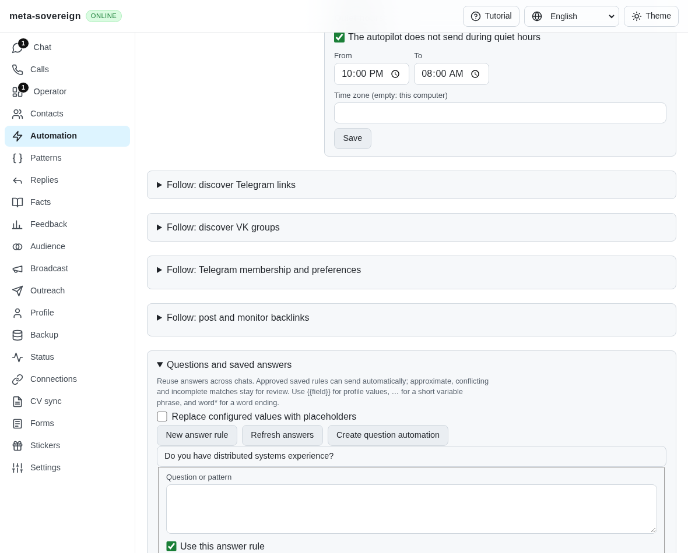
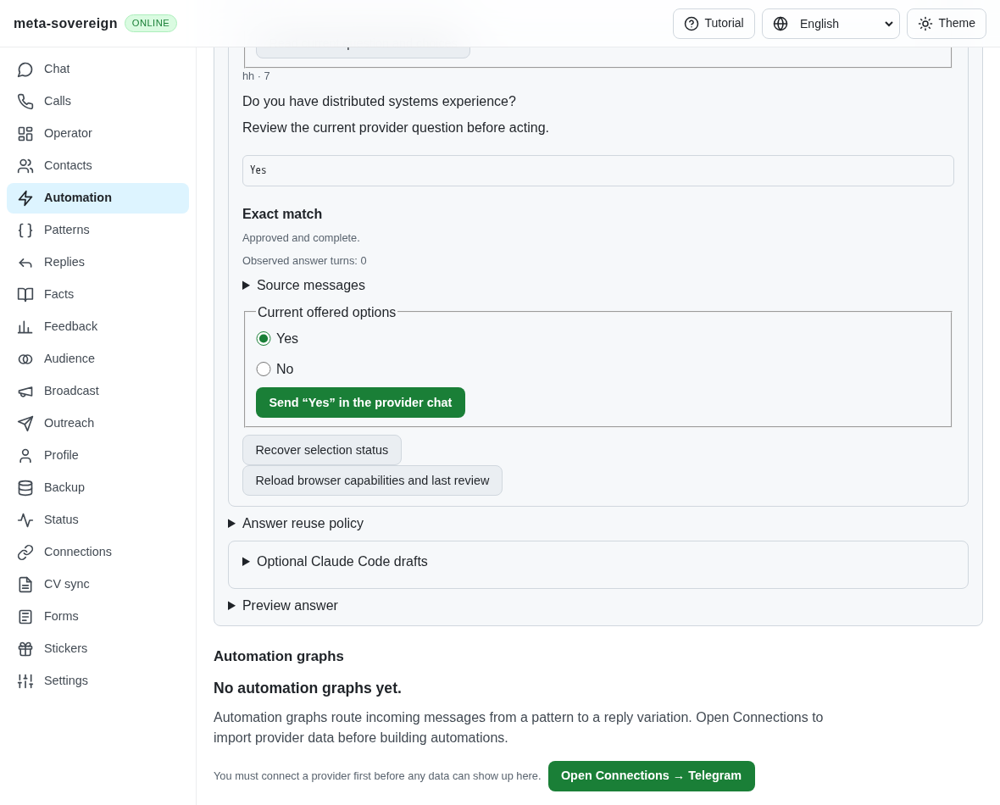
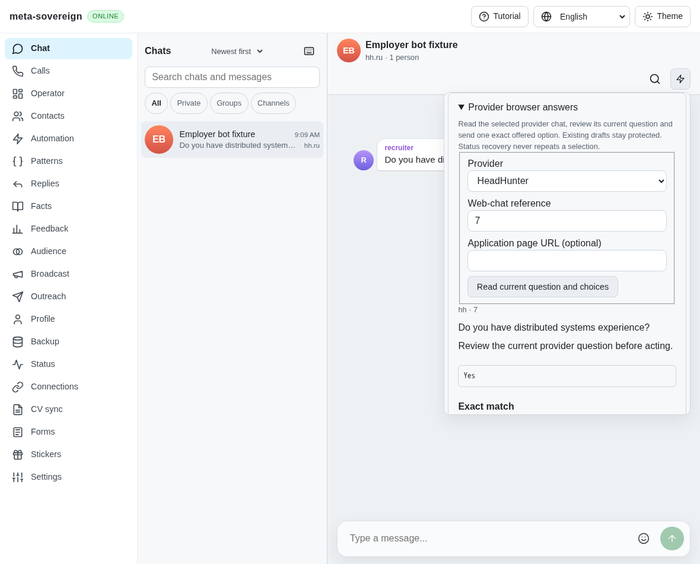
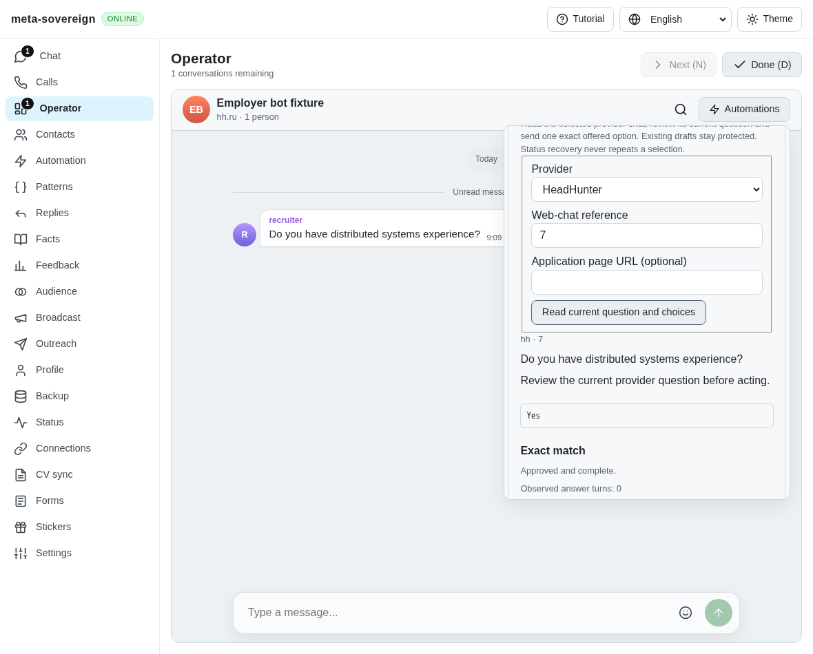
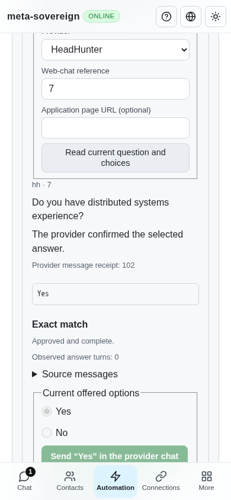

# Shared reviewed browser answers and durable recovery

[PR57](https://github.com/link-foundation/meta-sovereign/pull/57) exposes one question
service through CLI, trusted text/binary Lino and localized Questions, Chat and
Operator controls. QA14 remains partial: completed-summary option recovery,
automatic provider watchers and live provider parity remain unfinished.

## Reproduction and implementation

Parent `9d31e561d0028822654bd9cf220a236d1178f4e4` has guarded browser primitives,
but no reviewed browser command, API route or shared controls. The finite parent
probe restores those five entry files, builds their UI and proves the missing
CLI command, 404 route and absent controls. Every working source and generated
bundle is restored in `finally`.

Inspection reads the actual provider question and choices, ignoring caller
question/options. It plans against the selected profile/context and current
approved knowledge, then privately saves an immutable review for 30 minutes.
Capability discovery does not launch a browser. HH uses explicit numeric web
references or official URLs; no API/web identity mapping is guessed.

A separately confirmed exact offered label uses the production native chooser.
Its frozen question/options, owner-draft and document checks remain in force.
The durable reservation now uses the same question key across manual selection
and every automatic answer owner, independently of selected label or day. An
outgoing message receipt must match provider, chat and exact option. Missing proof
becomes unknown. Read-only recovery restores a saved review/receipt without
opening the browser or repeating a write; actual Lino-store reopen verifies this
for confirmed and uncertain outcomes. Interrupted sends recover as unknown.
Explicit outbox resolution is identified as the owner's decision.

Free-text prefill uses the existing owned empty-input/readback contract and does
not send. Unsupported/offline adapters cannot invent success. Trusted-origin
checks cover all POST actions. HTTP mutations disable read retry, while status
may recover read-only. Shutdown drains accepted actions before releasing browser
ownership. Existing browser/outbox diagnostics stay behind their current opt-ins.

During development, a failing mutation test exposed shallow memory-store aliases:
status now returns detached data. Real browser reload testing also exposed empty
target fields beside a restored review; recovery now restores the target fields.
The visual tests wait for a new review ID before changing the provider, avoiding
a false stale-question scenario caused by inspecting the old review too soon.

## Focused verification

- **78 Node checks pass**, including 15 new service/CLI/Lino/API checks, strict
  option compatibility, four-language parity and existing send-safety contracts.
  The new actual-disk check closes/reopens `.lino` storage and proves no replay.
- **Ten production Chromium cases pass**: exact saved option/positive receipt,
  reload recovery, owner draft, stale question, lost HTTP response, unknown
  receipt across reload, mobile width, free-text prefill, Chat and Operator.
  The helper joins the existing hosted Questions browser job for WebKit too.
- **Independent Playwright MCP passes** desktop review, reload recovery, owner
  protection and mobile receipt; zero page errors and ordinary text sends.
- Scoped lint/format/secret checks pass; lint retains four warnings in existing large functions. The existing duplication gate passes at **6.46%** against its 6.5% threshold.
- The original unit alias failure and browser draft failures are preserved with
  corrected logs. No provider/account or owner application server was used.
  Full runtime/browser matrices remain hosted rather than repeated locally.

Four-language usage: [English](../../QUESTION-BROWSER.md),
[Russian](../../QUESTION-BROWSER.ru.md), [Hindi](../../QUESTION-BROWSER.hi.md),
[Chinese](../../QUESTION-BROWSER.zh.md).

## Visual evidence

The evidence collector preserves parent entry sources, production/test sources,
initial failures, passing logs, CI observations and screenshot hashes in the
[archive](data/question-browser.tar.gz) and
[SHA-256 manifest](data/question-browser.tar.sha256.json). At the last observation,
parent 9d31 passes its completed runtime/Chromium and all auxiliary workflows;
WebKit remains running. Exact new-head CI still needs review. This unit does not
complete issue #56. PR57 remains draft and unmerged.
