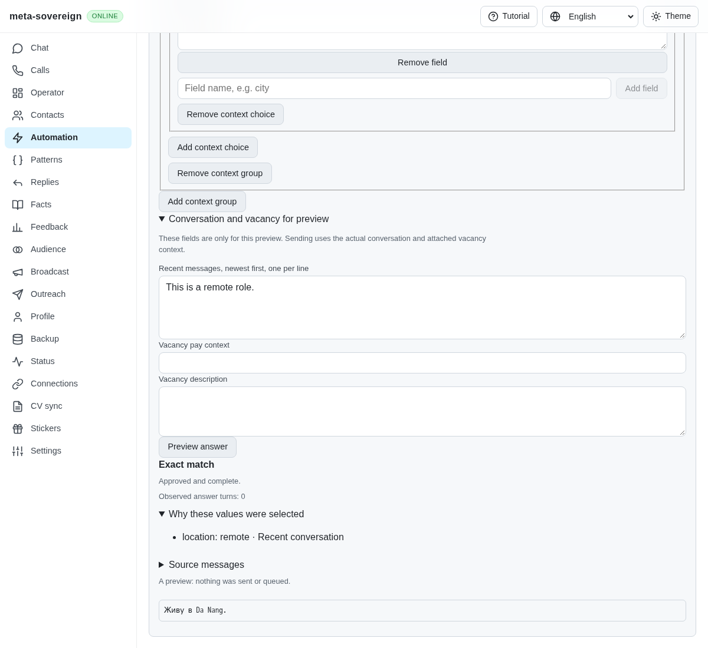
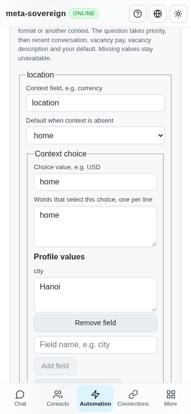

# Configured answer context across providers

Issue [56](https://github.com/link-foundation/meta-sovereign/issues/56) requires the HH reference's contextual answers in every chat. This step adds shared context groups and actual conversation/vacancy evidence to the existing answer action. Typed salary calculations, contact/CV extraction, lazy vacancy lookup and the remaining provider workflows are still required in the [inventory](reference-feature-inventory.md).

## Reproduction and cause

Previously, an approved `What salary …?` answer using `{{salary}}` stayed unresolved even when the action contained currency-specific values. Supplying a base RUB gross value could also answer a USD question with the RUB value. Four new regressions failed before the change; the failure and pass logs are retained in `data/question-context.tar.gz` with verified hashes.

The answer action previously stored only one flat profile. Neither planning nor the final delivery check supplied the actual recent conversation or vacancy metadata to substitution. The same limitation affected every provider using the shared planner.

## Model and resolution

An action can now define up to ten context groups, each with an identifier, an optional configured default and up to ten choices. A choice has its own identifier, literal token-phrase keywords and profile values. This supports owner-defined currencies, work formats or other vocabulary without hard-coded currency conversions. Identifiers, keyword/profile bounds, unique choices, valid defaults, disjoint field ownership and the 128 KiB UTF-8 configuration limit are validated before saving.

For each group the resolver checks the current question, recent conversation, attached vacancy pay, attached vacancy description and then the configured default. A unique explicit question choice wins. Multiple choices in the question or a recent relevant message need clearer context; they cannot silently select the default. Multiple choices in a vacancy field remain unresolved. Token boundaries distinguish USD from USDT. `blockchain` selects USDT only if the owner configures that keyword; unrelated cryptography wording does not infer it.

The resolver clears every field owned by a group before applying its selected choice. An unavailable USD gross field therefore stays missing even if the base profile or another currency supplies gross. A missing or ambiguous value keeps its placeholder and requires review when the answer uses that field. Unrelated answers do not require a currency choice they never use.

Automatic planning derives context from the actual same-provider, same-chat archive: at most twenty recent turns within 24 hours. An unrelated question, ambiguous context or unusable/service/deleted/pending/failed turn stops searching older messages. Invalid timestamps and uncertain delivery do not establish context. HH adapters attach only bounded, sanitized description/pay metadata actually present in that turn's vacancy payload, with a vacancy ID. They perform no invented lookup or scrape. Traces expose the selected choice, source and evidence ID without copying conversation bodies.

The delivery guard rebuilds that bounded context after typing and rereads the saved action, rules and reuse policy. Context edits, removed values, changed/disabled/deleted saved automations and changed vacancy attachments invalidate an automatic send before claiming the outbox. Explicitly reviewed drafts retain the existing current-question check.

## CLI, API and UI

The Automation editor exposes context groups, choices, keywords, defaults and values. The same controls appear in the answer preview; recent messages and vacancy fields entered there are explicitly preview-only. Creating an automation carries the configured groups and base profile into the common editor. Chat and Operator share the context evidence display.

Save structured automation files with `automations save <file.lino>`. Preview a saved action with `automations answers plan --automation=<id> --question=<text>`, or supply a structured preview with `--config=<file.lino>`. The two input flags are mutually exclusive. Input files are bounded to 4 MiB; `.json` remains explicit compatibility. Existing preview overrides remain available and do not silently discard saved configuration.

The existing default text/binary Lino automation save and answer-plan routes use exactly the same normalization and resolver. Invalid updates return a real error without mutating the previous action. The offline UI uses the same implementation. [The runnable example](../../../examples/answer-contexts.mjs) demonstrates currency selection and missing gross values without accessing a provider.

## Verification

Ten context/control cases pass, including all five shared providers, priority/defaults, independent groups, no cross-choice leakage, ambiguous history, bounded Unicode configuration, actual HH metadata, real text/binary API routes, Lino CLI save/preview, offline reads and six changes during typing. The combined focused Q&A/editor/localization check passes all 66 cases with concurrency one. Targeted lint and the production bundle pass.

The isolated production Chromium flow passes context editing, preview evidence, saved action round-tripping, refused saves and mobile width. A separate Playwright MCP check created an office/remote rule through the UI: ambiguity remained missing, and an actual preview vacancy description selected office with visible provenance. The 390-pixel document width was 390 pixels. An initial manual mobile capture contained the tutorial overlay; the committed capture was retaken with the existing fixture's tutorial opt-out. No live user server or provider was used. Full runtime/browser matrices remain in CI.

Before this step, the [existing answer controls](../../screenshots/issue-56-question-policy-after.png) had only a base profile. Afterward, a recent remote-role message selects the configured Da Nang value and displays its source:

This does not yet interpret salary tax/periods, replace stale learned numeric salary text, select salary ranges, infer arbitrary negation or recognize unconfigured currency words. Those require the next typed salary/intent work; the configured literal resolver must not be described as a complete salary engine.
