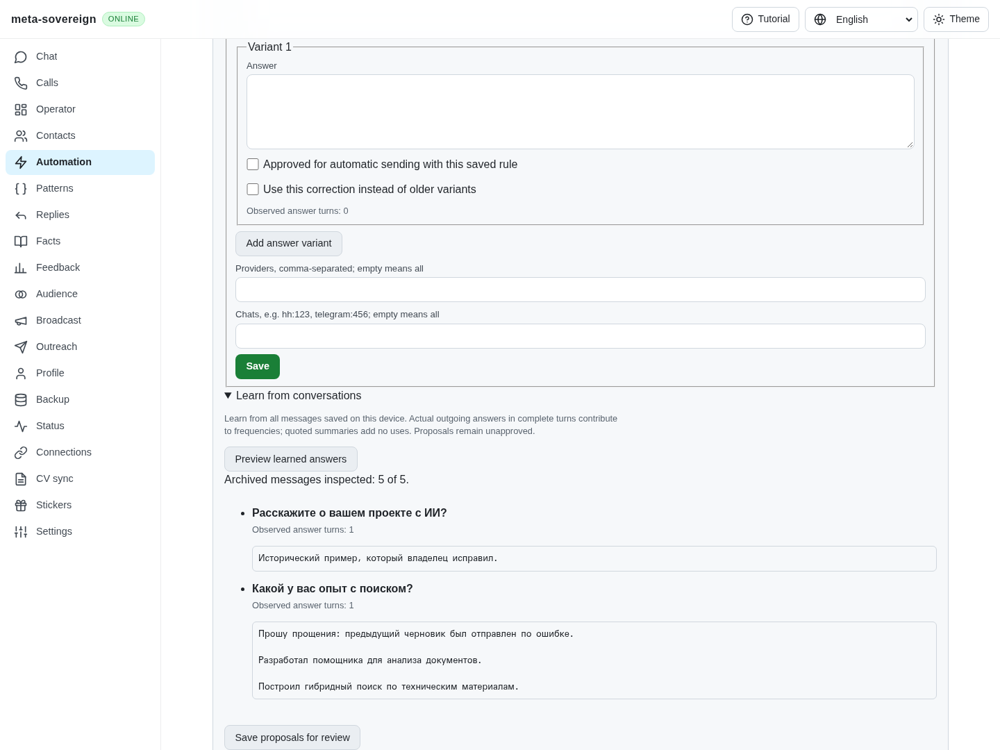
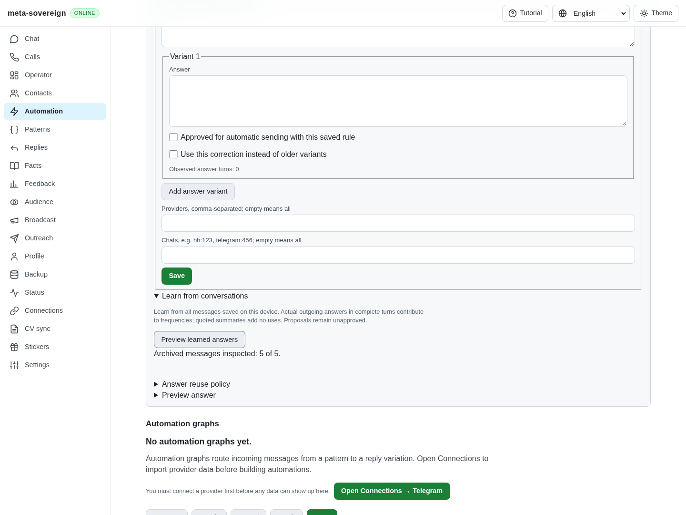
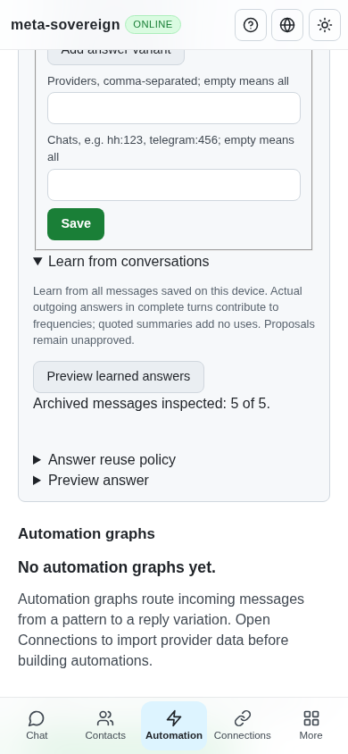

# Preserving owner corrections during answer learning

Work for [issue 56](https://github.com/link-foundation/meta-sovereign/issues/56)
in [PR 57](https://github.com/link-foundation/meta-sovereign/pull/57), covering
the explicit owner-policy path of QA08. General fact extraction and live provider
history imports remain required.

## Reproduction and root cause

Seed `experiments/issue-56/question-corrections-fixture.mjs`, which saves two
clean canonical answers and a historical outgoing message containing a one-off
apology and facts belonging to different questions. Preview Learn from
conversations. At preceding head `dfa1f68d`, the learner does not consult saved
rules, so it proposes the corrected historical wording again. Planning limits
canonical alternatives within a single rule but can still offer historical
wording from another rule ID. Five of the first six regression cases fail.

The shared correction guard now applies eligible explicit canonical answers
across rule IDs during both learning and planning. It respects provider/chat
scope, aliases, enabled state, configured contact contraction, profile expansion
and punctuation policy. Approximate matches cannot suppress unrelated history.
Conflicting explicit corrections still require review. Clean observed answers
retain their actual count; manual corrections and quoted summaries do not gain
invented sends. The original messages and edited versions remain intact.

The owner supplies the clean factual answer. This change does not infer or
extract new facts from arbitrary mixed prose. General QA08 cleanup remains open.
The behavior follows the HH reference requirements at
`fa0991b8c2d0896fb3b4be6c69947f0590094b15`,
`docs/requirements/forms-and-chats.md` lines 99–105, and its chat-learning tests.
Reference behavior was studied without copying code.

A separate regression exposed plain and percent-encoded `/private/` paths that
escaped the existing invite-link filter. Decoded URL paths are now checked;
malformed encodings fail closed. Such links stay in the transcript and cannot
become reusable questions or answers. Public portfolio URLs remain eligible.

## Verification

Seven core and two control cases join the compatibility checks for 47 passes:

```sh
node --test --test-concurrency=1 js/tests/question-corrections.test.js js/tests/question-corrections-controls.test.js js/tests/question-policy.test.js js/tests/question-archive.test.js js/tests/question-substitution.test.js js/tests/question-summary.test.js js/tests/question-lists.test.js
```

The controls cover CLI, offline UI and actual text/binary Lino HTTP requests.
Synthetic stored messages cover HH, Telegram, VK, email and WhatsApp. They verify
common stored-data behavior; live provider imports remain required. Repeated
archive application preserves both canonical rules and edited-message versions.

The CI-registered production Chromium questions flow passes. Independent
Playwright MCP verification compares the preceding production parser/bundle
with this draft in isolated fixtures, with accounts, handlers, scheduler and
sync disabled. Five inspected messages previously produced two incorrect
proposals; the corrected preview produces none. The browser regression also
checks that the clean zero-count canonical rules remain available. Desktop
and 390 × 844 mobile screenshots have been inspected, with no mobile horizontal
overflow. All fixture processes and browsers are closed.

Before:



After:



Mobile:



Scoped strict lint, formatting, secret scanning, whitespace and the production
web build pass. Raw evidence and source hashes are preserved in
[question-corrections.tar.gz](data/question-corrections.tar.gz), with a
[SHA-256 manifest](data/question-corrections.tar.sha256.json).

## CI and remaining requirements

The preceding `86eebd79` Checks run 42790770640 failed in Windows/Deno's first
`store-handoff.test.js` case: `EBUSY: resource busy or locked, rm` (complete log
lines 93461–93464). It reports 4,127 passes and one failure at line 93469; the
aggregate reports `test: failure` at lines 100883–100885. The complete log remains
in `ci-logs/checks-42790770640.log`; a bounded excerpt is archived. Root-cause
investigation and an exact-head passing matrix remain required. Other workflows
for that head pass. This is an actual failure, not a cancelled test claim.

Concurrent knowledge edits during archive learning, general apology/irrelevance
extraction, live imports and every other unchecked requirement in PLAN.md remain
open. PR 57 remains draft and unmerged.
