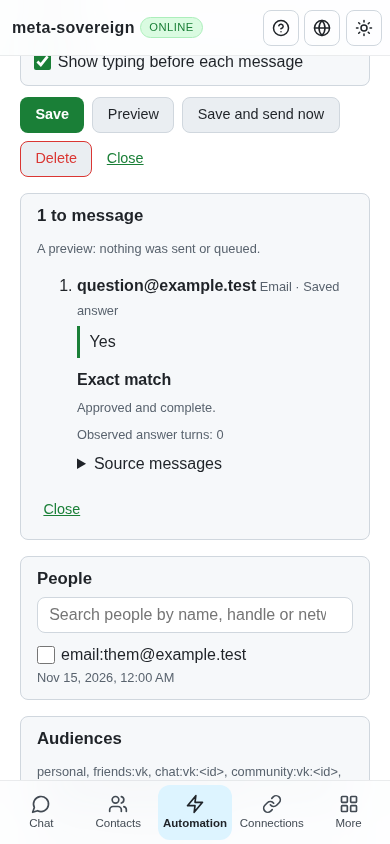
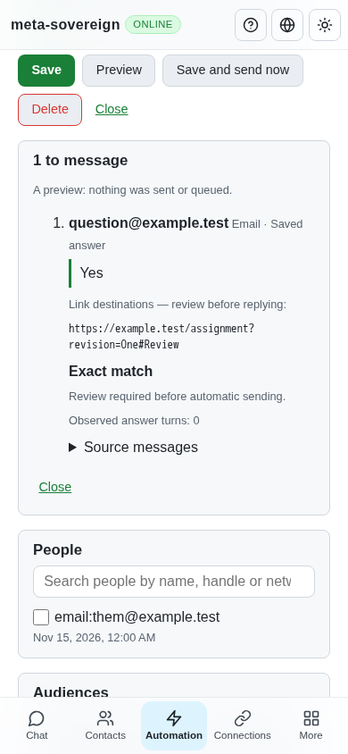

# Email alternative question destinations

Issue [#56](https://github.com/link-foundation/meta-sovereign/issues/56),
PR [#57](https://github.com/link-foundation/meta-sovereign/pull/57), 2026-11-15.

The published parent `7ba65f1e1f511aa307a2765f7c296a3e88cdf851` approves an
ordinary question even when its HTML alternative links the visible word to an
assignment. Four finite inputs reproduce this through the actual RFC 822, Gmail,
JMAP and Microsoft Graph normalizers. MIME, Gmail and JMAP prefer the plain
question while retaining the separate HTML safe tree. Graph's HTML conversion
keeps the visible question and omits its hidden mailto destination. Changing
only the destination leaves the frozen draft valid. The parent native preview
says “Approved and complete.”

The shared source-link extractor only reads Telegram metadata, and the email
record builder drops any normalized destination list. Planning and final history
therefore lose the identity already present in the existing sanitized email tree.
This is an internal projection defect, with no identified upstream defect.
The relevant primary specifications are
[MIME alternatives](https://www.rfc-editor.org/info/rfc2046/),
[JMAP email bodies](https://www.rfc-editor.org/rfc/rfc8621.html) and
[Graph itemBody](https://learn.microsoft.com/en-us/graph/api/resources/itembody?view=graph-rest-1.0).
Plain text alone cannot identify destinations carried by the other representation.

## Correction and limits

Read destinations from the existing safe tree in source order, preserving full
bytes, repetitions, query case and fragments. Retain them through all four
normalizers, shared planning and the final frozen-history check. Existing stored
trees work even when their older importer omitted normalized `links`. The shared
review component already displays these targets literally in CLI, both Lino
encodings and native previews. Destinations are never followed by this operation.

Tree traversal is iterative, with at most 6,000 source nodes and depth 40. The
existing destination limits remain 20 targets, 2,000 characters each and 6,000
total. Unknown link-bearing nodes, malformed children or URLs, conflicting stored
metadata and bounds failures retain `links: null` and refuse the question turn.
The HTML sanitizer marks rewritten or rejected anchor destinations as unverified;
its own depth/node overflow also retains an explicit refusal. Visible mail remains
importable. Existing default-off question diagnostics report identifiers and codes,
without destination or body payloads.

This unit covers complete observed bodies and the parser's own bounds. It does
not establish complete fetching of remotely omitted MIME parts or truncated JMAP
body values. QA04's advanced context and remaining provider cases are unfinished.

## Reproduction and verification

```sh
node experiments/issue-56/question-email-links.mjs
node --test --test-concurrency=1 js/tests/question-email-links.test.js js/tests/question-api-links.test.js
deno test --allow-all --no-check js/tests/question-email-links.test.js js/tests/question-api-links.test.js
```

- All six email regressions fail against the exact published parent. The finite
  parent comparison restores every production source in `finally`; its native
  before capture also uses the parent's actual production bundle. The initial
  Graph fixture used the wrong timestamp field, so that failed setup log remains
  alongside the corrected four-provider reproduction.
- Thirteen focused Node and Deno checks pass: six email cases plus the seven
  existing Telegram cases. They cover all four email input formats, existing
  stored trees, destination-only mutations after review, order/repetition,
  malformed and bounded metadata, literal CLI/Lino evidence and delivery policy.
  Confirmed linked drafts and ordinary visible-link automatic answers each
  deliver once through injected senders; replay is refused.
- Five focused sanitizer/renderer compatibility checks and the single hosted
  registration contract pass. The email scenario is the fourth mandatory entry
  in the existing question-provider browser group; engine budgets are unchanged.
- One isolated native Chromium scenario captures the actual parent/current
  preview at desktop and phone widths, with zero sends and page exceptions.
  Independent Playwright MCP checks English, Russian, Hindi and Chinese labels,
  full literal destinations, phone wrapping and no preview replay on reload.
  It reports zero page exceptions or destination requests. Its owned server
  reports zero sends and closed resources; the MCP page is closed.

MCP console evidence retains a favicon 404 and four `ERR_CACHE_WRITE_FAILURE`
diagnostics. The first scoped lint draft also retained a complexity warning;
sharing node-target validation removes it without weakening the lint gate.
No clean-console claim is made. Full runtime and browser matrices remain in
hosted CI; exact-head hosted verification is still required after publication.




The [checked evidence](data/question-email-links.tar.gz) and
[SHA-256 manifest](data/question-email-links.tar.sha256.json) preserve parent and
current sources, finite probes, focused logs, screenshots and native/MCP results.
This correction does not complete QA04 or issue 56. All 79 unchecked inventory
criteria remain required, and PR57 stays draft and unmerged.
