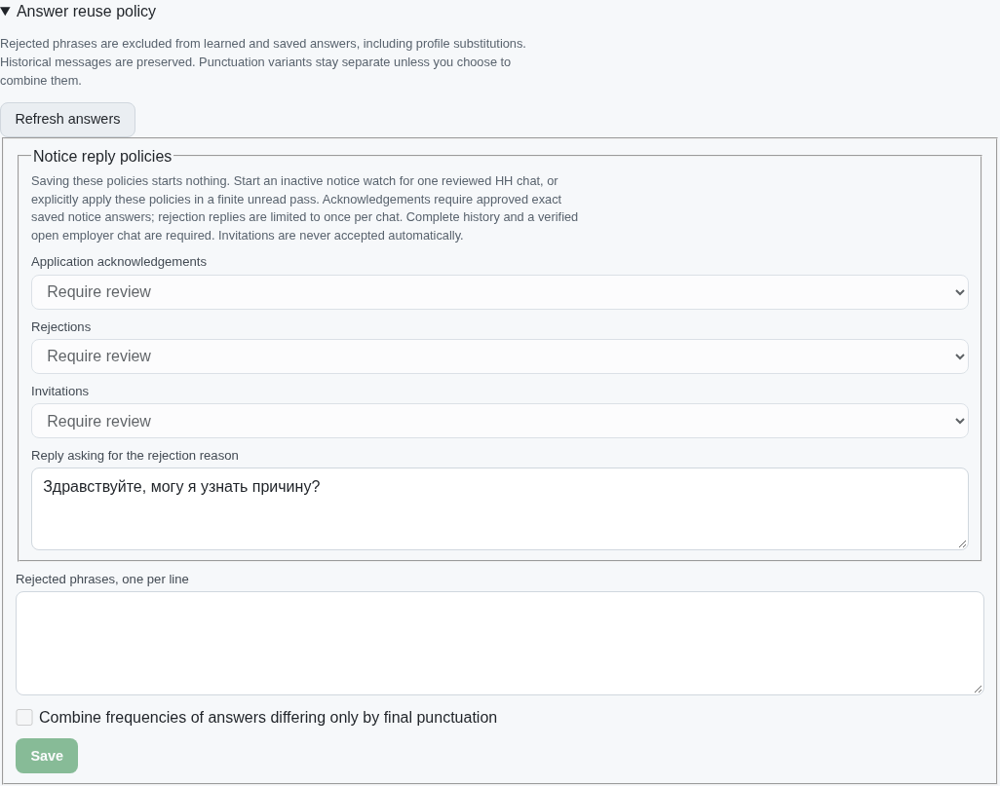
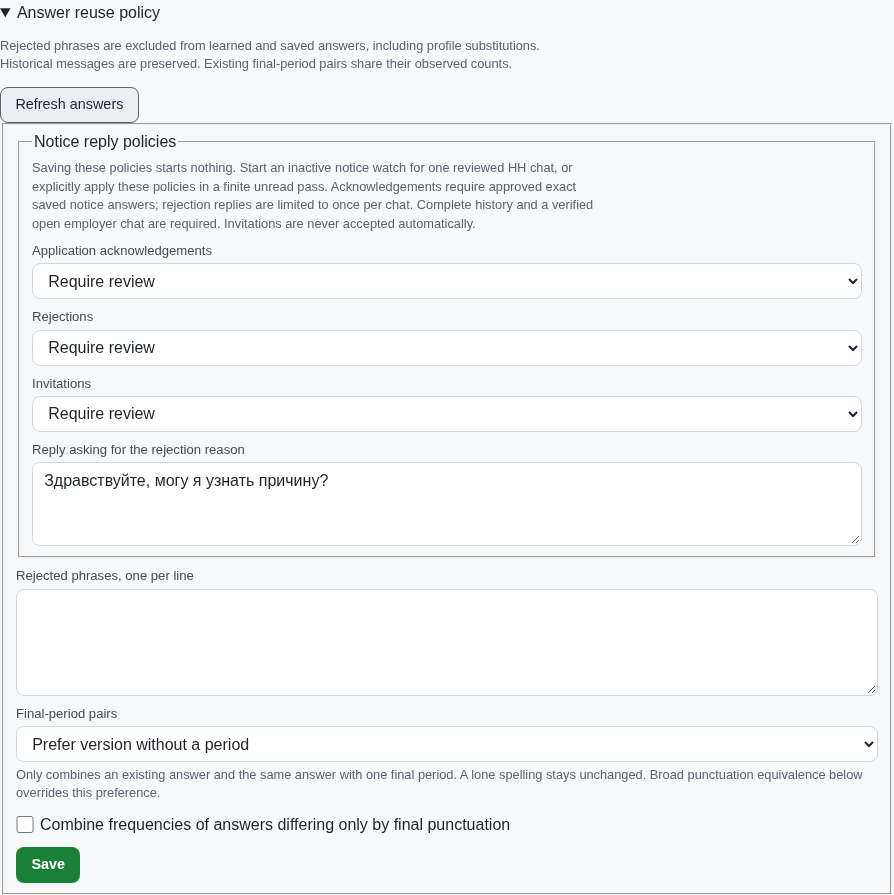
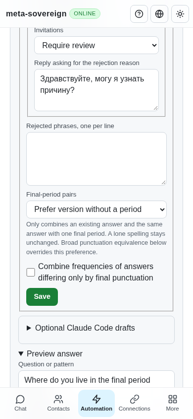

# Observed final-period pairs and saved preference

The [pinned reference tests](https://github.com/konard/hh-job-application-automation/blob/fa0991b8c2d0896fb3b4be6c69947f0590094b15/tests/answer-variants.test.mjs)
require an existing answer/answer-plus-period pair to share actual frequency,
with the period preferred by default regardless of count or order. The
[preference contract](https://github.com/konard/hh-job-application-automation/blob/fa0991b8c2d0896fb3b4be6c69947f0590094b15/tests/answer-preferences.test.mjs)
also permits `without` through CLI, environment and Lino configuration. Only
behavior was studied; no reference implementation was copied or executed.

## Reproduction and cause

Save approved variants `Vietnam` with count four and `Vietnam.` with count one,
then preview their question without broad punctuation equivalence. Before this
change the planner returned `Vietnam` with count four. The finite
`final-period-before.mjs` probe reloads the exact parent policy module and the
current first `question-final-period.test.js` case fails on that spelling: the shared
policy returned all variants unchanged whenever broad equivalence was off.
The retained initial draft log also contains a subsequently corrected test
assumption about unrelated alternatives; that assertion is not evidence of a
production defect.

The shared planner now combines only an actually observed single-final-period
pair within the same rule and approval/correction state. Its default is the
existing spelling with a period; `without` chooses the other observed spelling.
It sums safe counts and unions bounded evidence. Lone spellings, case and other
punctuation remain distinct. Debug events are content-free and disabled unless
`META_SOVEREIGN_QUESTION_DEBUG=1` is explicitly set.

Raw answer variants and transcripts remain unchanged. Repeating real archived
learning preserves the three actual observations and the same stored records;
only the candidate combines those observations. Approval remains independent.
The existing broad punctuation option keeps its separate behavior and takes
precedence when enabled.

## Controls and verification

The shared online/offline policy has an acknowledged with/without selector in
all four languages. Policy loads before editing, refusals retain pending input,
and reload returns the saved preference. CLI and both negotiated Lino transports
use the same policy. Read-only CLI planning supports isolated explicit flag,
environment, selected `.lenv`, working-directory `.lenv`, saved policy and default
precedence, including quoted Lino values. Other commands use saved policy.
See the [user guide](../../QUESTIONNAIRES.md#final-period-preference).

Schema migration `0023-answer-final-period` records the default only in an
existing policy, preserves an explicit `without` and refuses invalid saved
values. It changes no answer counts or approval. The native synchronization
schema remains equal to the registered schema.

Fifty-seven distinct focused portable checks pass across the new planner, controls,
configuration and migration cases plus existing reuse/notice-policy and 25 locale checks. The final seven planner/control cases are rerun after the isolated CLI integration assertion is added.
`question-final-period-controls.test.js` exercises actual CLI output, offline
acknowledgements, text/binary Lino requests and repeat learning. The mandatory
questions browser group now checks default/configured spelling, actual frequency,
persistence, refused-save recovery, unchanged raw records and compact layout.
The local run selects only that scenario on the installed Chrome; full runtime
and browser matrices remain in hosted CI. Playwright MCP independently exercised
the real native controls, save/reload and refusal behavior in an isolated fixture.
The browser and fixture are closed after verification.

Before, the policy offered only broad equivalence:

The shared policy now retains the saved spelling preference:

The [evidence archive](data/question-final-period.tar.gz) and its
[hash manifest](data/question-final-period.tar.sha256.json) preserve reference
bytes, the original failure, focused results, browser receipts and source hashes.
These checks cover the period portion of QA11. Its separately required
question-scoped approved-answer replacement/count contract remains unfinished;
QA11 and all other unchecked criteria remain required in PR57.
