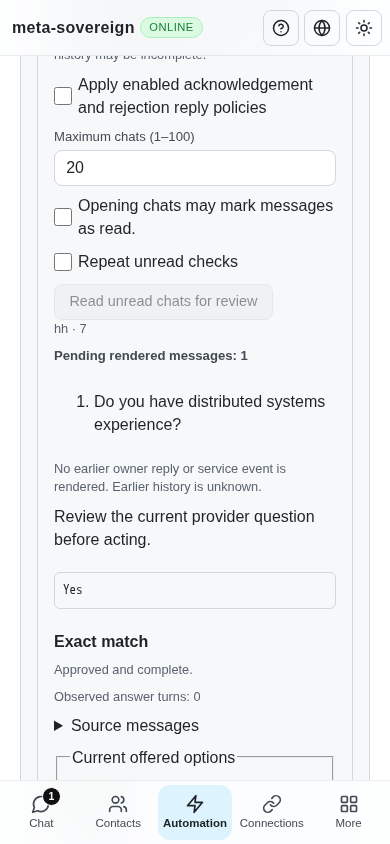
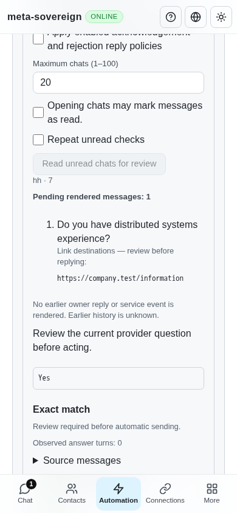
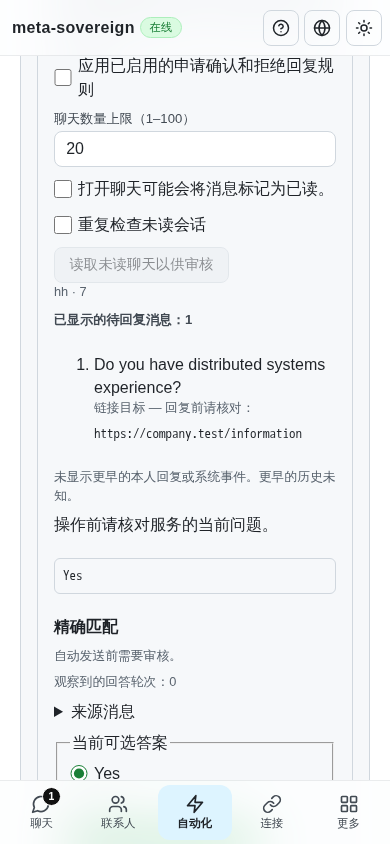

# Native question links retain their destinations

Issue [#56](https://github.com/link-foundation/meta-sovereign/issues/56),
PR [#57](https://github.com/link-foundation/meta-sovereign/pull/57), 2026-11-15.

The published `438f2bf4` question reader captured `innerText` and omitted native
anchor destinations. Changing only an anchor's `href` therefore left the complete
reviewed question unchanged. The saved exact answer remained approved and a
previously reviewed native choice could be dispatched after the destination
changed. This is separate from the preceding [text-link correction](question-template-links.md).

## Reproduction and correction

Approve `Do you have distributed systems experience?` with answer `Yes`. In the
disposable HH page, make `distributed systems` an anchor to
`https://company.test/information`. Inspect the question, change only the target
to `https://other.test/assignment`, then select the frozen `Yes` choice. The parent
probe records identical snapshots, `requiresReview: false` and one actual
synthetic-provider click with positive outgoing receipt `102`.

The shared native reader now captures ordered full destinations alongside the
unchanged visible message body. Relative targets resolve against the native
document's base URI. Capture permits at most 20 anchors, with at most 2,000
characters per destination and 6,000 total; oversized or unresolvable metadata
refuses capture. Repeated targets retain their order. Reading never follows a
link. All anchors within an admitted message participate, including ones without
their own layout rectangle: a `display: contents` anchor can still have a visible
label. A focused draft regression reproduced that omission before correction;
the final native fixture exercises this layout. Metadata participates in pending-turn coherence, frozen choice/text/prefill
guards and archived-history rechecks, including pointer-stage rechecks after
arming. Removing or changing a target invalidates the previous review.

A destination absent from the visible text requires fresh review even when a
saved exact answer, accepted summary, completed summary or model draft supplies
the answer. Earlier pending messages retain that requirement. Splitting an
earlier multi-question message initially lost its outer review flag during
aggregation; a new focused failing test reproduced this draft defect. The final
aggregate retains it and watcher admission checks it before any prefill or
selection. Existing optional metadata keeps legacy no-link records compatible.

Questions, Chat, Operator and the finite watcher reuse the same pending-message
component, which shows literal destination text in English, Russian, Hindi and
Chinese. These destinations are rendered as escaped code text. An owner can
explicitly review the current target and choose a supported answer; positive
delivery evidence and durable no-replay reservations remain required.

## Verification

- Replacing only modified, pre-existing production files with exact `438f2bf4`
  bytes makes all ten focused regression cases fail. Newly introduced helper
  files and the updated test fixture remain available during this partial-source
  comparison. The finite standalone native probe also reproduces the actual
  unsafe choice; no authenticated provider account is involved.
- Focused Node and Deno each pass ten cases: serialized capture and relative
  targets, finite bounds, full pending metadata, completed and accepted summaries,
  one mocked model call, five provider planners with metadata-only history
  mutation, split-question aggregation and finite watcher refusal. Forty-two
  existing text-reply, browser-review, watcher and pending-plan cases pass.
- One disposable native Chromium scenario passes four cases: review and literal
  target display; changed-target refusal followed by a fresh positive receipt;
  frozen choice/text/prefill refusal; and changes after choice/text arming.
  Reload disables replay. The parent comparison passes two expected-unsafe cases.
  Both comparisons retain desktop/phone screenshots. Final native evidence has
  zero page exceptions; direct stale-action checks have zero clicks/text sends.
- Independent Playwright MCP checks all four translated labels, literal URL
  display, no link element and no horizontal phone overflow. A fresh explicit
  choice obtains receipt `102`, and reload locks replay. Its separate fixture
  closes with one choice click, zero text sends and an empty draft. Console logs
  retain one favicon 404 and five browser cache-write failures; no clean-console
  claim is made. Both browser resources and fixtures are closed.
- The existing mandatory question-template browser group includes this scenario
  within its unchanged four-scenario limit. Full runtime/browser coverage stays
  in hosted CI. Scoped strict lint, formatting, secret scanning, diff and the
  unchanged duplication gate are required before publication.

Reproduce the focused comparison with
`python3 -B experiments/issue-56/question-hidden-links-before.py`; add `--native`
for the native parent comparison. Afterward run
`node --test --test-concurrency=1 js/tests/question-hidden-links.test.js` and,
with Chrome available,
`RUN_BROWSER_E2E=1 E2E_EXECUTABLE_PATH=/usr/bin/google-chrome node experiments/issue-56/question-hidden-links-browser.mjs`.
The scripts restore the current production sources and drain owned fixtures.

The checked [evidence archive](data/question-hidden-links.tar.gz) and
[SHA-256 manifest](data/question-hidden-links.tar.sha256.json) preserve source
snapshots, exact-parent production bytes, focused failures, successful local
checks, native/MCP evidence and screenshot hashes. Parent CI's separate
[single-changeset failure](ci-question-link-changeset.md) is corrected in
`060048e9`; final-head hosted checks remain required.

QA04 remains incomplete: this finite native reader correction does not establish
complete structured API-entity ingestion, advanced contextual intent handling or
provider parity. Every one of the 81 unchecked original inventory rows remains
required. PR57 remains draft and unmerged.
