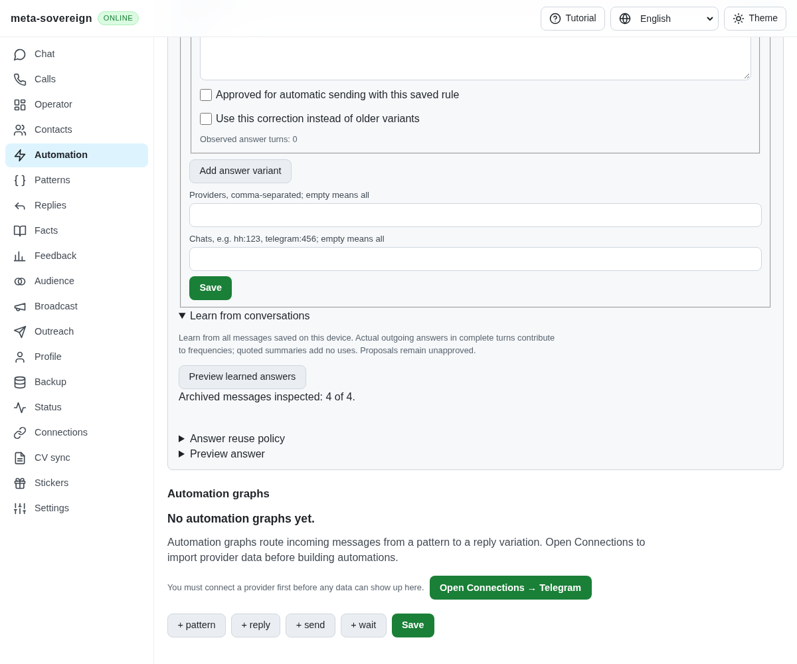
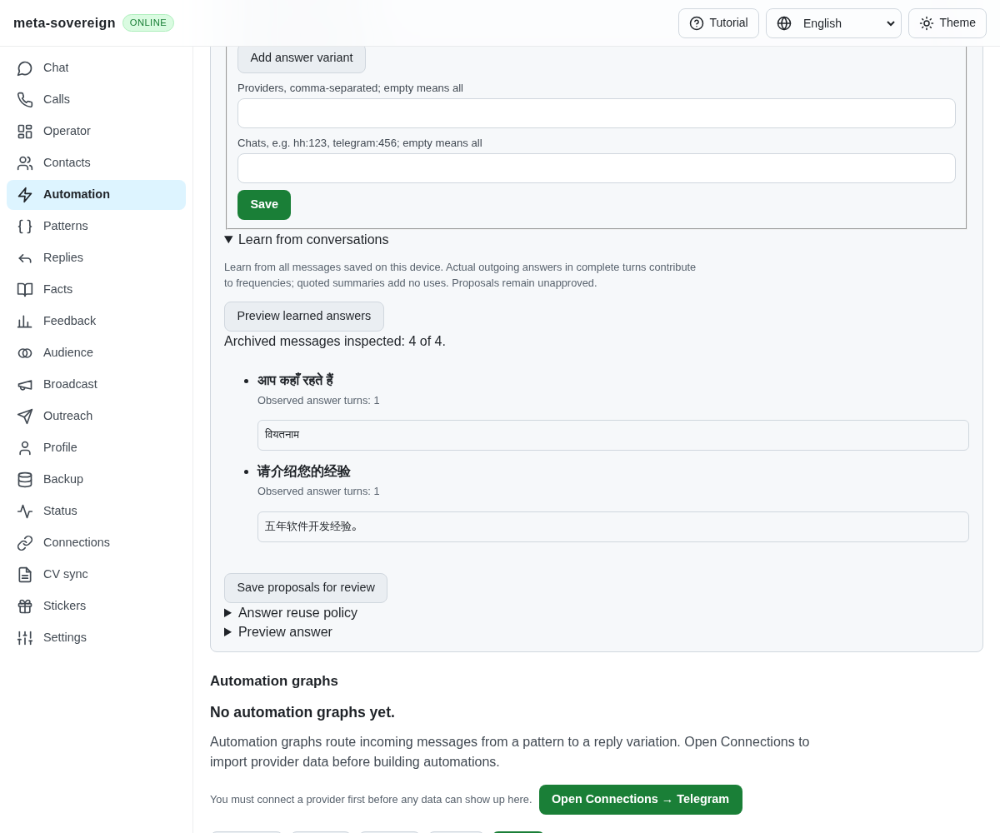

# Shared multilingual question recognition

The former word tokenizer retained Unicode letters and numbers but dropped combining marks. Hindi `दिन` and `दीन` consequently had identical keys. An approved answer for one question could be reused as an exact answer for a different word. Separately, CRM and automation used different English/Russian recognition rules; unmarked Hindi and Chinese requests were omitted from archive learning.

The shared tokenizer now retains combining marks and internal joiners. Canonically equivalent spellings still match after normalization, while meaningful vowel marks, programming-language symbols, currencies and distinct contact addresses remain distinguishable. Both CRM turn learning and automation use one bounded recognizer for explicit question marks and conservative English, Russian, Hindi and Chinese interrogatives or factual requests. Recognition handles delimited acknowledgments and sentence boundaries without rewriting stored messages or silently making an approximate answer exact. Template gaps cannot absorb these additional questions. Existing approval, option, scope and delivery checks remain in force.

Unicode's General Category groups letters and marks separately; spacing and nonspacing marks are not included in the letter group. This is why a letter/number-only expression lost the vowel signs. See the primary [Unicode property definitions](https://www.unicode.org/reports/tr44/tr44-38.html#General_Category_Values). This implementation is a bounded four-language heuristic, not unrestricted language understanding. Additional source layouts, acknowledgment matching, historical versions, forms and full provider execution remain open under R-AA1.

Reproduce without accounts using `node experiments/issue-56/question-language.mjs`. The finite before probe shows equal Hindi word keys and missed Hindi/Chinese requests; afterward the keys differ and all eight recognition examples have the expected result. `node examples/question-language.mjs` demonstrates unmarked archive learning with unapproved proposals and preserved transcripts.

Six of the initial seven focused regressions fail before the correction. The final 30 checks pass across the language, CLI/Lino API, existing conversation-context and automation tests. They cover both default transport encodings, five provider identifiers, mixed requests, numbered answers, owner-question barriers, extra-intent rejection and strict option identity. Changed-code ESLint, formatting and the production browser build pass. The existing production question browser flow, extended with Hindi/Chinese saves, previews, learning and a vowel-sign mismatch, passes in installed Chrome. The first launch could not start because this container lacks Playwright's pinned Chromium executable; the rerun explicitly selects `/usr/bin/google-chrome`. Pinned browser engines and runtime matrices remain in CI.

Independent Playwright MCP uses the same isolated four-message history before and after the change. Before, all four records are inspected with zero proposals. After, the Hindi and Chinese questions each produce their actual outgoing answer with one observed turn. Preview does not apply proposals or send messages. Every API response is successful; the only console error is the fixture's missing favicon. Both browser and fixture are closed. Raw probes, focused check logs, browser observations and source links are preserved with verified hashes in `data/question-language.tar.gz`.

Before: the unmarked questions are missed.

After: both actual answers are proposed for review.

The complete issue remains unfinished in [PR 57](https://github.com/link-foundation/meta-sovereign/pull/57).
