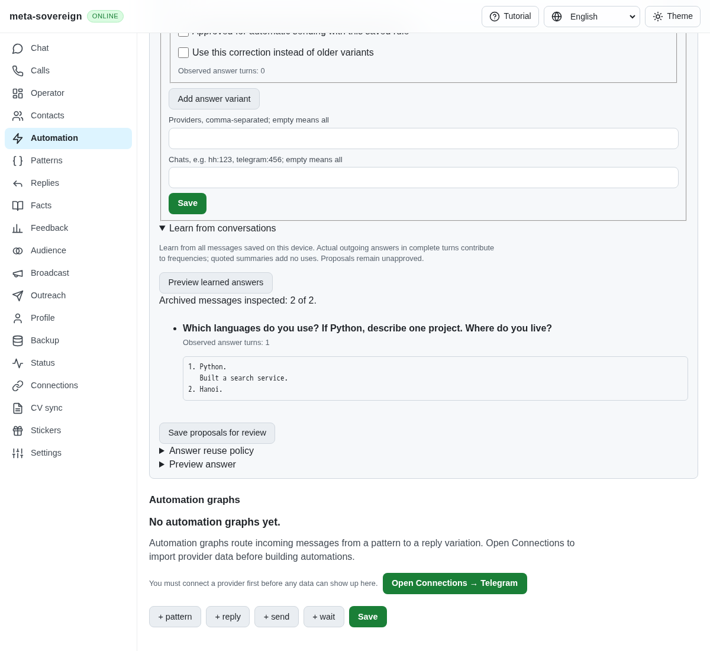
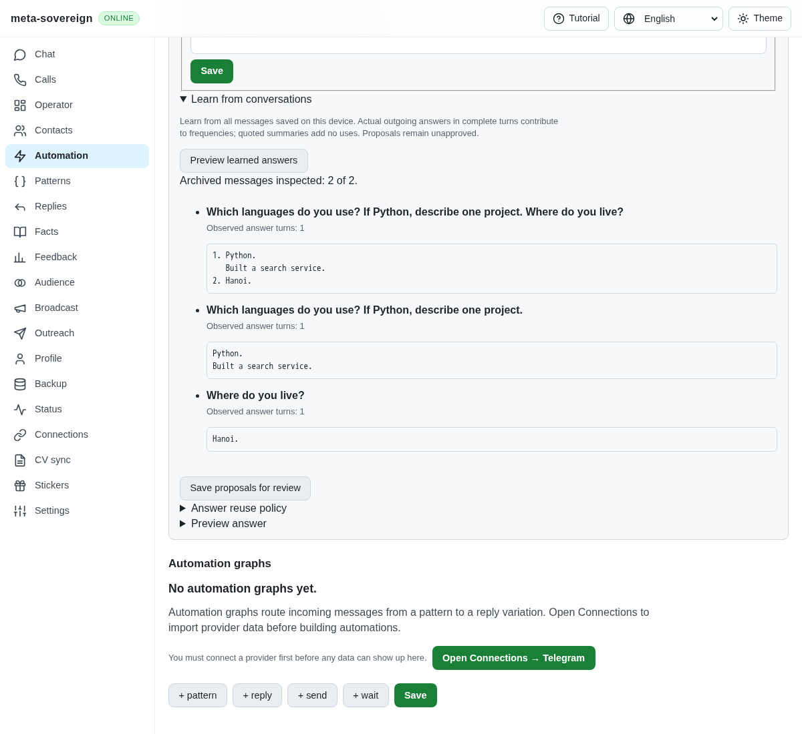
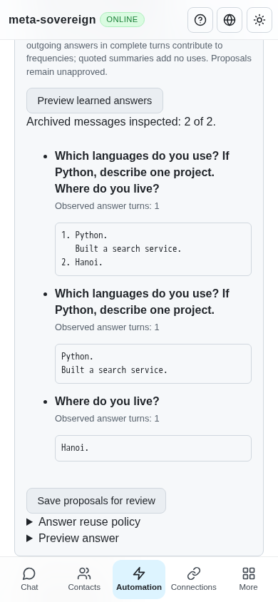

# Learning aligned questionnaires

Work for [issue 56](https://github.com/link-foundation/meta-sovereign/issues/56)
in [PR 57](https://github.com/link-foundation/meta-sovereign/pull/57).
This verifies the shared QA09 parsing mechanism and part of QA08's privacy
requirement. The wider provider, forms and device requirements remain required.

## Reproduction and cause

Save an incoming message containing these separate questions:

```text
Which languages do you use?
If Python, describe one project.
Where do you live?
```

Follow it with the actual outgoing answer:

```text
1. Python.
   Built a search service.
2. Hanoi.
```

Open Automations, saved answers, Learn from conversations and preview. At
preceding `b7ff171b`, only the whole questionnaire is proposed. The parser
accepts only single-line explicitly marked questions and answers. It cannot
align multiline answers, separate questions or conditional continuations.
It also treats a literal question mark inside an answer's code fence as a new
question. Approximate matching can prevent assembling a complete questionnaire.
The existing private-link guard checks outgoing answers but misses incoming
questions containing private access links.

Five of the initial six regressions fail before the correction. The sixth
guards conservative treatment of ambiguous inputs. Full logs and the actual
production before screenshot are preserved.

## Correction

The common bounded parser accepts sequential numbered or consistent bullet
questions and separate question lines, attaching conditional follow-ups and
instructions to their parent. Balanced backtick or tilde code fences retain
their literal contents and indentation. Numbered multiline answers align only
when their sequential count exactly matches the questions. Ambiguous markers,
reordered or duplicate numbers, unfinished fences and lists over 20 parts do
not invent component associations. The complete questionnaire pair remains.

Actual source message IDs determine each component's observed count. Relearning
does not inflate counts or approve a proposal. Complete component assembly
requires review and precedes approximate suggestions; exact or template matches
for the whole questionnaire retain priority. Private incoming access links are
excluded from reusable knowledge while the original transcript stays unchanged.

The behavior follows the pinned HH README's questionnaire and privacy
requirements (lines 810–811 and 843–853). Its latest revision was rechecked as
`fa0991b8c2d0896fb3b4be6c69947f0590094b15`; no reference code was copied.

## Verification

The focused group passes 53 checks:

```sh
node --test --test-concurrency=1 js/tests/question-lists.test.js js/tests/question-lists-controls.test.js js/tests/question-automation.test.js js/tests/question-policy.test.js js/tests/question-language.test.js js/tests/question-turns.test.js js/tests/question-archive.test.js
```

The nine new checks cover four-language conditional continuation, code fences
and indentation, ambiguous alignment, exact-whole priority, reviewed assembly,
incoming private links, unchanged transcripts and repeated learning across
CLI, offline UI and actual text/binary Lino HTTP routes. Synthetic saved
messages cover HH, Telegram, VK, email and WhatsApp. This is shared stored-data
verification; it does not claim live provider import or complete provider parity.

The existing CI-registered production Chromium questions flow passes with new
assertions for the conditional and location components, saved unapproved
receipts and the whole questionnaire. Independent Playwright MCP verification
uses the isolated `experiments/issue-56/question-lists-ui.mjs` production
fixture. Desktop shows all three proposals and saves them for review; a fresh
mobile preview retains a count of one for each. At 390 × 844 there is no
horizontal overflow. Browser and fixture are closed. The fixture additionally
supports graceful terminal or signal cleanup. The existing favicon 404 is the
only console network error observed.

Before:



After:



Mobile:



Scoped strict lint, formatting, secret scanning, whitespace and the production
web build pass. Raw logs, source hashes and the reference revision response are
in [question-lists.tar.gz](data/question-lists.tar.gz), with a
[SHA-256 manifest](data/question-lists.tar.sha256.json). Exact new-head CI is
still required.

## CI investigation

The preceding pushed head `b7ff171b` starts its five workflows at
2026-11-10 09:11:52 UTC. Link run 42788668595 initially fails on eleven GitHub
504 occurrences (raw log lines 431–465). Same-SHA attempt two fails on six
different GitHub 504 occurrences (rerun log lines 428–444). The checked links
remain enabled. Same-SHA attempt three passes at 09:23:21 UTC. Desktop,
security and Pages also pass; Checks is still running at this snapshot, so it
is not a passing matrix claim.

The older `c80df8b0` Checks run 42786205357 is cancelled during WebKit
`chat-users` at 09:14:43 UTC, after preceding browser checks pass (raw log
93835–93852). Its aggregate explicitly fails on `e2e-browser: cancelled`
(100243–100245). This superseded run is preserved as cancelled, not passing.
The full downloaded log remains in `ci-logs/checks-42786205357.log`; the smaller
diagnostic excerpt is included in this unit's archive.
