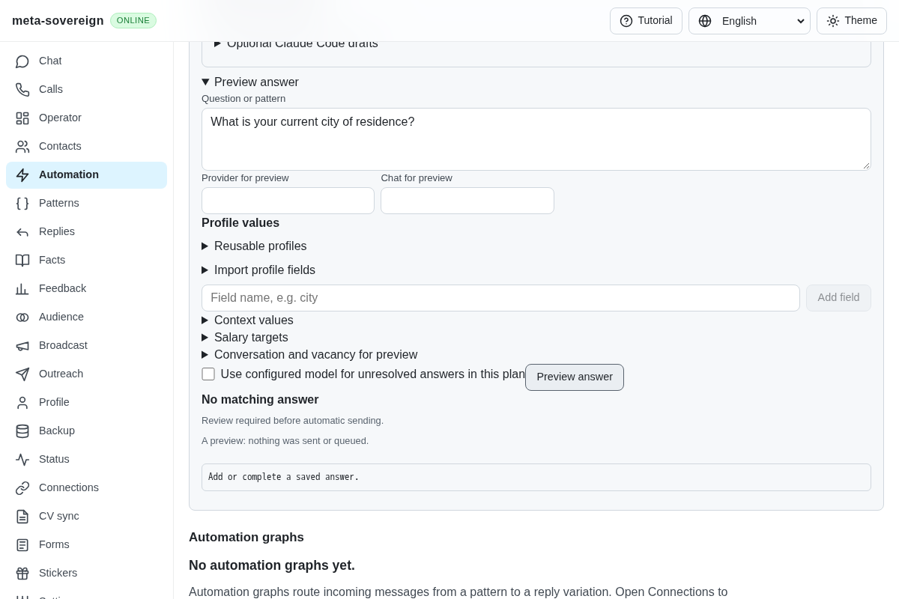
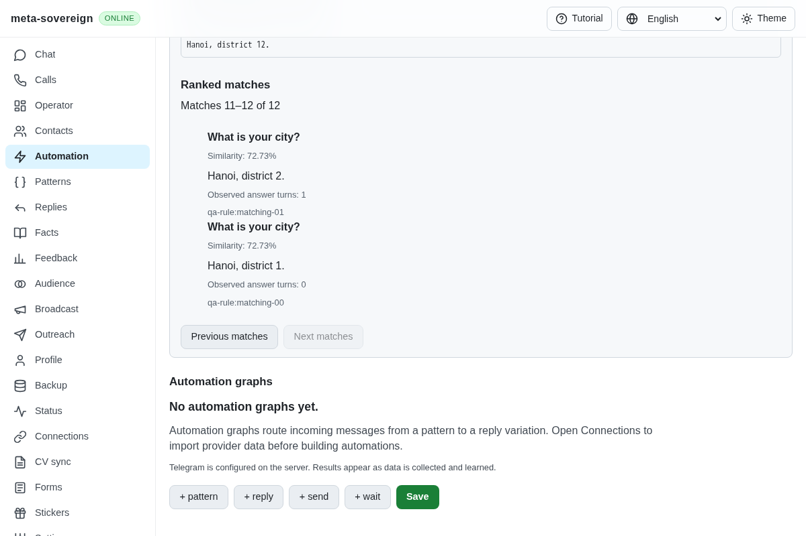
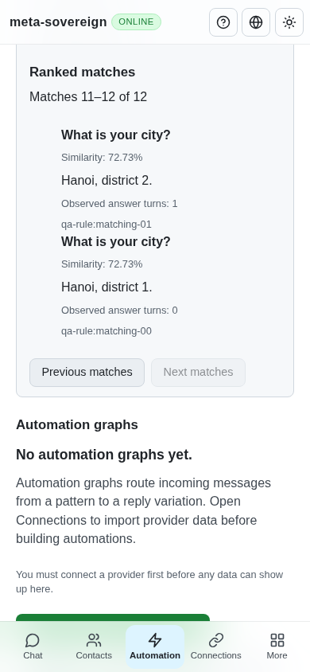
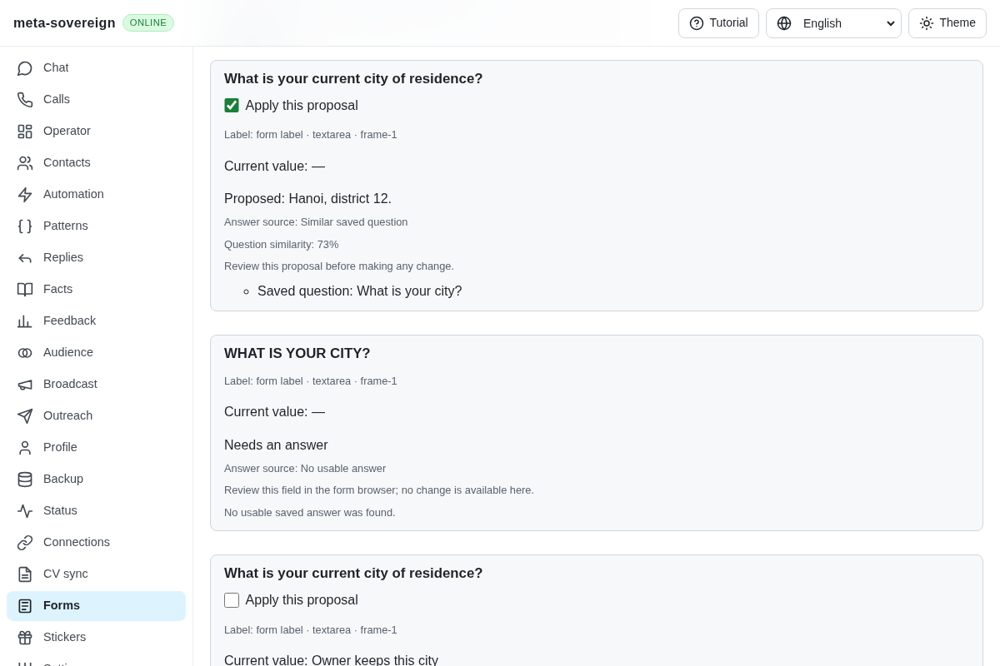

# Configurable question matching and ranked inspection

[PR 57](https://github.com/link-foundation/meta-sovereign/pull/57) adds the threshold, case sensitivity and complete sorted-match inspection required by reference QA02/B6. The behavior was studied in [reference PR 123](https://github.com/konard/hh-job-application-automation/pull/123) and the pinned reference at `fa0991b8c2d0896fb3b4be6c69947f0590094b15`; no reference code was copied or executed.

Previously, approximate matching had a fixed 78% threshold, folded letter case unconditionally and returned at most eight alternatives. The owner can now choose a threshold from 0% to 100%, preserve letter case and inspect every eligible answer in score order through bounded pages. The existing default remains 78%, with case folding. Existing saved actions retain their shape when no matching settings are supplied. Approximate results always require review, including approved saved answers.

Exact and template matching share the case setting. Text keeps Unicode normalization and the existing ё/е equivalence. Question-prefix removal preserves original case when requested. Canonical corrections use the same setting, so a correction for `Which CITY?` cannot override `Which city?` in case-sensitive mode. Actual matched aliases appear in inspection results. Scores rank before frequency; stable tie breakers preserve repeatable pages.

The shared subject guard still refuses different technologies, currencies and employment types even at threshold zero. Zero similarity, exhausted matching budgets, rejected answers, disabled rules and out-of-scope providers cannot become eligible. Configured context-variable templates retain their earlier currency behavior: only owner-configured choice keywords can be abstracted, every answer must reference a field supplied by that group, and explicit subjects or hardcoded answers retain the guard. This restores the two existing context regressions exposed by the parent CI run, while preserving the Go/C# regressions.

## Configure and reproduce

The answer preview, question-action editor and Forms planner expose the same threshold and case controls in English, Russian, Hindi and Chinese. Creating an automation from a preview retains those settings. Forms reviews freeze them with the selected plan and revalidate before applying. Existing owner values remain protected.

CLI question preview and form planning/review accept `--threshold=0.6`, `--case-sensitive=true` or `--matching=<Lino>`. Question preview additionally accepts `--match-offset=0 --match-limit=10`. The text and binary Lino endpoints and offline server use the same optional `matching: { threshold: 0.6, caseSensitive: true }` and `matchPage: { offset: 0, limit: 10 }` objects. Boolean/blank numeric flags, invalid ranges and malformed settings fail validation.

In the isolated `question-matching-fixture.mjs`, twelve approved rules answer `What is your city?` with different Hanoi districts. Ask `What is your current city of residence?`: the unchanged default produces no answer; at 60%, the 8/11 similarity produces a reviewed proposal. Inspect all matches to see ten results followed by the final two. Each result shows its saved wording, score, rendered answer, observed count, rule ID and selected state. Changing pages does not issue another model request.

Inspection returns at most 50 entries per API page (ten in the UI), evaluates at most 1,000 stored rules and shares a 4,194,304-cell work budget. A partial scan is explicitly marked incomplete. These resource limits do not imply that omitted candidates were evaluated; the legacy eight-alternative summary remains available without inspection. Full weighted rewording and provider parity remain required separately.

The initial eight regressions fail against parent `c3912720`; the before browser also fails because the controls are absent. The final checks pass:

```sh
NODE_OPTIONS=--max-old-space-size=384 node --test --test-concurrency=1 js/tests/question-matching-options.test.js js/tests/question-automation.test.js js/tests/question-subjects.test.js js/tests/question-controls.test.js js/tests/question-context.test.js
deno test --v8-flags=--max-old-space-size=384 --allow-all --no-check js/tests/question-matching-options.test.js js/tests/question-automation.test.js js/tests/question-subjects.test.js js/tests/question-controls.test.js js/tests/question-context.test.js
NODE_OPTIONS=--max-old-space-size=384 node --test --test-concurrency=1 js/tests/question-policy.test.js js/tests/forms-review-prefill.test.js
RUN_BROWSER_E2E=1 E2E_EXECUTABLE_PATH=/opt/google/chrome/chrome QUESTIONS_MATCHING_ONLY=1 NODE_OPTIONS=--max-old-space-size=384 node js/tests/e2e-questions-browser.mjs
RUN_BROWSER_E2E=1 E2E_EXECUTABLE_PATH=/opt/google/chrome/chrome FORMS_MATCHING_ONLY=1 NODE_OPTIONS=--max-old-space-size=384 node js/tests/e2e-forms-reader-browser.mjs
```

There are 45 passing checks in Node, the same 45 in Deno and 21 additional Node compatibility checks. Coverage includes all twelve candidates, stable pagination, scores before frequency, aliases, explicit incomplete scans, strict settings, case-aware canonical corrections, action round trips, threshold-zero subject protection, selected-only form application, readonly knowledge and actual CLI/offline/text-binary Lino requests.

Production Chromium verifies the two match pages, phone layout, threshold/case changes, invalid-field gating and persisted automation settings. Its Forms flow reads back exactly one selected city answer, preserves the uppercase unresolved field and owner's existing city, closes the owned browser and records zero submissions. Independent Playwright MCP confirms both pages, 72.73% scores, desktop/phone layouts and the same actual form values and one receipt; its console contains only a missing fixture favicon. These scenarios also run in the normal hosted browser sequences.









## Evidence and remaining work

The [verified archive](data/question-matching-options.tar.gz) and [manifest](data/question-matching-options.tar.sha256.json) retain before/after source snapshots, initial failures, full focused logs, reference PR evidence, actual browser/MCP receipts and screenshot hashes. Recollect with [collect-question-matching.py](../../../experiments/issue-56/collect-question-matching.py). Strict changed-code lint, scoped formatting, the production web bundle and the existing 6.5% duplication gate pass. Complete runtime/browser/native matrices remain on hosted CI and must be assessed for the new SHA.

This verifies the matching settings and inspection mechanism. Complete weighted fuzzy rewording, historical/provider parity, automatic multi-form filling and every other unchecked issue requirement remain open. PR 57 stays draft and unmerged; issue 56 is unfinished.
