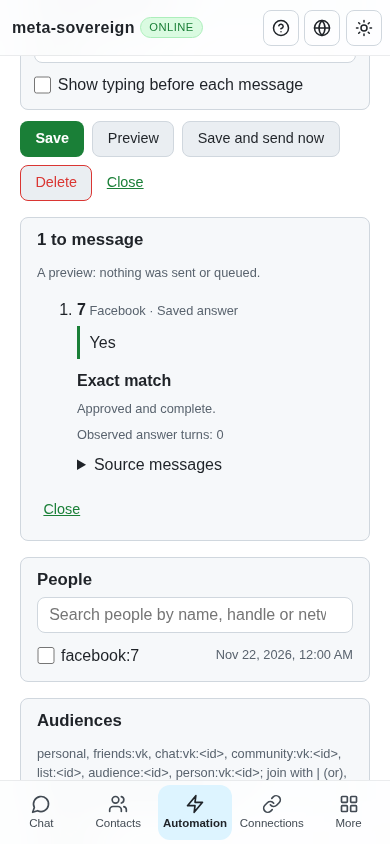
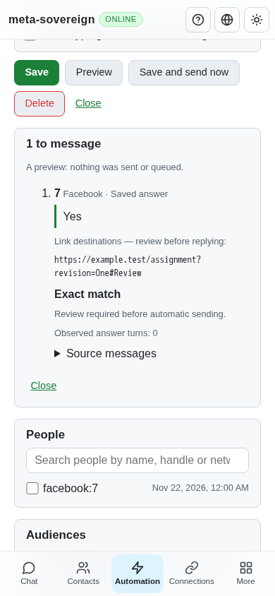

# Meta message destinations in answer review

Issue [#56](https://github.com/link-foundation/meta-sovereign/issues/56),
PR [#57](https://github.com/link-foundation/meta-sovereign/pull/57), 2026-11-23.

When a Messenger message asks a familiar question and attaches a share or an
action button, the published parent `b616c880` can approve a saved answer without
showing the destination. A destination-only edit also leaves the previous
review valid. Facebook and Instagram HTML archives lose external anchors when
the associated message enters shared history.

The Facebook history adapter requests shares and generic-template actions along
with its existing fields. Normalization keeps the complete destination from
Graph shares and template actions, supported webhook shares and web URL buttons,
and Facebook and Instagram JSON shares and HTML anchors. Media previews,
postback payloads and reaction profile links are outside that extraction.
Malformed URLs, incomplete Graph edges, unsupported content, and the temporary
Instagram messaging CDN preview produce the existing unverifiable-link state.
The exact URL bytes enter the answer's frozen question history and private
learning checks. Previewing an answer leaves the destination inert.
[Graph Message reference](https://developers.facebook.com/docs/graph-api/reference/message),
[Messenger card examples](https://developers.facebook.com/docs/messenger-platform/marketing-messages/),
[Instagram webhook examples](https://developers.facebook.com/documentation/instagram-platform/webhooks/new).

Older JSON imports retain their normalized share attachments and benefit without
reimport. Older HTML imports that discarded the anchor need the original archive
imported again. An explicit Graph field selection still takes precedence, so its
caller controls which metadata it can verify.

## Reproduction and verification

```sh
python3 -B experiments/issue-56/question-api-links-parent.py --meta
node --test --test-concurrency=1 js/tests/question-meta-links.test.js
python3 -B experiments/issue-56/question-api-links-parent.py --meta --browser
node experiments/issue-56/question-meta-links-browser.mjs
```

Fourteen of sixteen checks fail on the actual published source. The two controls
cover ordinary text/media and local attachments/reaction profiles. The comparison
restores the edited files in a finally block. The corrected source passes 111
focused Node checks and 94 Deno tests with 27 substeps. Checks exercise the live
adapter with injected Graph responses, normalized and imported history, target
edits and bounds, private learning, the CLI and both Lino encodings. The scenario
is registered in the existing hosted question-templates browser group.

The isolated Chromium fixture changes from “Approved and complete” to “Review
required before automatic sending” and shows the exact destination. Both screens
record zero sends and no page exceptions. Independent Playwright MCP sees the same
inert target at 390 pixels, with zero destination or mutation requests and no
page exceptions. A favicon request returned 404. The browser and fixture server
were closed.




The [evidence archive](data/question-meta-links.tar.gz) and
[SHA-256 manifest](data/question-meta-links.tar.sha256.json) preserve source,
test logs, screenshots and browser diagnostics. Graph history verification used
injected responses on the configured v22.0 path. Authenticated Graph responses,
remaining provider representations, and the wider QA04 context checks still
require verification. The issue inventory remains at 88 verified and 30 open.
