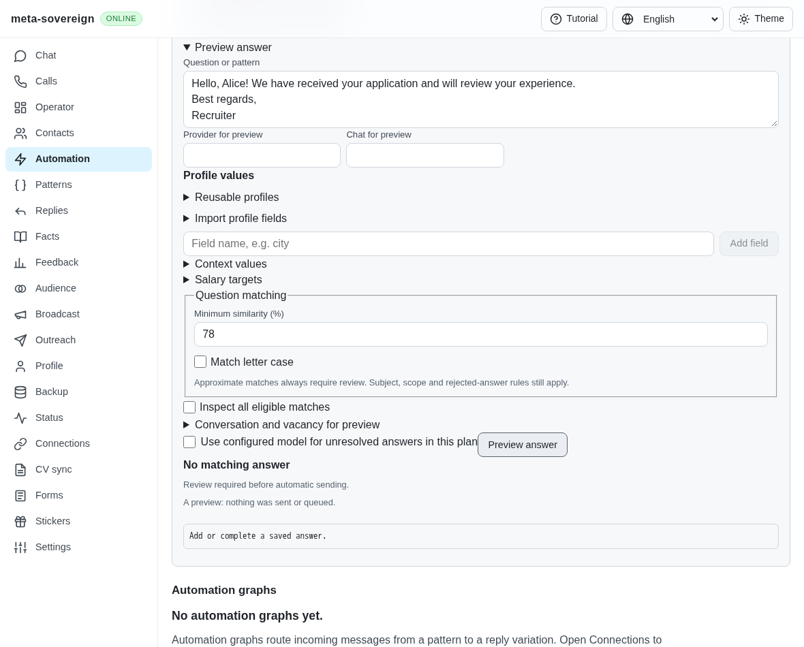
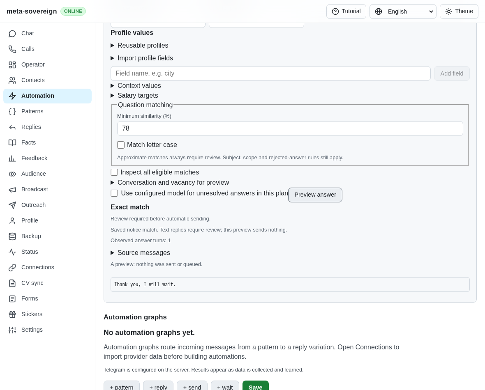
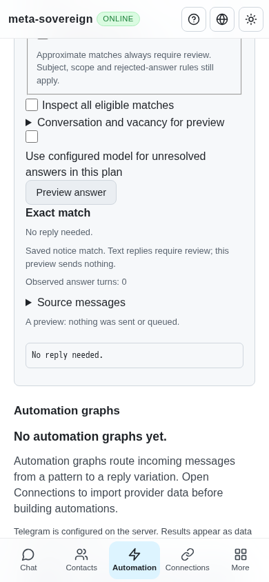

# Saved passive notices

The pinned HH reference requires reusable notice replies, greeting/signature normalization and a saved `[без ответа]` marker as well as questions. See [chat behavior C4, C6, C12–C15](https://github.com/konard/hh-job-application-automation/blob/fa0991b8c2d0896fb3b4be6c69947f0590094b15/docs/requirements/forms-and-chats.md). This step adds notice storage and reviewed planning to the existing shared question controls; automatic notice delivery and history learning remain unfinished.

## Reproduction and cause

On actual parent `e172fd11a6f8dea07b8528051374e498871b21ab`, save a rule for “We have received your application and will review your experience.” with the reply “Thank you, I will wait.” Preview that notice with a greeting and a signature. The planner returns an empty unanswered result because ordinary messages cannot enter question matching; normalization also drops the notice kind. The parent has no notice editor selector. The new regression fails against that actual parent; the isolated production browser reproduces its missing proposal with zero provider sends.

## Shared behavior

- Explicit `kind: notice` records use the existing scoped answer store, variants, profile substitutions, rejection policy, CLI and negotiated text/binary Lino routes. Existing question records retain their shape. The CLI accepts `answers save --kind=notice`; offline editing uses the same validation.
- Notice matching removes one bounded greeting and an explicit final signature. Exact matches, explicit ordered-word patterns and conservative whole-template containment use existing match ranking. Approximate and containment-only no-reply matches require review.
- Questions, actionable requests, invitations, rejections and links cannot become passive matches. Guards inspect the original message before removing its greeting or signature. Form labels and strict native choices continue to use question rules.
- Text notice replies always require review, including approved variants. The runner retains the proposal and refuses unreviewed delivery for each of the five provider namespaces in the focused fixture.
- The no-reply marker is permitted only on notice records. A current approved unambiguous exact or explicit-pattern rule can yield an empty no-reply result. Unapproved, conflicting and approximate variants stay reviewable. The marker is never outbound text, and a proposed no-reply result cannot trigger a model reply.
- English, Russian, Hindi and Chinese controls expose the rule kind, review requirement and no-reply state. Both desktop and 390-pixel views retain the existing shared layout.

## Verification

`question-notices.test.js` and `question-notice-controls.test.js` cover the new planner, runner, CLI, offline and actual HTTP paths. Together with focused question, summary, strict-choice, receipt-validation and locale checks, 72 Node tests and 72 Deno tests pass with one test worker. The parent fails the notice-reply regression.

`experiments/issue-56/notices-before.py` temporarily reads the actual parent source, captures its failing assertion and UI, then restores sources and the web bundle in `finally`. `notices-ui.mjs` exercises six focused production Chromium scenarios, including unapproved/approved no-reply saves, edited requests and mobile overflow; its instrumented provider records zero sends. The normal hosted question-controls browser group retains this scenario. Independent Playwright MCP checks confirm reviewed text, explicit no-reply approval, request refusal and the mobile layout. An initial MCP assertion used an incorrect label; inspection and the corrected assertion passed without a product change. The first local browser launch found no bundled Chromium, so the focused probe uses the already installed Chrome executable.

Raw logs, source snapshots, MCP observations and screenshot hashes are retained in [the evidence archive](data/question-notices.tar.gz) with [its manifest](data/question-notices.tar.sha256.json).

## Remaining required work

Actual notice/reply history learning, regenerated generalized patterns, complete pending-turn and owner-activity guards, inactive acknowledgement/rejection sends, unread traversal and paused-chat orchestration remain required. This step does not satisfy those criteria or live provider parity. The PR remains draft and unmerged; all other unchecked issue requirements remain open.
