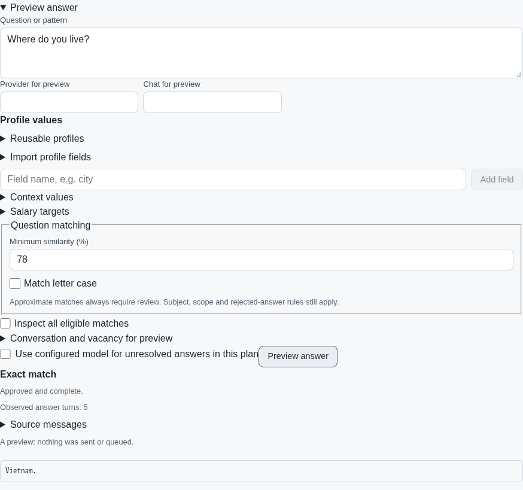

# Final-period observations across saved rules

The pinned [answer preference contract](https://github.com/konard/hh-job-application-automation/blob/fa0991b8c2d0896fb3b4be6c69947f0590094b15/tests/answer-preferences.test.mjs)
requires actual counts for equivalent final-period spellings of one question.
The existing implementation grouped by saved rule ID. Two approved rules for
`Where do you live?`, containing `Vietnam` with four observations and `Vietnam.`
with one observation, incorrectly selected `Vietnam` with four observations.

## Reproduction and correction

Four finite regressions fail against the two exact published parent modules
from `0e676ed071a1042ffa6bc50c28a2ff32f873e496` with current dependencies:

```sh
node --max-old-space-size=384 --import ./experiments/issue-56/question-period-scope-before.mjs --test --test-concurrency=1 --test-timeout=15000 js/tests/question-period-scope.test.js
```

Eligible exact matches now share the same question boundary already used by
declared answer wordings. The planner combines five actual observations and
selects the configured literal spelling. Provider/chat restrictions and disabled
rules are checked before grouping. Different questions, approximate/template
rules, approval and canonical correction states retain their boundaries.

Both punctuation policies reuse the existing safe observation combiner. Shared
evidence keeps the original alternatives and requires review instead of silently
counting a turn twice. Counts must remain safe integers. Raw saved rules,
transcripts and evidence are preserved. No provider operation is started by
planning, and no unobserved punctuation is invented.

## Verification

The four regressions cover rule order, both period preferences, provider/chat
eligibility, overlapping evidence, CLI and both default Lino encodings. Twenty-four
focused checks and eleven separate wording/correction compatibility checks pass.
The mandatory native questionnaire scenario now puts the pair in separate rules;
the three-scenario wording sequence still observes counts five, five and one and
restores the original saved rules. Failure, reload and compact layout assertions
remain active. Shared preview requests now reuse one test helper; the same native sequence passes after that extraction. Strict scoped lint/format/secrets, the production build and the unchanged 6.5% duplication limit pass. The actual over-limit duplication report is preserved; consolidation keeps every assertion. Full runtime/browser matrices are left to hosted CI.

Independent Playwright MCP uses an isolated temporary server and memory store,
with no provider account. The parent preview shows four and `Vietnam`; the
corrected preview shows five and `Vietnam.`. The same probe verifies the saved
`without` preference after reload and the 390-pixel compact layout. Both owned
servers and browser pages are closed afterward.




The [evidence archive](data/question-period-scope.tar.gz) and
[manifest](data/question-period-scope.tar.sha256.json) preserve the parent modules,
raw failures, successful receipts, screenshot hashes and exact source hashes.
The parent hook substitutes only the two faulty modules; it is not represented
as a complete prior checkout. The native parent timeout and its failure capture
are retained separately from the independent successful MCP parent observation.

This is a partial QA11 correction in [PR #57](https://github.com/link-foundation/meta-sovereign/pull/57).
Fresh exact-source hosted verification, the complete QA11 audit and all other
unchecked original criteria remain required. Acceptance remains 77 of 118;
the 41 unfinished criteria are not accepted by this local result.
