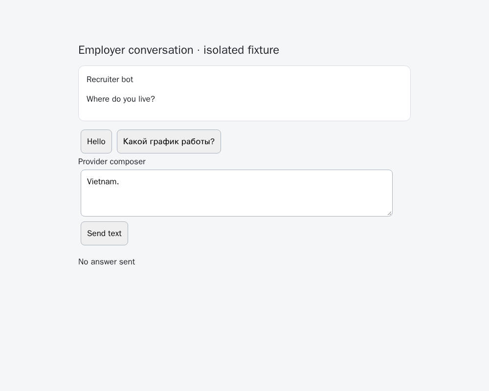

# Retained final-period worker configuration

The pinned [worker preference contract](https://github.com/konard/hh-job-application-automation/blob/fa0991b8c2d0896fb3b4be6c69947f0590094b15/tests/answer-preferences.test.mjs)
requires standalone automation to respect the final-period configuration. The
shared saved policy alone did not cover command configuration or later browser
revalidation. This is part of QA11; every other unchecked criterion remains
required in [PR #57](https://github.com/link-foundation/meta-sovereign/pull/57).

## Reproduction and cause

Against published parent `83c5b1f7`, all seven finite regressions fail:

```sh
node --max-old-space-size=384 --import ./experiments/issue-56/question-period-workers-before.mjs --test --test-concurrency=1 js/tests/question-period-workers.test.js
```

With the approved observed pair `Vietnam` (four uses) and `Vietnam.` (one use),
`answers browser inspect` and `unread` ignore `ANSWER_FINAL_PERIOD: without`.
Direct inspection initially previews `Vietnam`, but normalized review settings
omit the override, so watched revalidation prepares `Vietnam.`. Saved automation
actions also lose the setting during normalization, absent command settings erase
it in answer previews, and ordinary automation planning ignores configuration.

Optional validated settings now survive normalization. Command resolution applies
to previews, browser inspection/unread processing and ordinary plan/run commands.
Reviews freeze the resolved setting, and ordinary runs retain their command
setting through confirmed delivery checks while still reading current knowledge.
Saved actions remain the fallback when no command setting exists. Policy, raw
observations and process environment are unchanged. See the
[configuration guide](../../QUESTIONNAIRES.md#final-period-preference).

## Verification boundary

All 49 focused portable checks pass, alongside the one affected CI registration
contract, strict lint, formatting and the production web build. The unchanged
duplication gate passes at 6.50%. The portable cases exercise actual CLI dispatch, both Lino encodings,
saved actions and input files, a bounded watcher, unread draft preparation and a
confirmed send to a mock adapter. No authenticated provider send is claimed.

The mandatory question-controls browser group includes actual browser-commander
preparation on a routed synthetic HH page. It checks the observed five-use
preview, retained immutable planning setting and the native composer without
clicking Send. Its focused mode uses installed Chrome; complete browser/runtime
matrices remain on CI. The before and after screenshots show the resulting native
draft, with the same unchanged question and source observations.




The first browser command skipped because its required opt-in was absent. The
next fixture initially changed only the current DOM, so inspection's navigation
restored the unrelated original question. That failure is retained separately;
the corrected fixture serves its configured question on every navigation. Neither
attempt establishes a production failure. The portable fixture's initial duplicate
strict-choice setup is also retained separately from the seven correct parent
regressions.

The [archive](data/question-period-workers.tar.gz) and its
[manifest](data/question-period-workers.tar.sha256.json) preserve exact prior
modules, raw results and source hashes. Fresh exact-source hosted verification
and the complete original QA11 acceptance audit remain required. This correction
alone accepts no inventory row.

## Earlier non-passing hosted run

The `7001c9a4` [pipeline](https://github.com/link-foundation/meta-sovereign/actions/runs/43967685639)
failed after its test and browser jobs were cancelled. The preserved pipeline log
identifies both cancelled dependencies at lines 98–101. GitHub's browser-job
annotation explicitly says a higher-priority waiting request caused cancellation.
The representative Chromium 1/4 log records passing scenarios through line 1338,
then cancellation at line 1341 during the next browser check. This establishes
superseded verification, without establishing a failing application assertion.
Full-run log retrieval exceeded GitHub CLI's API-request limit; targeted job logs
and job/run metadata are preserved instead. The newer `83c5b1f7` run has a browser
failure still under investigation; it is not treated as accepted verification.
