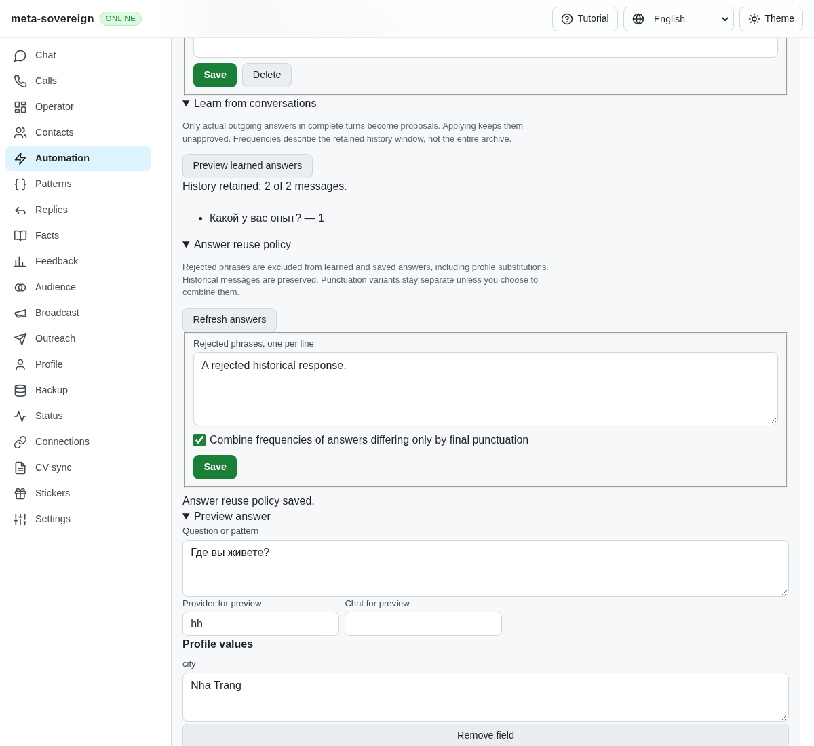
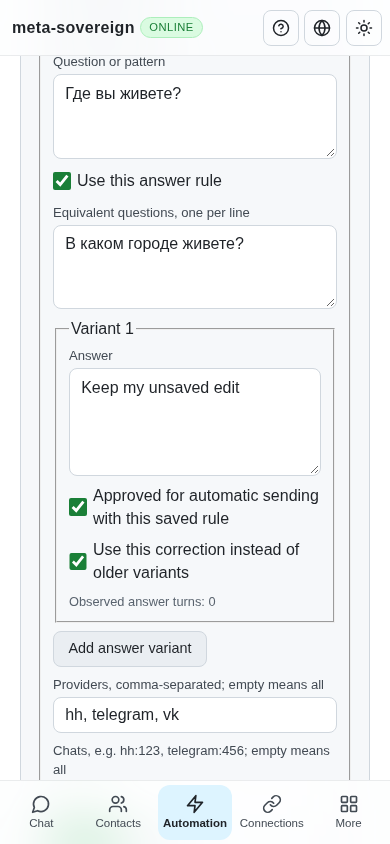

# Answer corrections, reuse policy and completed questionnaires

Issue [56](https://github.com/link-foundation/meta-sovereign/issues/56) extends the HH reference's answer behavior to every chat. This step extends the [shared Q&A foundation](question-answers.md); contextual salary, forms and provider execution remain required in the [inventory](reference-feature-inventory.md).

## Reproduction and cause

The four initial regressions in `question-policy.test.js` failed before implementation: a frequent historical answer defeated an explicit correction, Markdown quoting revived rejected wording, a completed bot questionnaire yielded no reusable facts and still looked like an incoming question, and punctuation variants could not be combined by an explicit preference. The matcher previously knew only frequency and approval; learning required an adjacent outgoing turn. The failing assertions and later checks are preserved in `data/question-policy.tar.gz` with verified hashes.

Saved variants now accept an explicit canonical correction. It supersedes older variants without inventing observations; approval remains separate. Equivalent question spellings can be saved on the same rule. Conflicting canonical corrections require review. Historical messages remain intact.

The persisted reuse policy excludes rejected token phrases from saved and learned answers, including after profile substitution. Formatting and whitespace cannot revive a rejected phrase; a short rejected `No` does not exclude `Node.js`. Saving a canonical answer containing rejected wording fails. Changes are checked again by the existing delivery guard, so a rejection saved after planning stops an automatic send.

Final-punctuation equivalence is off by default. Enabling it combines observed frequencies and provenance for otherwise identical variants within a rule and approval/correction state. The most frequent original spelling is retained. Frequencies stay safe integers; invalid combined counts fail validation. It does not modify transcripts or grant approval.

Explicitly marked completed questionnaire summaries yield unapproved factual proposals with count zero and the summary message as provenance. Recognized complete summaries need no reply. Unknown trailing text, new questions or new tasks prevent that classification; no incoming content is silently dismissed. The bounded parser currently recognizes the tested Russian/English heading and question/answer layouts, so the broader reference-summary audit remains open.

## Controls and verification

The shared Automation editor exposes equivalent questions, a correction checkbox per variant, rejected phrases and optional punctuation equivalence. Policy loads before editing; failed saves keep the entered text and report the actual failure. The CLI exposes `automations answers policy [file.lino]`, `--reject=<phrase>`, `--clear-rejected` and `--punctuation-equivalent=true|false`. Saving a rule accepts `--canonical`; structured rule files retain aliases and all variant fields. CLI output remains Lino by default.

`GET /api/automations/answers/policy` reads policy; `PUT` or `POST` saves it using the same implementation as CLI and offline UI. Both default text and binary Lino routes are covered. Invalid policy leaves the previous record intact.

Six focused policy cases pass. The combined 56-case Q&A/editor/localization check passes, including real API, CLI, learning and delivery checks. The production Chromium fixture passes saved aliases/corrections, policy persistence, rejected saves with retained edits, learning and mobile layout. Full runtime/browser matrices remain in CI. The first screenshot-enabled mobile check caught the responsive shell before React switched navigation surfaces; its bounded diagnostic identified the temporary desktop form layout. The fixture now waits for the actual compact shell before checking the painted width, with overflow diagnostics retained. Playwright MCP separately exercised the controls and viewport changes using isolated synthetic conversations.

Before the change, the [existing Q&A controls](../../screenshots/issue-56-questions-after.png) had no reuse policy. The saved policy now appears alongside learning and preview:

Full-archive cumulative counts, concurrent policy editing, broader summary layouts and the remaining contextual/reference behaviors still need their acceptance evidence. This step does not complete issue 56.
