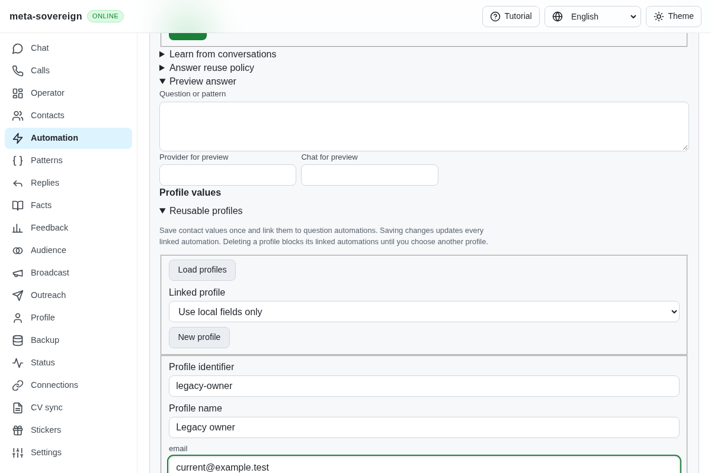
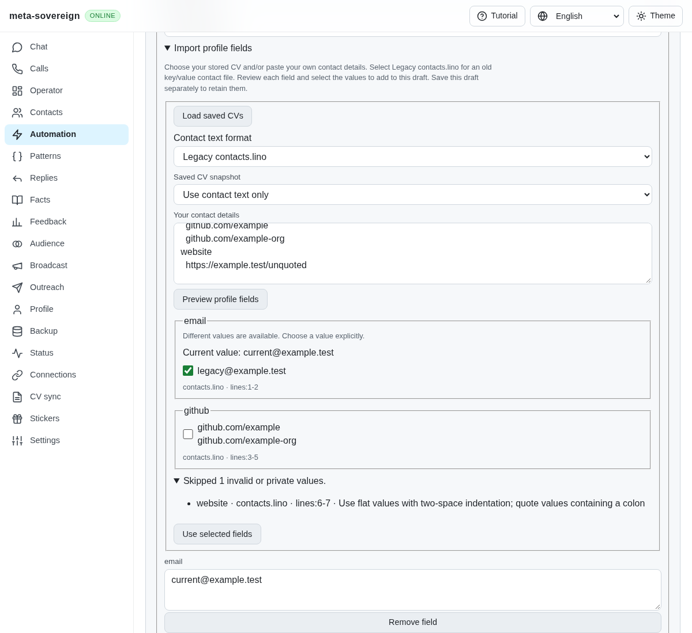
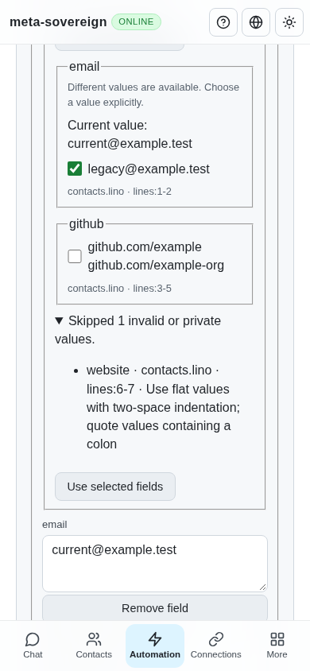

# Review legacy contacts before importing profile fields

Work for [issue 56](https://github.com/link-foundation/meta-sovereign/issues/56)
in [PR 57](https://github.com/link-foundation/meta-sovereign/pull/57), completing
the inventoried QA05 contact import alongside contact/CV extraction and named
profiles. The wider R-AA1 and issue requirements remain open.

## Reproduction and root cause

At `68328f69`, passing a valid legacy `contacts.lino` list to the profile
extractor returned an empty profile. The extractor understood labelled contact
text but had no legacy format. The reusable profile editor also lacked the
source importer offered by the local override editor. The archived Node
regression and before screenshot reproduce both gaps.

The reference is `konard/hh-job-application-automation` at
`fa0991b8c2d0896fb3b4be6c69947f0590094b15`. Its `src/qa-database.mjs`,
`src/contacts.mjs`, contact tests and migration script describe flat named
entries, two-space-indented lists and literal quoting. The implementation
learns those behaviors without copying code or importing owner contact data.

The explicit `contacts-lino` format now uses the installed Links Notation
parser's lossless syntax tree. It preserves literal values, lists, Unicode,
quoted spaces, encoded literals, multiline values and source line ranges.
Multiple values under one key become one newline-separated field. Repeated
keys become alternative candidates; an existing owner value remains in place
until a candidate is selected. Each member of a contact list must pass the
existing contact/private-link validation.

Unquoted colon values, unsupported nesting, mixed quoted fragments, invalid
keys, empty entries and invalid/private values have field/source/reason skip
reports without rejected raw values. Unfinished quotes are explicitly refused:
the general parser permits some as bare references, which would silently
import a partial contact. Syntax errors do not repeat the owner's input.

## Shared controls

`automations answers profiles import [id] --file=contacts.lino --json` returns
a read-only draft. An optional existing profile supplies current values and
target revision metadata. `automations answers profile --format=contacts-lino
--text-file=contacts.lino` uses the same extractor. Neither command saves a
profile or an automation.

The existing `POST /api/automations/answers/profile` accepts the explicit
format through default text and binary Lino. Browser-only controls call the
same core. The ordinary contact format remains `text`; unknown formats fail.

Both local override editors and staged reusable-profile editors offer a
localized format selector, preview, per-field evidence, current values,
unselected alternatives and detailed skip reasons. Applying selected fields
changes that draft only. Saving remains a separate explicit action. Failed
requests keep the source and staged fields. A changed source, format or owner
value invalidates an in-flight result rather than overwriting newer edits.
Local overrides do not update the linked reusable profile.

## Bounds and verification

Source text retains the existing 64,000-character limit. CLI legacy files
have a 256,000-byte limit. Parsing has a depth limit of four, up to 4,096
source lines and 100 entries, with at most 20 candidates per field and 2,000
characters per resulting value. Oversized, malformed and private cases use
finite synthetic fixtures; no stress workload or owner file was used.

Seventy-three selected Node checks and seven Deno checks pass with 384 MiB
heap limits. The checks cover lists, duplicates, quoting, CR/LF/CRLF source
ranges, bounded refusals, selected-CV conflicts, immutable stores, actual CLI,
text/binary API, offline controls, existing profile/substitution behavior and
all four UI languages.

```sh
NODE_OPTIONS=--max-old-space-size=384 node --test --test-concurrency=1 --test-timeout=30000 js/tests/question-profile-legacy.test.js js/tests/question-profile-legacy-controls.test.js js/tests/question-profile-source.test.js js/tests/question-profile-controls.test.js js/tests/question-shared-profile.test.js js/tests/question-shared-profile-controls.test.js js/tests/question-substitution.test.js js/tests/question-substitution-controls.test.js js/tests/i18n.test.js
deno test --allow-all --v8-flags=--max-old-space-size=384 js/tests/question-profile-legacy.test.js
NODE_OPTIONS=--max-old-space-size=384 RUN_BROWSER_E2E=1 E2E_EXECUTABLE_PATH=/usr/bin/google-chrome E2E_ARTIFACT_DIR=ci-logs node experiments/issue-56/legacy-profile-browser.mjs
```

The focused production Chromium flow checks preview-only behavior, selective
application, detailed skip reasons, failures, concurrent owner edits, retry,
explicit central saving, separate local overrides and both question editors.
It is included in the existing questions browser flow for CI.
That existing flow also passes after scoping local-field selectors separately
from central fields and giving independent profile checks fresh documents.
An independent Playwright MCP check uses the isolated profile fixture,
applies an email and a two-line GitHub list, observes a real malformed-input
HTTP 400 with preserved staged values, retries, saves and reloads the exact
values. At 390 pixels the document remains 390 pixels wide. The browser and
fixture close afterward. The deliberate 400 and an existing optional account
capability error appear in its console; this is not a clean-console claim.

Before, the reusable profile editor has manual fields without source import:



After, the review preserves current values and source lists, selects only the
email and explains why the unquoted URL was skipped:





The [evidence archive](data/question-profile-legacy.tar.gz) and
[verified manifest](data/question-profile-legacy.tar.sha256.json) preserve
the failing-before checks, focused results and source hashes. Exact new-head
CI and all unchecked issue-wide requirements remain required. The earlier
chat overlap-warning assertion is still under investigation; a diagnostic
commit prints geometry if it recurs. PR 57 remains draft and unmerged.
