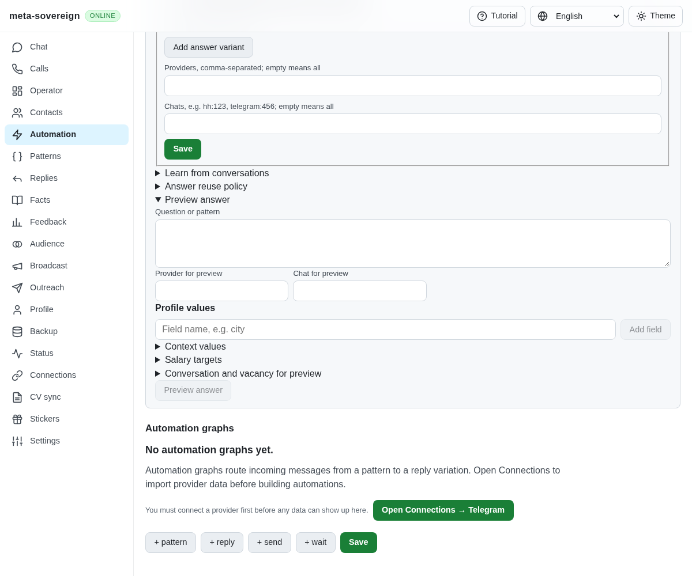
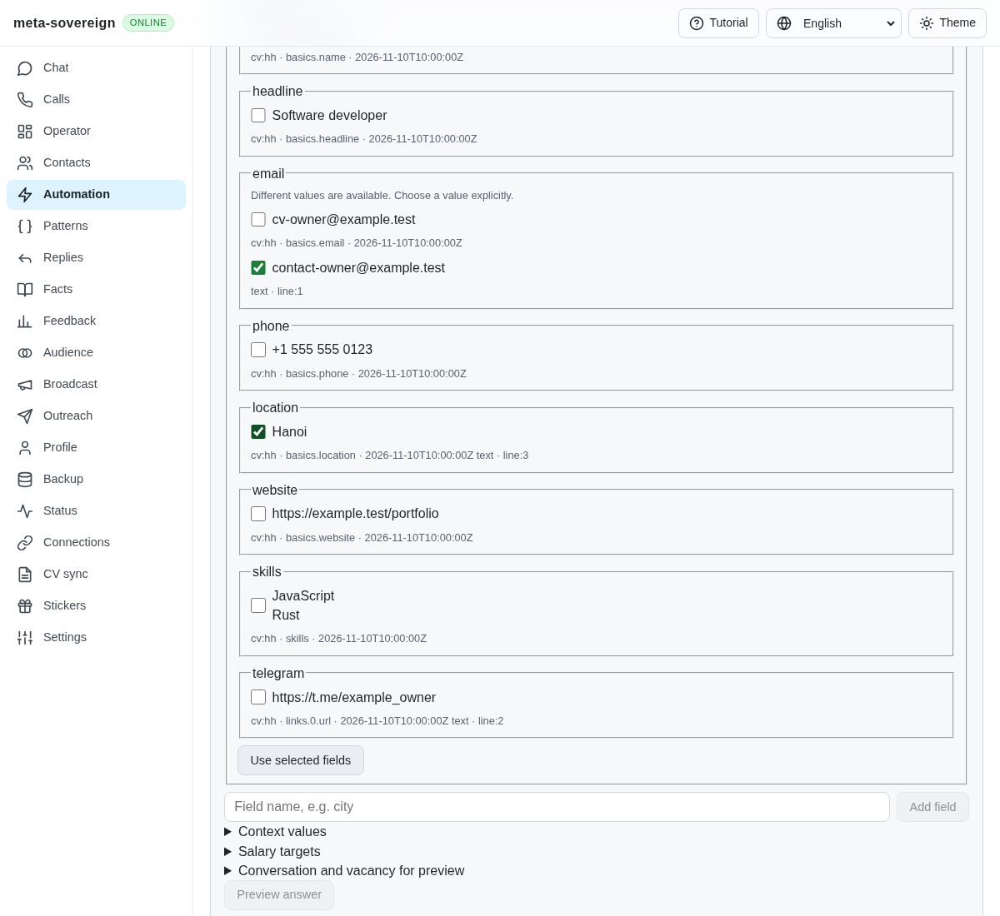
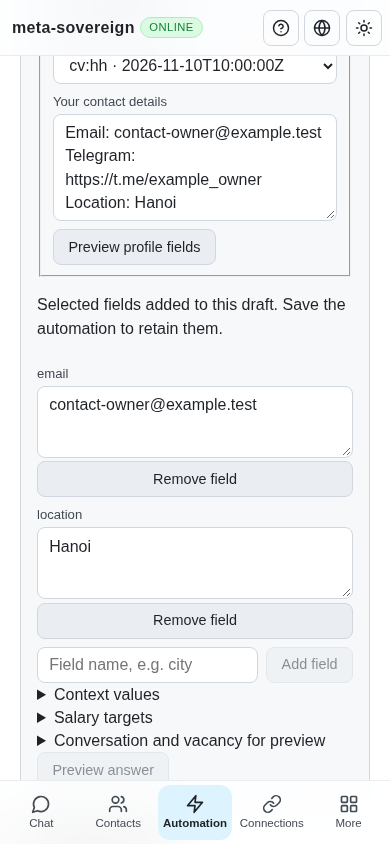

# Review contacts and CV facts before adding profile fields

Work for [issue 56](https://github.com/link-foundation/meta-sovereign/issues/56)
in [PR 57](https://github.com/link-foundation/meta-sovereign/pull/57), covering
the contact/CV extraction mechanism in QA05 and R-AA1.

## Gap and reference behavior

Previously, profile placeholders required manual entry. There was no shared
CLI/API/UI path for extracting contact facts from an owner's text or a selected
stored CV. The initial CLI regression fails against `ed241ef5` because the
profile command is unavailable. A second regression catches the missing public
browser bridge methods: adding an API factory alone does not expose controls
to the production application.

The reference is `konard/hh-job-application-automation` at
`fa0991b8c2d0896fb3b4be6c69947f0590094b15`. Its contact expansion preserves
unknown placeholders and reads centralized contact values. We inspected its
contact source/tests and current related merged PR metadata; no reference code
was copied. Central reusable profiles and importing that project's legacy
`contacts.lino` remain required work after this extraction mechanism.

## Shared extraction and explicit choices

`automations answers profile-sources` lists metadata for at most 50 stored
`cv:` snapshots. `automations answers profile --cv=hh --text-file=contacts.txt
--json` produces a read-only draft. The same operations use
`GET /api/automations/answers/profile-sources` and
`POST /api/automations/answers/profile`, negotiated as text or binary Lino.
The browser-only fallback runs the same extraction against its local store.
A remote refusal stays an error instead of claiming an offline success.

Extraction reads only the explicitly selected CV and supplied text. It supports
EN/RU/HI/ZH labels, public contact links, canonical object/Lino CV basics, skills
and links. Each distinct value retains source ID, field path or text line,
and available snapshot timestamp. Duplicate values combine their evidence.
Conflicting values remain alternatives; existing nonempty values survive.
Missing fields are never invented. CV salary preferences are not interpreted
as net/gross, monthly/hourly or currency instructions.

The shared profile editor in question previews and automation actions offers
source loading, preview, per-field explicit selection and applying selected
values to the current draft. No value is selected implicitly. Applying does
not save an automation, approve an answer or send a message. A response arriving
after the owner changes the profile is refused with a retry message. Failed
reads preserve source text and profile edits. Controls report actual loading,
empty, conflict, skipped-value and failure states in all four UI languages.

Input text is limited to 64,000 characters, file input to 256,000 bytes, each
field to 2,000 characters, candidates to 20 per field, and CV skills/links to
100 each. Source timestamps are bounded metadata. Invalid contacts,
unresolved placeholders, control characters and private/access-bearing URLs
are excluded; skip reports do not repeat rejected values. Default-off question
debugging reports only field/conflict/skip counts.

## Verification and limits

The focused regression group covers extraction, current-value preservation,
conflicts, duplicate evidence, four-language labels, private/malformed values,
finite limits, object/Lino CVs and metadata-only catalogues. Control tests use
the actual CLI, offline API and isolated server's text/binary Lino routes,
including refusal handling and public browser bridge exposure. Existing
substitution, control and translation checks remain in the selected group.
All 52 selected Node checks and seven core Deno cases pass with 384 MiB heap
bounds. Strict scoped lint passes.

```sh
NODE_OPTIONS=--max-old-space-size=384 node --test --test-concurrency=1 js/tests/question-profile-source.test.js js/tests/question-profile-controls.test.js js/tests/question-substitution.test.js js/tests/question-controls.test.js js/tests/i18n.test.js
deno test --allow-all --v8-flags=--max-old-space-size=384 js/tests/question-profile-source.test.js
npm run build:web
RUN_BROWSER_E2E=1 E2E_EXECUTABLE_PATH=/usr/bin/google-chrome E2E_ARTIFACT_DIR=ci-logs node js/tests/e2e-questions-browser.mjs
```

The focused production Chromium flow exercises source loading, exact evidence,
explicit selection, unchanged stored CVs, refusal recovery, a held extraction
response overtaken by an owner edit, a fresh retry and both shared editors.
Independent Playwright MCP verification uses the isolated reusable fixture
`experiments/issue-56/question-profile-ui.mjs`, with no provider account or
running application server. It verifies selected-only updates, retained source
and profile edits after refusal, stale-response recovery, separate automation
and question drafts, and a 390-pixel mobile layout. The fixture and browser
close afterward. The optional-account fixture logs its existing capability
request error; the deliberately refused extraction also logs HTTP 400. Neither
is presented as a clean console run.

Before, there was no extraction control:



After, conflicts retain their sources and require explicit choices:



The applied draft fits mobile and contains only the chosen values:



[Archived evidence](data/question-profile.tar.gz) and its
[verified manifest](data/question-profile.tar.sha256.json) preserve failing-before
checks, focused results, source hashes, MCP observations and preceding-head CI
metadata. The preceding head's broken-link retry passed on the same SHA;
its main Checks workflow was still queued when this evidence was captured.

Full runtime and browser matrices remain in CI. Central reusable profiles,
provider-history extraction, wider form/provider parity, all other unchecked
PLAN.md criteria and exact new-head CI remain unfinished. PR 57 stays draft
and unmerged.
