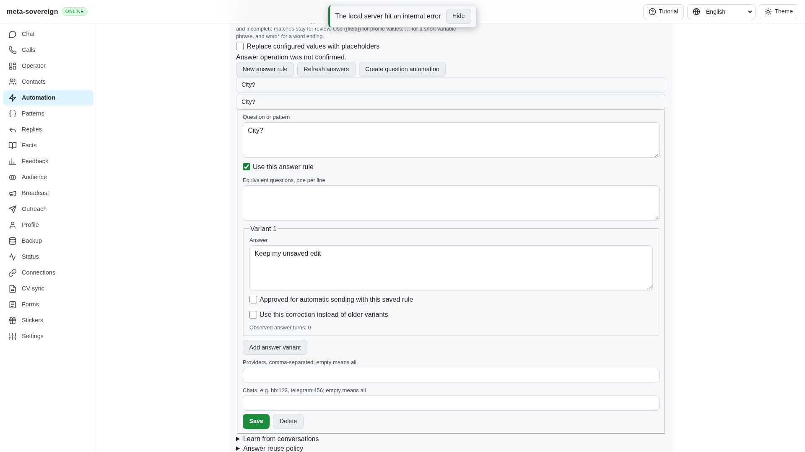
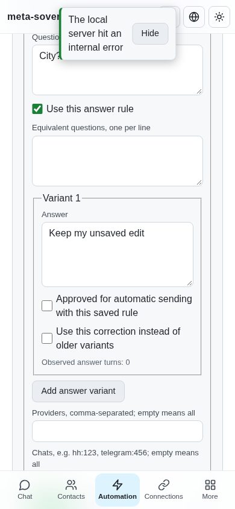

# Preserve question edits after unconfirmed responses

[PR 57](https://github.com/link-foundation/meta-sovereign/pull/57) rejects malformed answer-save responses before replacing the editor state. It also validates saved rule identity and ordinary saved values, rule lists and deletion identity. Explicit server contraction and the existing offline editing path retain their behavior.

## Reproduction and cause

Open Automation → Questions, save a rule, edit its answer, and intercept the next save with HTTP 500, `Content-Type: text/lino` and this deliberately malformed refusal body:

```lino
(error "Answer fixture refusal" status "failed")
```

This body decodes as a list, rather than a Lino object. The server response reader attaches `httpStatus: 500`, but the old answer client checked only named `error` and `status` fields. It accepted the response, returned an undefined rule and replaced the edited rule. Rendering the saved-answer list then crashed with `Cannot read properties of undefined (reading 'id')`, leaving the screen blank. The independent MCP console preserves the actual crash. I supplied the malformed fixture during investigation; it exposes a client validation defect and is not evidence that a provider emits this response.

The client now rejects failed HTTP status, non-record responses and explicit refusal markers. A save must contain a normalized rule with the requested identity; ordinary saves must confirm the normalized submitted values. Explicit contraction can confirm a server-generated template. A list must contain at most 1,000 valid rules and a deletion must confirm the requested rule identity. Unconfirmed remote responses do not invoke local fallback storage. The editor's existing failure path retains the owner edit and shows the error.

Before: the malformed response crashes the screen.


After: the edited answer remains visible with an unconfirmed-operation error.





## Verification

The six API regression tests initially produce three failures (`Missing expected rejection`) and three passes. After the fix, 18 focused Node checks and the same 18 Deno checks pass. Seven additional profile/substitution compatibility checks pass in Node, including both Lino transports and explicit contraction. Strict changed-code lint, scoped formatting and the production browser bundle pass.

```sh
NODE_OPTIONS=--max-old-space-size=384 node --test --test-concurrency=1 \
  js/tests/question-api-confirmation.test.js js/tests/question-controls.test.js \
  js/tests/app-navigation.test.js js/tests/answer-model-api.test.js
deno test --v8-flags=--max-old-space-size=384 --allow-all --no-check \
  js/tests/question-api-confirmation.test.js js/tests/question-controls.test.js \
  js/tests/app-navigation.test.js js/tests/answer-model-api.test.js
RUN_BROWSER_E2E=1 E2E_BROWSER=webkit QUESTIONS_REFUSAL_ONLY=1 \
  CI_BROWSER_DEBUG=1 NODE_OPTIONS=--max-old-space-size=384 \
  node js/tests/e2e-questions-browser.mjs
```

The focused production WebKit check verifies four responses: a proper refusal object, a malformed refusal list, an empty successful response and a wrong-rule receipt. Each preserves the edited value and unchanged stored rule. These cases also remain in the normal hosted question scenario. The independent MCP reproduction checks desktop and 390-pixel phone layouts, retained input, no horizontal overflow and Settings → Contacts → Back scroll recovery (767 pixels). Its console contains the expected injected HTTP 500 plus unsupported fixture read errors, without the previous React crash. The browser and isolated fixture server were closed after verification.

The [verified archive](data/question-response-confirmation.tar.gz) and [per-file manifest](data/question-response-confirmation.tar.sha256.json) preserve complete focused logs, source, test/probe code, run metadata, MCP receipts and screenshot hashes. Rebuild with `python3 -B experiments/issue-56/archive-answer-confirmation.py` after regenerating the named local evidence.

## Separate hosted failures remain open

Checks run [42917035254](https://github.com/link-foundation/meta-sovereign/actions/runs/42917035254), created 2026-11-10T22:42:38Z for `eea31cdbfa698bced1248a5df17b7045099d401d`, contains three separate browser failures:

- Chromium job 130187499615, complete `resume-profile-parent-job-130187499615.log`, line 2423: `model configuration survives reload`. The screenshot shows the selected CV and enabled setting, but an empty model name.
- WebKit job 130187499697, complete `ci-answer-model-parent-webkit.log`, line 2278: `refused save retains the edit`. This fixture supplied a valid refusal object; its screenshot shows the older answer despite the refusal alert.
- The same WebKit log, line 2283: a Contacts navigation wait times out while Settings remains selected. The screenshot shows Settings scrolled and Contacts hovered.

Their roots are not established. Focused WebKit save/refusal and scroll/navigation probes pass; the Chromium learning → capacity → model sequence also passes and confirms a 13-character model name before and after reload. The malformed-response fix above does not explain these failures. The hosted scenarios now record bounded native control events and opt-in application state transitions, including value lengths rather than private input contents. The model scenario additionally checks the acknowledged model name before reloading. No retry or longer timeout hides a failed interaction. Production diagnostics remain off unless the existing `metaSovereignDebug` flag is enabled.

At the precommit check, `e7e6e1f7` Pages, links and security workflows pass; Checks is queued and Desktop is running. This unit requires its own complete hosted matrix. Every unchecked issue criterion remains required and PR 57 stays draft and unmerged.
