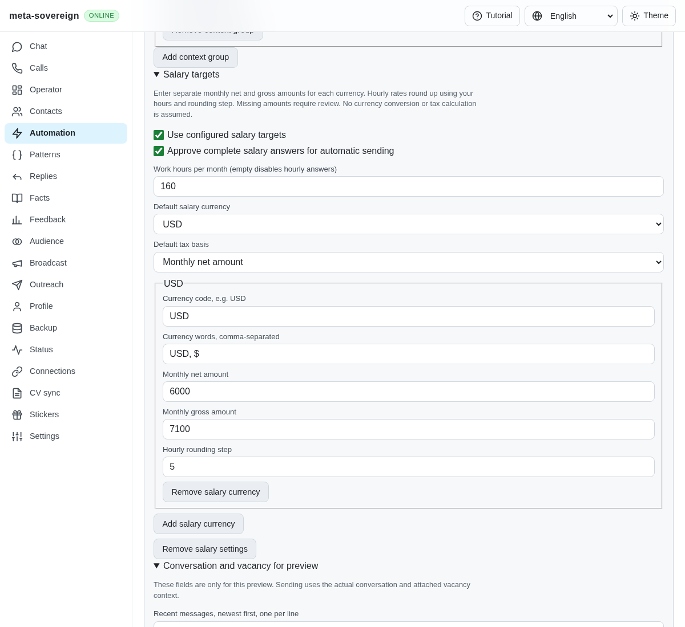
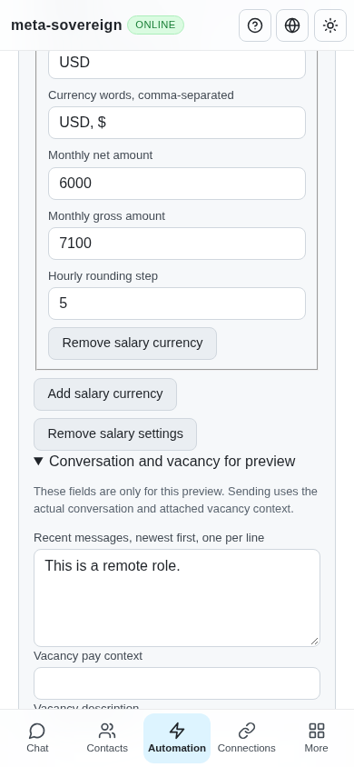

# Configured salary targets

Issue 56 extends the HH answer behavior to every provider. Generic profile substitution could not distinguish a current monthly target from an old literal answer, calculate an hourly rate, inherit the tax basis of a short follow-up, or select a numeric salary band. The nine initial regressions produced eight failures and one passing exclusion case before implementation. Their original output is retained in `data/question-salary.tar.gz`.

The shared answer action now accepts optional `salary` settings. The owner enables the feature, supplies independent monthly net/gross targets for each currency, chooses a default currency/basis, and separately approves generated answers for automatic delivery. Missing targets stay unresolved; USD, USDT and their gross amounts do not borrow from one another. Currency selection uses the current question, bounded actual conversation, actual attached vacancy and the configured default. A missing or ambiguous currency cannot silently choose another target. English and Russian wording is independent of currency.

Hourly amounts use `ceil(monthly / monthlyHours / hourlyStep) * hourlyStep`. Hours default to 160; positive decimal hours are accepted, and an explicit null disables hourly answers. Rounding defaults to 500 for RUB and 5 for other currencies and remains configurable per currency. No tax or exchange-rate conversion is assumed. A request for an annual amount, offered-range acceptance, previous pay, payroll calculations or an unrelated question does not trigger this planner.

Short clarifications inherit the nearest related salary question's basis and period, while an intervening unrelated question stops inheritance. A short follow-up cannot silently change a monthly discussion into hourly pay. Plain stale numeric replies are replaced by current targets and current period wording. Personal explanations retain their text and require review when they contain numbers. Multi-question messages assemble components for review rather than sending only the salary answer.

Offered options are parsed as bounded numeric ranges with decimal comma, thousands/millions scales and currency, basis and period checks. Only one containing range can be selected automatically. Overlapping ranges, gaps, foreign currencies, conflicting tax bases and missing values remain reviewable. Generated wording still passes the persisted rejection policy. The existing delivery guard rereads the saved salary settings after typing: target, hours, approval, enablement or removal changes prevent an outbox claim.

CLI owners can save an `answer-questions` action in a `.lino` automation file and run `automations answers plan --automation=<id> --question=...`, or preview a standalone `.lino` configuration with `--config=...`. The default text/binary Lino API and offline UI use the same configuration and planner. Preview and saved-action editors expose the same settings with English, Russian, Chinese and Hindi labels.

Verification:

- `question-salary.test.js`: ten cases cover explicit/default currencies, net/gross, USDT isolation, decimal hours and upward boundaries, related follow-ups, stale literals/personal detail, exclusions, multi-question assembly, approval, bands, all five providers, invalid configuration and rejected/ambiguous generated replies.
- `question-salary-controls.test.js`: three integration cases cover UI model round trips, offline preview, Lino CLI, both API representations, invalid-edit nonmutation and five changes during typing with zero sends/outbox claims.
- The combined relevant nine-file run passes 79 checks with concurrency one. Changed-source lint and production web build pass.
- Production Chromium Q/A flow creates targets through visible controls, previews unapproved and approved answers, displays currency evidence, saves the action, verifies persisted values/approval and checks a 390-pixel viewport. Playwright MCP independently checks that a net-only USDT configuration cannot answer a gross request: the result contains `{{salary_gross_usdt}}`, requires review and says nothing was sent or queued. The fixture and browser were closed afterward.

This is partial reference coverage. The follow-up [calculation evidence](salary-calculation.md) adds explicit progressive/company/payout tax schedules and dated rate snapshots. Rate fetching/cache recovery, both-basis wording, contraction of learned literals into salary placeholders, advanced multilingual/conditional questions, real provider button/form execution and the remaining issue-wide workflows still require implementation and verification. The complete CI matrix must also pass before finalization. During this work, exact parent `c9749badd570a5cf2b7ed5a65ccfb2ca7f5ef28d` exposed a separate native HTTP early-rejection TCP reset; its Rust log identifies `lino_http.rs:28` and `Connection reset by peer` at lines 548–550. The bounded staged-close correction and subsequent passing Rust/runtime jobs are recorded in [ci-native-rejection.md](ci-native-rejection.md).
