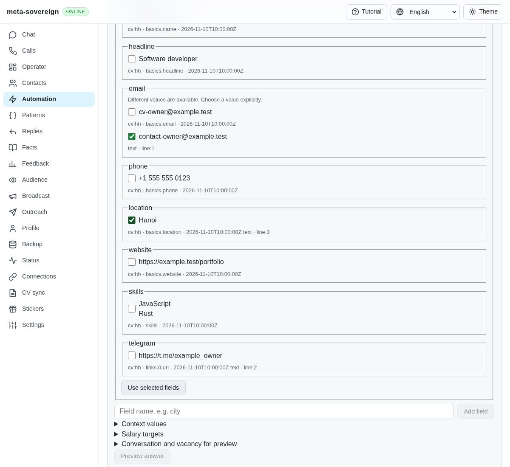
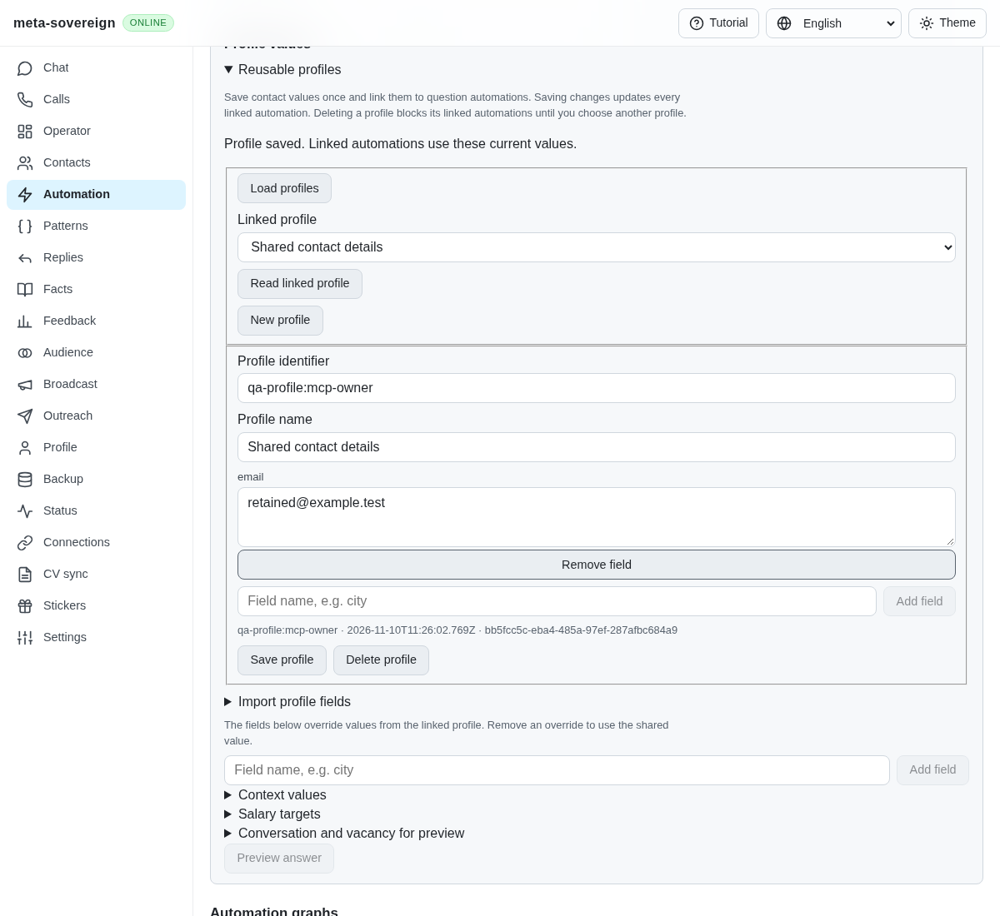
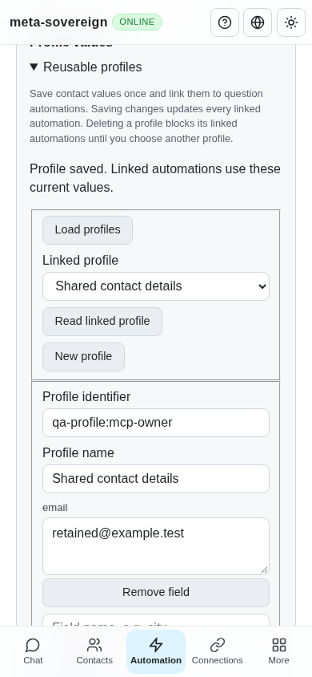

# Reuse current owner values across question automations

Work for [issue 56](https://github.com/link-foundation/meta-sovereign/issues/56)
in [PR 57](https://github.com/link-foundation/meta-sovereign/pull/57), covering
the named-profile mechanism in QA05 and R-AA1.

## Reproduction and behavior

At `48a13ae1`, profile values belonged to individual actions. A named profile
reference did not resolve, so the regression's `{{email}}` placeholder remained
unexpanded instead of using `first@example.test`. Updating one action did not
update other actions. The focused failing-before check is preserved in the
evidence archive.

Named `qa-profile:` records now contain an owner label, values, an opaque edit
revision and an update timestamp. An action stores the selected profile ID and
its explicit local overrides separately. Plans resolve the current saved
values, then apply overrides. The same resolution runs in standalone previews,
pure/offline plans, contraction, archive learning and the final delivery check.
The evidence records the profile identity, label, revision, timestamp and
overridden keys. It appears in the common preview/Chat/Operator answer evidence.

For example, save `owner` with `email=first@example.test`, select it in two
question actions, and update it to `second@example.test`. Both subsequent
previews use the new address. A local email override affects its own action.
Deleting the profile leaves its reference visible and blocks planning until
the owner reviews it. No default profile is selected automatically.

The reference remains `konard/hh-job-application-automation` at
`fa0991b8c2d0896fb3b4be6c69947f0590094b15`; its contact source/tests informed
the behavior without copying code. Importing that repository's legacy
`contacts.lino` is still required work after this named-profile mechanism.

## CLI, negotiated API and shared editors

The CLI exposes `automations answers profiles list`, `show <id>`,
`save <id> --name=<name> --values=<Lino> [--revision=<revision>]`,
`save --file=profile.lino` and `delete <id> --revision=<revision>`.
Files can contain a canonical profile object or its `profile` wrapper; JSON
files remain an explicit compatibility input. `--profile-id=<id>` selects the
same values for question planning and contraction/learning commands.

The default text/binary Lino API uses `GET /api/automations/answers/profiles`
for metadata, and POST `read`, `save` and `delete` under that route. Reads and
deletes take an ID; updates/deletes also take the loaded revision. A new save
requires an absent record. Remote refusals and malformed or mismatched
acknowledgements stay errors. The browser-only fallback uses the same core.

Both localized profile editors offer explicit loading/selection, a separate
staged central editor, saving and deletion. Saving links that record to the
current draft. Local overrides remain separate. A failed or stale save keeps
the unsaved fields; the owner can explicitly reload and retry. Source-text/CV
extraction continues to apply selected values to the current local draft.
Saving a profile does not save an automation, approve an answer or send.

## Concurrency and limits

The existing per-store knowledge writer queue serializes profile CRUD with
answer-rule and policy writes. Each accepted save receives a fresh UUID, so a
stale save/delete and a delete/recreate cycle cannot silently overwrite another
edit. This queue coordinates one store instance; it does not replace a storage
engine's cross-process or replicated transaction guarantees.

Archive learning captures the selected profile before contraction, subscribes
to profile changes and rechecks its bounded knowledge snapshot before writes.
The query-only fallback also rechecks. Final delivery compares the current
profile provenance even when a newer revision renders the same text. A missing
source or an edit during typing requires review before any outbox/send claim.

There are at most 50 profiles, 100 fields per profile and 2,000 characters per
value. IDs have a 64-character key, labels have 120 characters, aggregate saved
profiles have a 4 MiB serialized-size budget, and CLI files have a 1 MiB limit.
Catalogues return metadata without contact values. The finite capacity check
seeds 50 small profiles; no stress workload was run locally.

## Verification

All 81 selected Node checks and nine core Deno checks pass with 384 MiB heap
bounds. They cover changed-once resolution across five provider fixtures,
local overrides, stale writes/deletes, concurrent writers, immutable pure plans,
contraction/learning, subscribed and query-only invalidation, final delivery
guards, malformed/bounded records, metadata-only listing, actual CLI,
text/binary Lino routes, offline controls, browser exposure, acknowledgement
validation, existing substitution and all four UI languages.

```sh
NODE_OPTIONS=--max-old-space-size=384 node --test --test-concurrency=1 js/tests/question-shared-profile.test.js js/tests/question-shared-profile-controls.test.js js/tests/question-concurrency.test.js js/tests/question-substitution.test.js js/tests/question-profile-controls.test.js js/tests/question-controls.test.js js/tests/i18n.test.js js/tests/question-automation.test.js
deno test --allow-all --v8-flags=--max-old-space-size=384 js/tests/question-shared-profile.test.js
NODE_OPTIONS=--max-old-space-size=384 RUN_BROWSER_E2E=1 E2E_EXECUTABLE_PATH=/usr/bin/google-chrome E2E_ARTIFACT_DIR=ci-logs node experiments/issue-56/shared-profile-browser.mjs
```

The production Chromium helper is also included in the existing questions
browser flow used by CI. Its focused entrypoint verifies both shared editors,
save/refusal/retry, concurrent-edit recovery, retained overrides/references,
source evidence, deletion and a 390-pixel mobile layout. Independent Playwright
MCP verification uses the isolated `question-profile-ui.mjs` fixture and checks
that an unsaved email survives an actual Lino API refusal and saves on retry.
The fixture and browser close afterward. Deliberate refusals log HTTP 400 and
the fixture's optional account capability request logs its existing error;
these runs are not claimed to have a clean console.

Before, profiles only had per-action fields and source extraction:



After, the staged central record and local overrides are visibly separate:



The same controls fit the mobile viewport:



[Archived evidence](data/question-shared-profile.tar.gz) and the
[verified manifest](data/question-shared-profile.tar.sha256.json) retain the
failing-before check, focused results, MCP observations and source hashes.
The preceding head's runtime matrix, including Windows Deno, passed; its
Chromium lane failed an existing automation-chat overlap-warning assertion
at log line 2208. Pages was cancelled during its hosted browser check. Those
results are preserved for investigation and do not verify this new change.

Legacy contact import, provider-history extraction, wider form/provider/device
parity, every other unchecked PLAN.md criterion and exact new-head CI remain
unfinished. PR 57 stays draft and unmerged.
