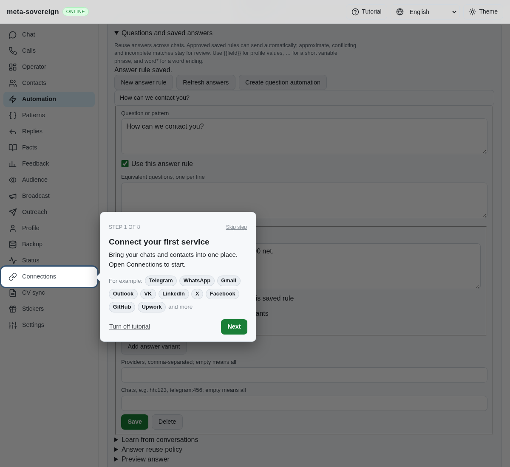
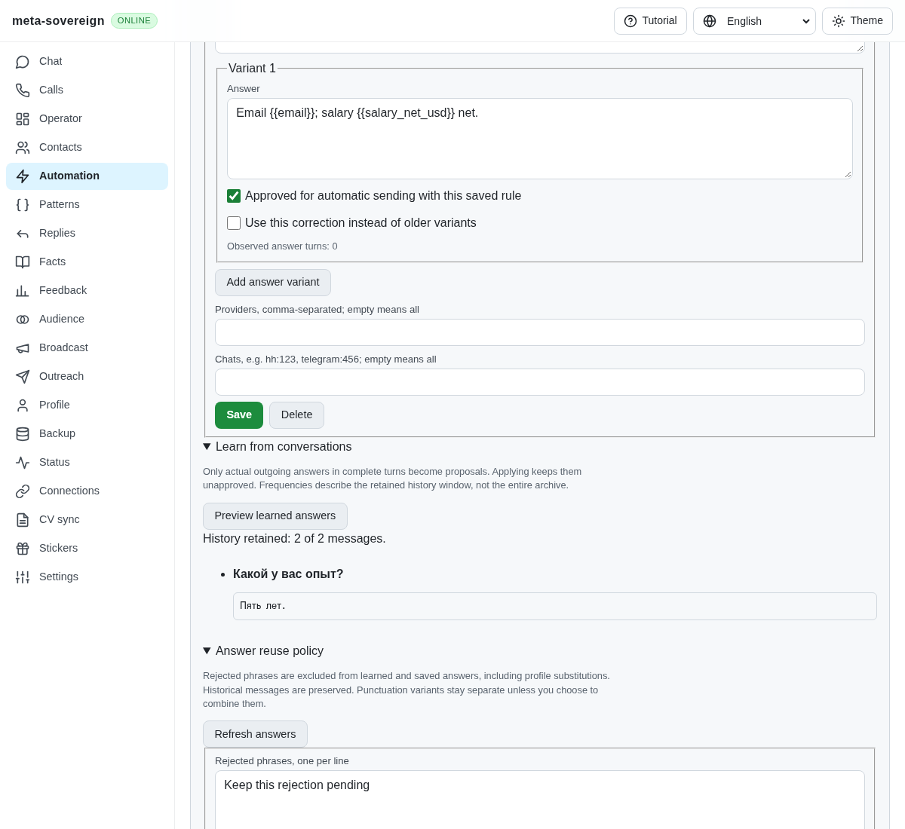
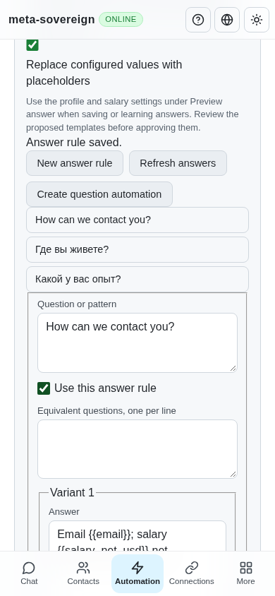
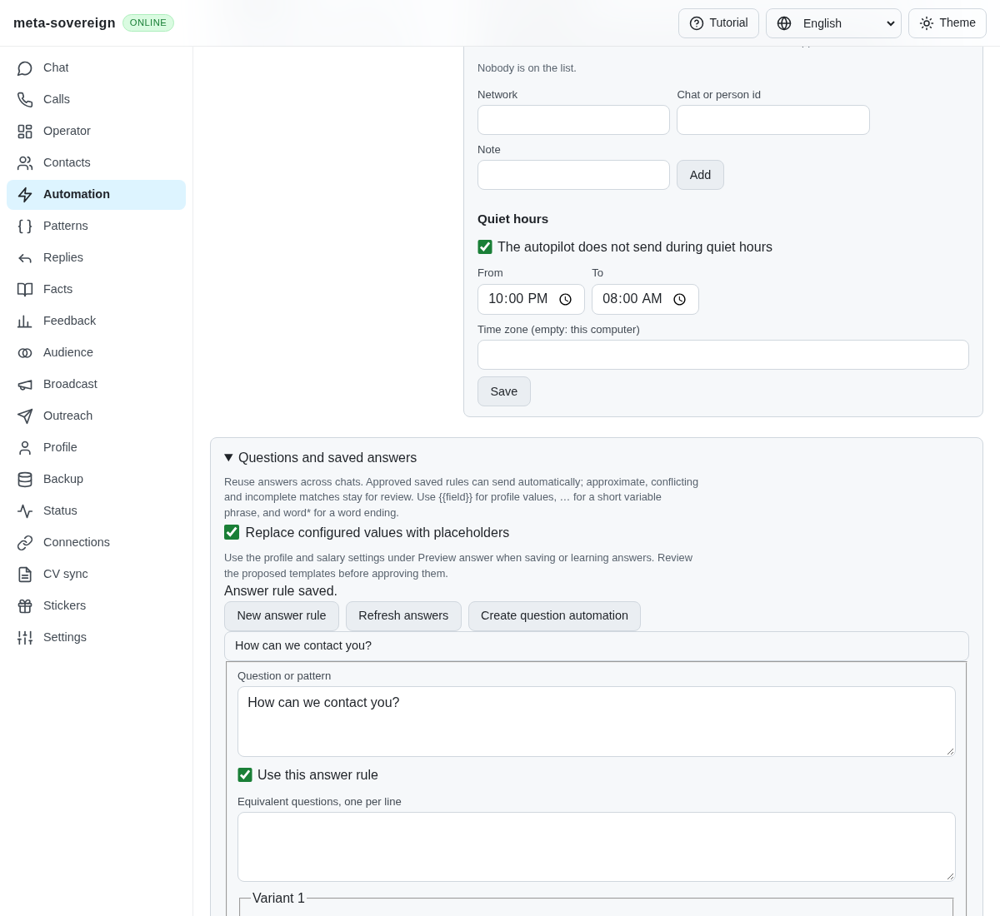

# Configured contact and salary placeholders

Saving or learning an answer previously retained literal contact details and salary amounts. Existing placeholders expanded, but importing a literal answer did not produce reusable fields. Five initial regression cases fail against that behavior. Two further failing-before cases expose a monthly/hourly mismatch and rejection hidden by contraction.

Opt in to **Replace configured values with placeholders** under Questions and saved answers. Configure profile values and salary targets under Preview answer, then save or preview learned proposals. A literal `Email owner@example.test; salary $6 000 net.` becomes `Email {{email}}; salary {{salary_net_usd}} net.`. Proposals show their actual answer text before applying and remain unapproved. Rule records do not receive a copied profile or salary configuration.

Contraction recognizes whole configured values and common phone formatting. It skips short fragments, URL schemes, ambiguous duplicate values and existing placeholders. USD and USDT remain distinct; a larger number or different decimal is not partially replaced. Saving an unchanged expanded template retains the original placeholder. This is explicit substitution from configured data; automatic extraction from contacts and CVs remains open.

Salary placeholders resolve through the same current, dated calculations as direct salary answers. Explicit currency fields include `salary_net_usd`, `salary_gross_eur` and `salary_gross_hourly_usd`. Generic `salary_net`, `salary_gross` and hourly variants use the question's currency context or the configured default. Missing/stale calculations stay unresolved, salary approval is still required, and currency or period mismatches require review. Configured profile values cannot override generated salary fields. Canonical rejected content is checked before and after contraction, and rendered answers retain the existing policy and delivery checks.

The CLI supports `automations answers save` and `learn` with `--contract` and the existing `--profile`, `--config` or `--automation` inputs. Rule files may explicitly specify `contract: true`. Both text and binary Lino API calls and the offline UI use the same implementation. Previewing does not send or queue anything.

Verification: all 37 cases in the substitution, policy, context and question-automation files pass with concurrency one. The controls test exercises CLI, offline UI and an actual isolated server with both Lino encodings. Focused lint, production bundle build and the production Chromium question flow pass. The latter verifies save/expand, salary evidence and desktop/mobile fit; it runs in both existing CI browser jobs. Independent Playwright MCP verifies the actual checkbox, templated save, changed email and approved complete preview. Its browser and isolated server are closed. `node examples/question-substitution.mjs` is an offline executable example. Raw logs and MCP metadata are retained with verified hashes in `data/question-substitution.tar.gz`.

| Before                                                                                                                                                                                  | After                                                                                                                                                                            |
| --------------------------------------------------------------------------------------------------------------------------------------------------------------------------------------- | -------------------------------------------------------------------------------------------------------------------------------------------------------------------------------- |
|  |  |

This verifies shared substitution, not complete provider/form parity. Cumulative archive learning, contact/CV extraction, wider multilingual handling and the remaining issue-wide requirements stay unfinished. Exact-head CI must still pass. See [PR 57](https://github.com/link-foundation/meta-sovereign/pull/57).
