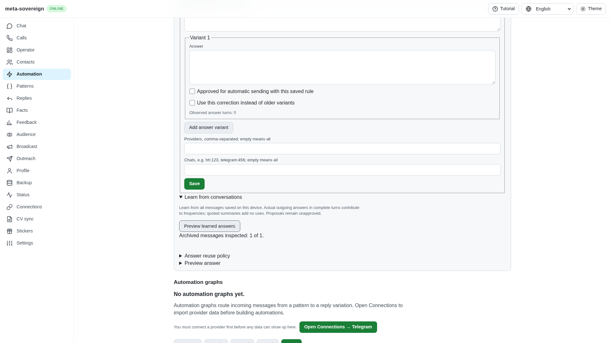
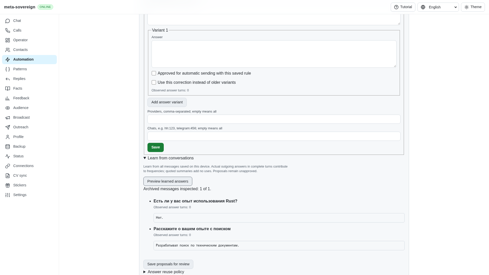
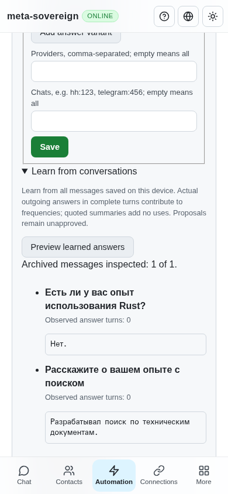

# Learning recruiter handover summaries

Work for [issue 56](https://github.com/link-foundation/meta-sovereign/issues/56)
in [PR 57](https://github.com/link-foundation/meta-sovereign/pull/57), covering
the shared QA07 parser. Live provider history imports remain required.

## Reproduction and correction

Save the synthetic recruiter message from
`experiments/issue-56/question-summary-fixture.mjs` and preview Learn from
conversations. The preceding `86eebd79` parser proposes no facts: it lacks the
actual HH header, trailing answer labels followed by a new line, and the
empty employer-question footer. Six initial regressions fail before the fix.

The common parser now accepts these layouts and explicit question/answer labels
in English, Russian, Hindi and Chinese. Headerless summaries require at least
two complete pairs and a recognizable question. Balanced code fences retain
indentation and blank lines. Unknown text, additional tasks, unfinished fences
and more than 20 pairs prevent the completed-summary no-reply classification.
An unfinished fence owns its remaining lines, so quoted text cannot become
independent facts. The input bound remains 12,000 characters.

Quoted answers have count zero, original-message provenance and no approval.
Relearning does not invent sends. Counterquestions, private access links and
rejected wording do not become facts. The original transcript is unchanged.
Only a structurally complete summary suppresses a reply; a new task stays open.

The actual layout and zero-count behavior follow the pinned HH README at
`fa0991b8c2d0896fb3b4be6c69947f0590094b15`, lines 816–824. The latest reference
requirements and relevant chat-learning tests were also inspected. Reference
code was not copied; fixtures use different synthetic facts.

## Verification

Seven parser regressions and two control cases join the existing compatibility
checks for 42 focused passes:

```sh
node --test --test-concurrency=1 js/tests/question-summary.test.js js/tests/question-summary-controls.test.js js/tests/question-policy.test.js js/tests/question-lists.test.js js/tests/question-lists-controls.test.js js/tests/question-turns.test.js js/tests/question-archive.test.js
```

The controls cover CLI, offline UI and actual text/binary Lino HTTP routes.
Synthetic stored messages cover HH, Telegram, VK, email and WhatsApp. This
verifies common stored-data behavior, not live provider imports.

The CI-registered production Chromium questions flow passes with a new assertion
for saving an unapproved zero-count summary fact. Independent Playwright MCP
verification uses the isolated production fixture, with accounts, handlers,
sync and the scheduler disabled. The before process uses a Node module loader
to load the preceding committed parser without changing the worktree. Its
browser also loads the preceding bundle. The after process uses the draft.
Both facts appear at desktop and 390 × 844 mobile width, with no horizontal
overflow. Both browsers and all fixture processes are closed.

Before:



After:



Mobile:



Strict scoped lint, formatting, secret scanning, whitespace and the production
web build pass. Raw logs and source hashes are preserved in
[question-summary.tar.gz](data/question-summary.tar.gz), with a
[SHA-256 manifest](data/question-summary.tar.sha256.json).

## CI evidence and limits

The preceding `86eebd79` starts five workflows at 2026-11-10 09:26:46 UTC.
Links 42790770401, Security 42790770524 Desktop 42790770539 and Pages 42790770625 pass at this
snapshot. Checks is still running. The exact next-head matrix
remains required.

Older `b7ff171b` Checks 42788668440 is cancelled during WebKit's tutorial flow
at 09:29:31 UTC (full log line 83647), after peer-bar passes (83642–83644).
The aggregate fails explicitly on `e2e-browser: cancelled` (99554–99556).
Its complete log remains in `ci-logs/checks-42788668440.log`; a bounded excerpt
is archived. Cancellation is not a passing matrix claim.

QA08 apology/irrelevance extraction, other QA01–QA26 gaps, provider workflows,
forms, HH/VK parity and all open device/platform requirements remain required.
PR 57 stays draft and unmerged.
