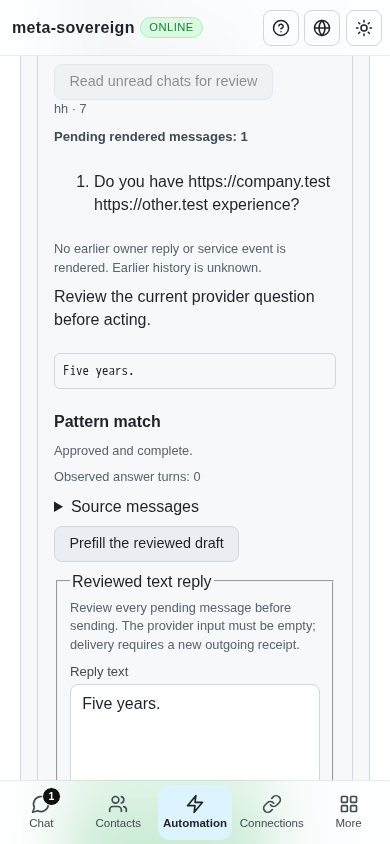
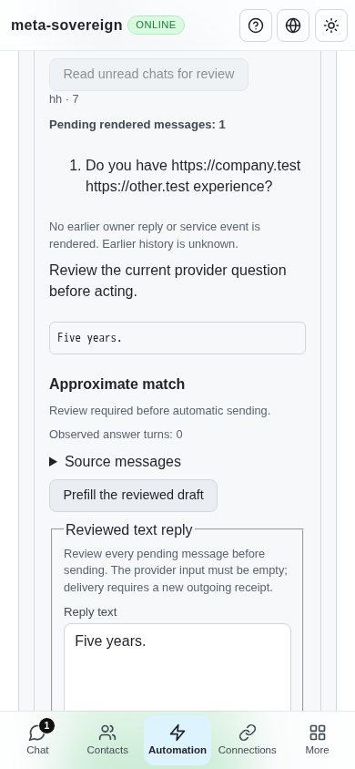

# Question templates retain link identity

Issue [#56](https://github.com/link-foundation/meta-sovereign/issues/56),
PR [#57](https://github.com/link-foundation/meta-sovereign/pull/57), 2026-11-14.

The published `f5e62321` matcher checked only whether either text contained
`http:`, `https:` or `www.`. A template already containing a URL could absorb
a second URL through its wildcard gap. Bare domains and action schemes could
also disappear into the gap. Exact normalization discarded punctuation and
folded case before comparison, hiding changes to a URL path or query.

## Reproduction and correction

Save and approve `Do you have https://company.test … experience?` with the answer
`Five years.`. Inspect the actual native question
`Do you have https://company.test https://other.test experience?`.
The parent reports **Pattern match** without requiring review. The corrected
matcher reports **Approximate match**, requiring fresh review. Inspecting either
version sends nothing; this experiment never authorizes or attempts a reply.

The shared matcher now compares ordered, repeated full text-link targets before
exact normalization or template expansion. URL path case and punctuation remain
significant. Scheme links, bare domains, international domains, `mailto:` and
`tel:` targets participate. Bare host casing remains immaterial. A bare name such
as `example.zip` or `resume.pdf` can be a domain or a filename; introducing it
also requires review. Unchanged technical filenames retain normal question case
folding. Ambiguous trailing URL punctuation conservatively requires review.

Chat previews reuse the text scanner while retaining their HTTP/bare-domain
selection, ordinary filename exclusions and display-punctuation trimming. Link
recognition itself performs no network requests or navigation. Hidden rich-text
link entities absent from the captured question text are outside this change;
this unit does not establish complete provider or contextual parity for QA04.

## Verification

- The exact parent fails four of six new regression cases; two compatibility
  cases pass. The final focused Node and Deno runs each pass eleven cases,
  including saved-rule foreground CLI, offline controls and both default Lino
  encodings. Five provider planners each produce a real draft requiring review.
- Thirty-four existing question-automation, language and chat-preview checks
  pass. The focused CI contract retains the mandatory browser group and its
  scenario budget in both engines.
- Finite native Chromium captures the actual parent behavior and corrected
  behavior, with desktop and phone screenshots and no page errors. The existing
  saved-template scenario also obtains one positive outgoing receipt, preserves
  its exact answer and locks replay after reload. Its effects belong to its own
  disposable fixture, separate from the zero-send link-guard fixture.
- Independent Playwright MCP saves the URL template through the production UI,
  reads the native question and verifies the review requirement at phone width.
  The owned fixture closes with zero choice clicks, zero text sends and an empty
  composer. Console evidence retains a favicon 404 and a handled cache-write
  diagnostic; no clean-console claim is made.
- Scoped strict lint, formatting, secret scanning, diff and the unchanged 6.5%
  duplication limit are checked before publishing. Hosted checks for the final
  commit remain required.

The first lint draft added one decision to an already full matcher and exceeded
the existing complexity limit. Moving link validation into the bounded input
validator fixes that warning without relaxing the rule. The first screenshots
placed the match label at the viewport edge; the retained final screenshots
scroll the actual label into view. Draft logs are retained alongside final logs.

The checked [evidence archive](data/question-template-links.tar.gz) and
[SHA-256 manifest](data/question-template-links.tar.sha256.json) preserve source
snapshots, exact-parent matcher bytes, finite regressions, browser and MCP
receipts and screenshot hashes. Reproduce the focused parent failure with
`python3 -B experiments/issue-56/question-template-links-before.py --before`.
Add `--native` and an available `E2E_EXECUTABLE_PATH` for the isolated native
comparison. This is a production matcher correction; all remaining issue #56
criteria stay required and PR57 remains draft and unmerged.
